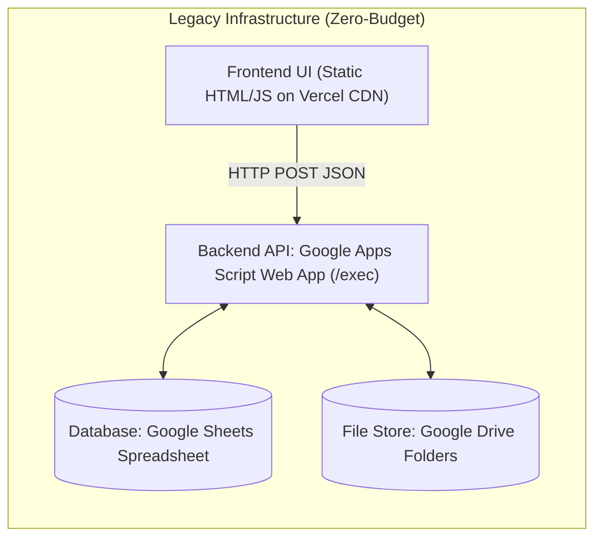

# 00 — System Context & Organizational Environment

> **Requirement Prefix:** `SYS`  
> **Status:** RATIFIED BASELINE  
> **Target Audience:** System Architects, Laravel Implementers, Product Owners, Academic Evaluators  

---

## 1. Organizational Mission & Domain Context

**SISURAT** (Sistem Informasi Surat) is a specialized administrative letter and digital document archival management information system engineered for the **Dinas Pendidikan, Kebudayaan, Kepemudaan, dan Olahraga (Disdikbudpora) Kabupaten Semarang** (Department of Education, Culture, Youth, and Sports of Semarang Regency, Central Java, Indonesia).

The primary operational responsibilities of the department encompass:
* Regulating, supervising, and coordinating more than 1,000 public and private primary and secondary educational institutions (SD, SMP) across Semarang Regency.
* Archiving formal inbound correspondence from ministries, regional government secretariats, schools, and private organizations.
* Registering and archiving official outbound administrative notices, decrees, and circular letters.
* Managing the official verification, issuance, and handover of student achievement awards and certificates (**Piagam Penghargaan**) for district, regional, and national student competitions (such as O2SN, FLS2N, and MAPSI).

---

## 2. Multi-Division Organizational Structure

Disdikbudpora Kabupaten Semarang operates through more than 10 internal administrative divisions (e.g., *DIKDAS* [Pendidikan Dasar], *DIKMEN* [Pendidikan Menengah], *PAUD*, *GTK* [Guru dan Tenaga Kependidikan], *KURSISSMP*, *KEBUDAYAAN*, *PEMUDA*, *OLAHRAGA*, *SEKRETARIAT*).

Under legacy manual administration, incoming correspondence and certificates were managed haphazardly across decentralized Google Forms, personal spreadsheets, and paper physical binders. The SISURAT initiative was launched to provide a unified, multi-tenant digital portal where each division manages its archives in total server-side isolation while enabling centralized departmental oversight by the **Super Admin Pusat**.

---

## 3. Primary User Personas & Actors

| Persona | Internal Role Code | Scope | Primary Business Responsibilities |
|---|---|---|---|
| **Super Admin Pusat** | `super_admin` | Global (All Divisions) | Overall system administration, division lifecycle provisioning, global school reference data maintenance, cross-division audit log inspection, and acting on behalf of any division via active context switching. |
| **Admin Divisi** | `admin_divisi` (or `admin`) | Division-Scoped | Division administration, managing Division Operators, performing full CRUD on letters and certificates belonging to their division, reviewing local audit trails. |
| **Operator Divisi** | `operator` | Division-Scoped | Daily operational clerical staff. Responsible for registering incoming letters, registering outgoing letters, creating piagam collection records, and uploading file attachments. Denied permission to update or delete records. |
| **Public / School Rep.**| `guest` / `public_user` | Public Form Only | Representatives of schools (principals, teachers, competition winners) submitting proof of certificate retrieval, providing digital canvas signatures without requiring authentication credentials. |

---

## 4. Types of Records Managed

1. **Surat Masuk (Incoming Letters):** Official incoming correspondence received from third parties, containing sender agency, letter number, letter date, receipt date, subject, and attached scanned files.
2. **Surat Keluar (Outgoing Letters):** Official departmental outgoing letters, notices, and directives, containing letter number, letter date, dissemination date, subject, and attached scanned files.
3. **Piagam Penghargaan (Award Certificates):** Formal handover and collection records for student competition awards, linking student recipient name, competition type, competition year, school NPSN, collector identity, and an authenticated digital signature image.
4. **Referensi Sekolah:** Central registry of educational institutions across Semarang Regency, indexed by national school code (**NPSN**).
5. **Referensi Divisi (Pengambilan & Jenis Perlombaan):** Division-specific customizable categories for collection types (e.g., Piagam, Piala, Medali) and competition types (e.g., O2SN, FLS2N, MAPSI).
6. **Audit Logs:** Immutable chronological event stream capturing system mutations, logins, logouts, authorization rejections, and security alerts.

---

## 5. The Legacy Ecosystem & Technical Rationale

The legacy SISURAT v3.1 system was designed under a strict **Zero-Budget Infrastructure** philosophy, intentionally avoiding server procurement, commercial web hosting, or database licensing:

### Roles of Legacy Components:
* **Google Apps Script (GAS):** Functioned as a serverless execution runtime for all routing, session checking (backed by `CacheService`), RBAC enforcement, and spreadsheet cell mutations.
* **Google Sheets:** Functioned as a relational database substitute. In Sprint 2, multi-tenancy was achieved by dynamically generating 5 separate sheets per division with the naming convention `{KODE}_surat_masuk`, `{KODE}_surat_keluar`, etc.
* **Google Drive:** Functioned as binary document storage. Files were uploaded via 72 KB Base64 chunking into GAS `CacheService`, reassembled into Drive files, and configured with public viewing permissions (`ANYONE_WITH_LINK`).

---

## 6. The Motivation for Redesign: Empirical Facts vs. Perception

The operational complaint motivating the system redesign was:  
> *"The legacy system is perceived as slow enough to discourage staff from actually entering letters."*

### Empirical Reality Established by Forensic Audit:
1. **The Root Cause is Implementation Architecture, Not Inherent Google Technology:**
   - **72 KB Chunking Overhead:** Because GAS `CacheService` limits value size to 100 KB, a 5 MB attachment requires over 70 sequential HTTP POST requests. At ~4.5 seconds per round-trip, a single upload takes ~5.5 minutes.
   - **Full Sheet Scans on Requests:** Every authenticated request performed full tabular scans on `db_users` and `db_divisi`.
   - **Cartesian Cache Eviction:** Every write operation generated up to 1,650 cache keys across role, page, limit, and division permutations, executing batch evictions synchronously.
2. **Measured Baseline Latencies (Verified in `laporan_pengujian_bab43.json`):**
   - User Login: **7,694 ms (~7.7s)**
   - Cross-Division RBAC Check: **11,095 ms (~11.1s)**
   - Chunk Upload: **4,191 ms – 4,972 ms per 72 KB slice**
   - Drive Finalization: **10,187 ms (~10.2s)**
3. **Data Integrity Hazards:** User management updated records by physical spreadsheet row numbers (`row_number`), creating catastrophic write-to-wrong-row risks upon concurrent edits.

---

## 7. Meaning of "Migration" in This Project

In the SISURAT project, **"Migration" does NOT mean rewriting or compiling Google Apps Script into PHP.**

Migration represents an **architectural replatforming**:
1. **Preserving Genuine Business Domain Logic:** Retaining multi-tenant division isolation, the 3-tier role hierarchy, the canvas signature capture, public certificate handover workflows, and audit trail accountability.
2. **Replacing Infrastructure Workarounds with Standard Relational Engineering:**
   - Replacing 80+ dynamic Google Sheet tabs with normalized MySQL/MariaDB relational tables.
   - Replacing 72 KB chunked uploads and public Google Drive URLs with a single sub-second multipart HTTP upload into private disk storage served via authenticated streaming routes.
   - Replacing row-number addressing with immutable primary keys and database transactions.
3. **Target Hosting Independence:** Delivering a robust, maintainable Laravel 12 application (with a planned post-foundation upgrade path to Laravel 13) deployable on cost-effective shared hosting (cPanel/Apache) or dedicated VPS.
