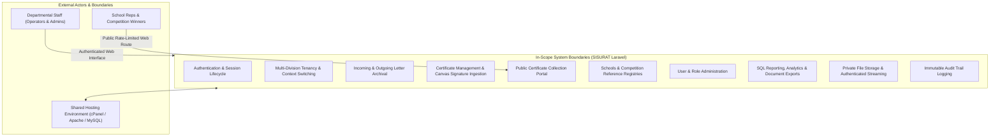

# 01 — Scope & System Boundaries

> **Requirement Prefix:** `SYS`, `FUN`  
> **Status:** RATIFIED BASELINE  
> **Target Audience:** System Architects, Laravel Implementers, Product Owners  

---

## 1. System In-Scope Boundaries

The target Laravel 12 system (with a planned post-foundation upgrade path to Laravel 13) encompasses all functional domains, authorization policies, operational workflows, and data management responsibilities required to replace the legacy SISURAT v3.1 system completely.

### In-Scope Functional Modules
1. **Authentication & Identity (`AUTH`):** Secure login, Bcrypt hashing, role assignment, active/inactive account status, sliding session expiration, and rate-limited brute-force protection.
2. **Multi-Tenant Division Isolation (`TEN`, `RBAC`):** Server-side data segregation across >10 administrative divisions, active division context resolution for Super Admin, and absolute cross-division denial for division-bound users.
3. **Persuratan (Letter Management) (`FUN`, `BR`):** Full lifecycle management for Surat Masuk (Incoming) and Surat Keluar (Outgoing) including metadata capture, date tracking, private document attachment, and soft delete with restoration.
4. **Administrasi Piagam & Tanda Tangan Canvas (`FUN`, `BR`):** Authenticated administrative management and public self-service collection of competition awards, incorporating HTML5 digital canvas signature capture.
5. **Master Data & Reference Registries (`FUN`):** Central national school registry (NPSN) and division-level customizable reference lists for competition categories and pickup categories.
6. **User Administration (`FUN`, `RBAC`):** Administrative user onboarding, role updates, division assignment, password resets, self-deactivation protection, and self-deletion prevention.
7. **Reporting & Analytics (`FUN`, `PERF`):** Authentic database-driven monthly traffic analytics, multi-criteria date filtering, CSV streaming, and PDF generation.
8. **Private Binary Document Management (`FILE`, `SEC`):** Secure storage on private filesystem disks, validation of MIME types (PDF, JPG, PNG up to 10 MB), and policy-enforced streaming gateways.
9. **Audit Trail Logging (`AUD`):** Automated recording of critical mutations, logins, logouts, access denials, and security-relevant events.

---

## 2. Explicitly Out-of-Scope Capabilities

The following capabilities are **NOT** part of the target Laravel implementation:
1. **Integration with Google Workspace APIs:** Google Apps Script execution, Google Drive API, Google Sheets API, and Google Forms integrations are eliminated.
2. **External Single Sign-On (SSO):** LDAP, Active Directory, Google OAuth, and SAML2 are out of scope for the initial release; internal database authentication is standard.
3. **Automated Physical Mail Delivery Tracking:** Tracking postal tracking numbers (resi Pos/JNE) or physical courier dispatch services.
4. **Disposition Workflow & Routing Hierarchy:** Formal multi-level digital disposition (e.g. Kepala Dinas $\rightarrow$ Sekretaris $\rightarrow$ Kepala Bidang $\rightarrow$ Kasi) was not implemented in legacy v3.1 and is excluded from Phase 1.
5. **Full Mobile Native App Development:** iOS and Android native applications are out of scope; the application will be delivered as a responsive mobile-friendly web application.

---

## 3. Legacy Features Explicitly Rejected (`DEPRECATED_DO_NOT_PORT`)

The following legacy mechanisms existed as technological workarounds in Google Apps Script but are **EXPLICITLY REJECTED** and **MUST NOT** be ported to Laravel:

| Legacy Mechanism | Legacy Provenance | Rejection Rationale | Target Replacement Strategy |
|---|---|---|---|
| **72 KB Chunked File Upload** | `js/api.js:L16`, `10_UploadService.js` | Workaround for GAS `CacheService` 100 KB limit. Caused 5-minute upload latencies. | Standard single multipart HTTP POST streaming handled natively by PHP/Laravel (`$request->file()`). |
| **Physical Tab Partitioning per Division** | `11_DivisionService.js:L134`, `db.txt` | Google Sheets workaround to avoid reaching row limits. Resulted in 80+ dynamic sheets. | Unified normalized database tables (`incoming_letters`, `outgoing_letters`, `piagams`) with indexed `division_id`. |
| **Public Google Drive Link Sharing** | `05_Drive.js:L37`, `10_UploadService.js:L103` | Workaround to view files without Drive auth. Caused critical data exposure. | Private disk storage (`storage/app/private`) served via authenticated controller streaming (`Storage::download()`). |
| **Spreadsheet Row-Number Addressing** | `07_UserService.js:L146-277`, `user-management.js` | Workaround for lack of primary key indexing in Google Sheets. Created severe race conditions. | Immutable primary keys (`id` and `uuid`) addressed through standard Eloquent ORM routing. |
| **Permission Shield Client Files** | `SISURAT_MULTIDIVISI_v2.md:L71-77` | Redundant client-side permission duplicates already eliminated in legacy Sprint 2. | Laravel Form Requests, Middleware, and Policies. |
| **Fabricated Monthly Analytics Chart** | `js/dashboard.js:L102-115` | Workaround for lack of server-side temporal aggregation in Google Sheets. | Authentic SQL `GROUP BY MONTH(letter_date)` query execution. |
| **Client Stale-While-Revalidate (SWR) LocalStorage Cache** | `js/cache.js`, `js/api.js` | Workaround to mask 5-11 second GAS execution latency. Adds stale-read complexity. | Fast sub-100ms relational SQL queries directly from MySQL/MariaDB. |

---

## 4. Capabilities Requiring Human Product Decisions (`USER_DECISION_REQUIRED`)

The following items represent operational ambiguities where technical defaults have been formulated, but final product confirmation is logged in [`25-OPEN-QUESTIONS.md`](25-OPEN-QUESTIONS.md):

1. **Offline Synchronization Queue (`js/sync.js`):** Legacy implemented an offline queue in `localStorage`. If department operators only work on stable office LAN, this adds unnecessary complexity. *Safe Default:* Standard online web application; offline sync queue disabled unless explicitly requested.
2. **User Multi-Division Membership:** Legacy restricted users to exactly one division (`db_users.divisi_id`). *Safe Default:* Preserve 1:1 user-to-division association; only Super Admin can switch divisions.
3. **Attachment Cardinality:** Legacy permitted 1 file URL per record (with a Sprint 2 design note proposing JSON arrays up to 5 files). *Safe Default:* Polymorphic `attachments` table supporting 1 file initially, expandable to N files without schema alterations.
4. **Letter Number Scoping & Uniqueness:** Legacy did not enforce unique constraints on `nomor_surat`. *Safe Default:* Soft uniqueness warning per division per calendar year.
