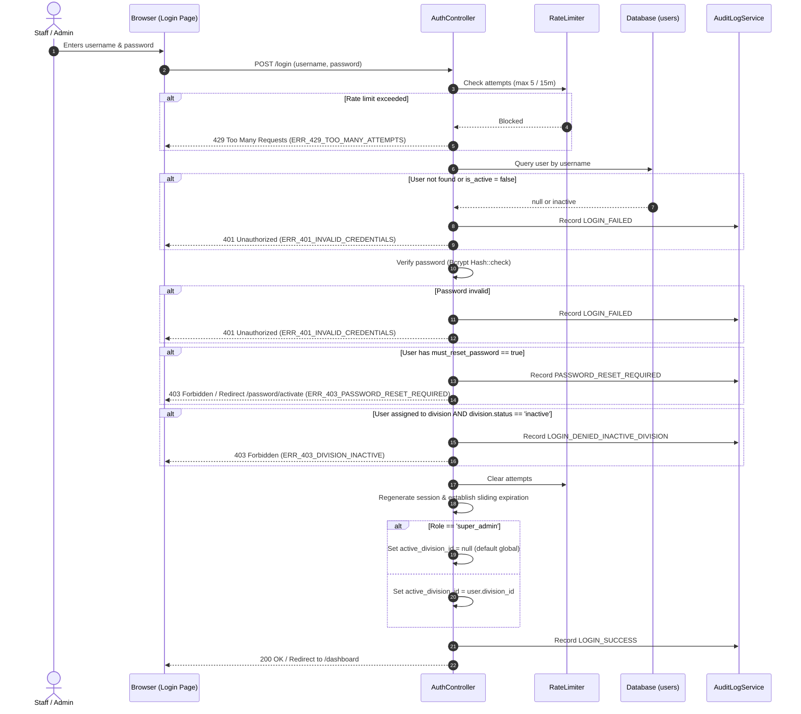
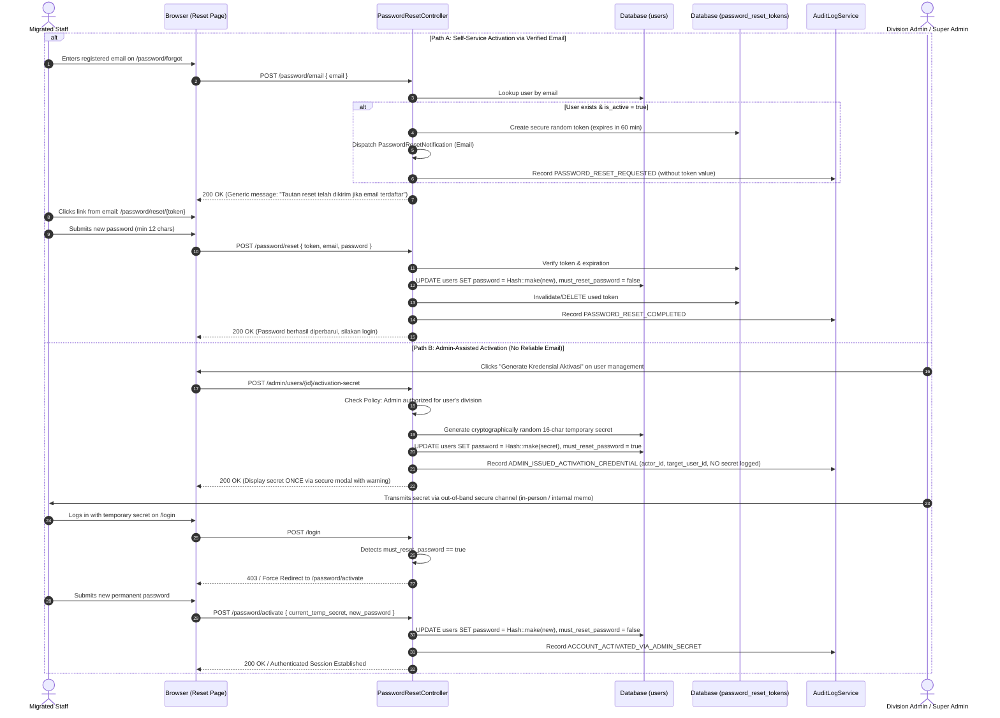
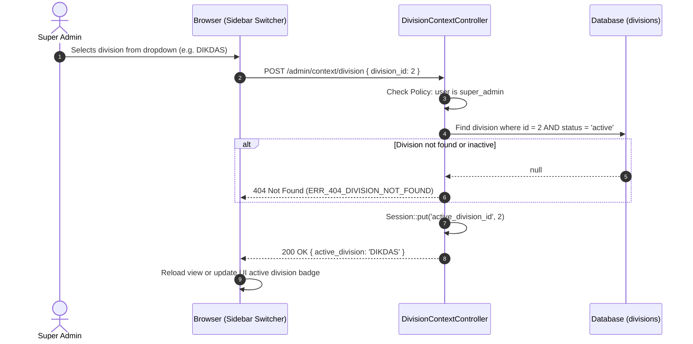
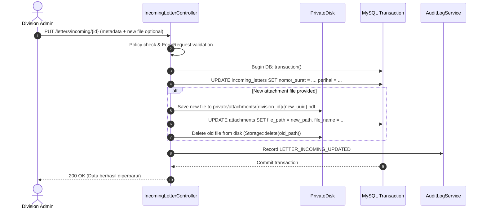
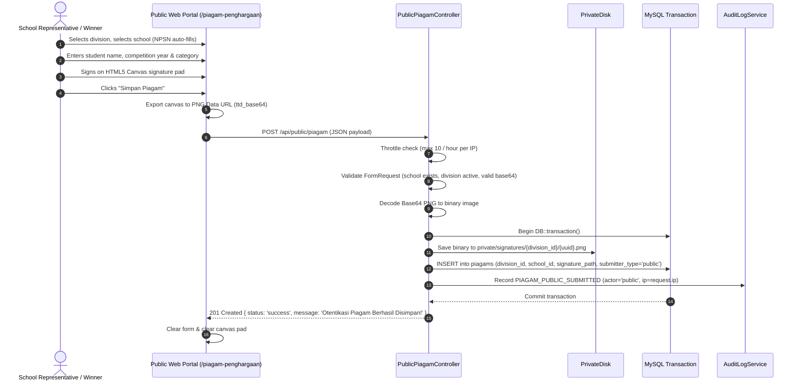
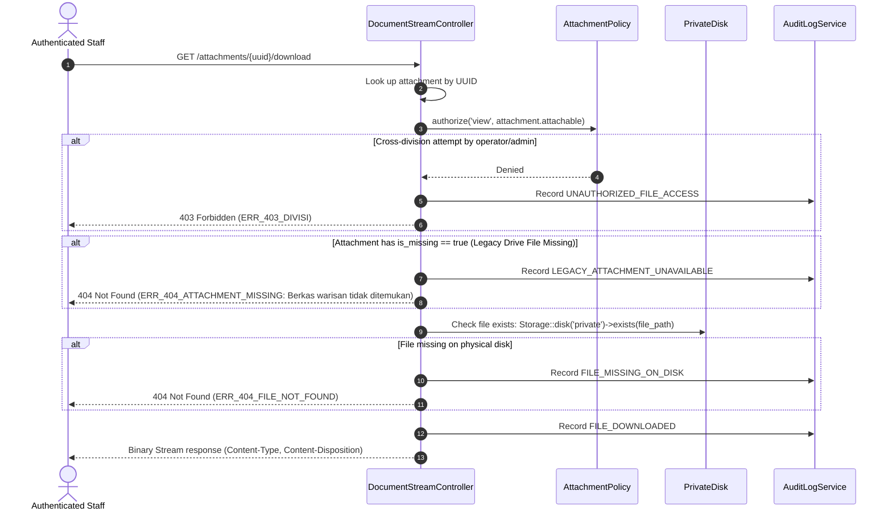
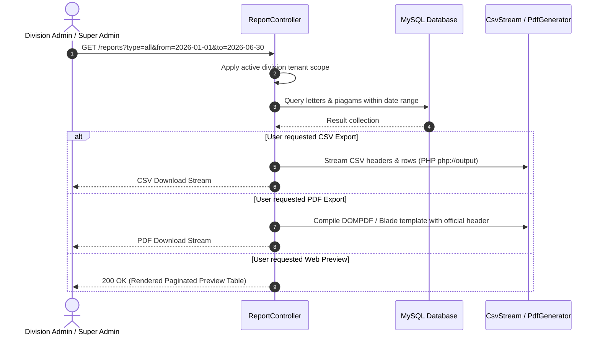

# 05 — End-to-End Workflow Contracts

> **Requirement Prefix:** `WF`  
> **Status:** RATIFIED BASELINE  
> **Target Audience:** Developers, QA Architects, UI Engineers  

---

## 1. Authentication & Division Context Workflows

### WF-AUTH-01: User Login Workflow



* **Idempotency & Concurrency:** Login is stateful (session creation) and protected by IP/username throttling.
* **Failure Handling:** Generic error message displayed to prevent username enumeration: *"Username atau password salah."*

---

### WF-AUTH-02: Migrated Account Password Activation & Reset Workflow



* **Security Guarantees:** Legacy weak hashes and plaintext credentials are never accepted. Secrets and tokens are never logged. Generic enumeration shielding applies to all public endpoints.

---

### WF-TEN-01: Super Admin Division Context Switch



---

## 2. Letter Management Workflows

### WF-SM-01: Create Incoming Letter (Surat Masuk)

```mermaid
sequenceDiagram
    autonumber
    actor Operator as Division Operator / Admin
    participant Client as Browser Form
    participant IdemMid as IdempotencyMiddleware
    participant LetterCtrl as IncomingLetterController
    participant Policy as LetterPolicy
    participant Storage as PrivateDisk (Storage::disk)
    participant DB as MySQL Transaction
    participant Audit as AuditLogService

    Operator->>Client: Fills form (nomor, asal, tanggal, perihal) & attaches PDF
    Client->>Client: Generate UUIDv4 for Idempotency-Key
    Client->>IdemMid: POST /letters/incoming (Header: Idempotency-Key: {uuid})
    
    IdemMid->>DB: Query idempotency_keys WHERE key = {uuid} AND user_id = {auth_id}
    alt Key exists with matching request_hash AND status = 'completed'
        IdemMid-->>Client: Replay cached HTTP 201 Response
    else Key exists with DIFFERENT request_hash
        IdemMid-->>Client: 409 Conflict (ERR_409_IDEMPOTENCY_CONFLICT)
    else Key exists with status = 'in_progress'
        IdemMid-->>Client: 409 Conflict (ERR_409_CONCURRENT_REQUEST)
    end

    IdemMid->>DB: INSERT into idempotency_keys (key, user_id, status='in_progress', hash)
    IdemMid->>LetterCtrl: Pass request to controller
    LetterCtrl->>Policy: authorize('create', IncomingLetter::class)
    LetterCtrl->>LetterCtrl: Validate request (StoreLetterRequest)

    LetterCtrl->>DB: Check potential duplicate (division_id, asal_surat, nomor_surat, tanggal_surat)
    opt Potential Duplicate Found
        Note over LetterCtrl: Record advisory flag; does NOT block legitimate save
    end

    LetterCtrl->>DB: Begin DB::transaction()
    LetterCtrl->>Storage: Stage file to private/tmp/{uuid}.pdf
    LetterCtrl->>DB: INSERT into incoming_letters (uuid, division_id, ...)
    LetterCtrl->>Storage: Move to private/attachments/{division_id}/{uuid}.pdf
    LetterCtrl->>DB: INSERT into attachments (attachable_id, file_path, ...)
    LetterCtrl->>DB: UPDATE idempotency_keys SET status='completed', response_code=201, response_body=...
    LetterCtrl->>Audit: Record LETTER_INCOMING_CREATED
    DB-->>LetterCtrl: Commit transaction

    alt Any error during DB insertion
        LetterCtrl->>Storage: Delete staged file
        LetterCtrl->>DB: Rollback transaction (Idempotency key deleted or marked failed)
        LetterCtrl-->>Client: 500 Internal Server Error (ERR_500_SAVE_FAILED)
    end

    LetterCtrl-->>Client: 201 Created (JSON / Redirect with toast)
```

* **Data Mutations:** Inserts 1 row in `incoming_letters`, 1 row in `attachments`, 1 row in `idempotency_keys`, 1 row in `audit_logs`.
* **File Mutations:** Writes 1 file into `storage/app/private/attachments/{division_id}/`.
* **Atomicity & Consistency:** If database insert throws exception, the compensating cleanup action immediately deletes the staged physical file from disk.
* **Server-Side Idempotency:** Double-tap submissions or retried requests are trapped by `IdempotencyMiddleware` before any database or filesystem side-effects occur.
* **Duplicate Letter Handling:** Incoming letter collisions from different senders are permitted; database primary key `id` is authoritative.

---

### WF-SM-02: Update Incoming Letter with Attachment Replacement



* **Compensation Logic:** Old physical file is deleted **only after** the database update transaction confirms commitment. If transaction fails, the newly uploaded temporary file is purged, leaving the original attachment intact.

---

## 3. Piagam & Digital Signature Workflows

### WF-PG-02: Public Piagam Collection with Canvas Signature



---

## 4. File Streaming & Download Workflow

### WF-FILE-01: Authenticated Attachment Download



---

## 5. Reporting & Analytics Workflow

### WF-REP-01: Monthly Recap & Report Generation


