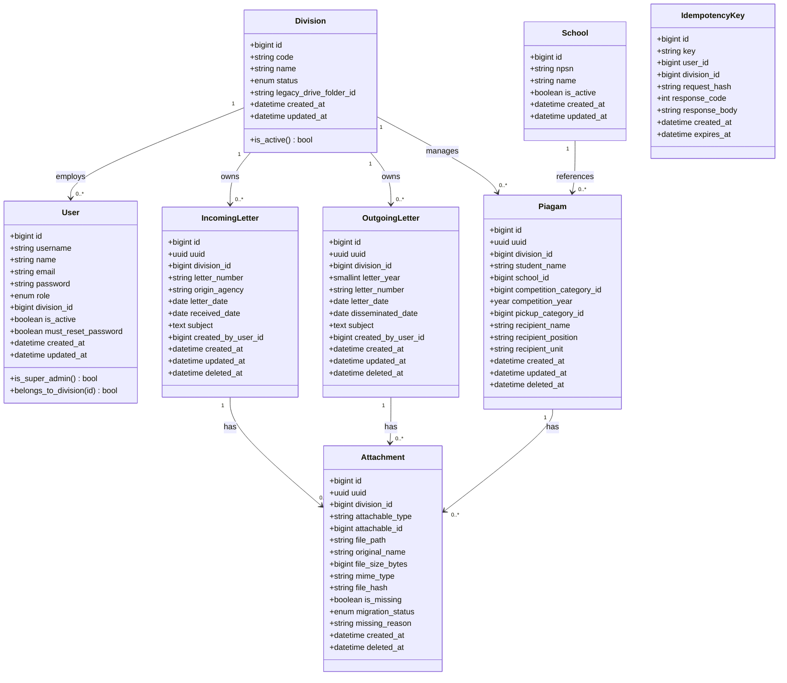

# 06 — Logical Domain Model & Entity Invariants

> **Requirement Prefix:** `DM`  
> **Status:** RATIFIED BASELINE v1.3.0  
> **Target Audience:** Database Architects, Backend Implementers, Domain Analysts  

---

## 1. Domain Class Diagram (Target Relational Architecture)

---

## 2. Core Entity Invariants & Lifecycle Rules

### 2.1 Division
* **Invariant DM-DIV-01:** `code` is immutable once provisioned, uppercase alphanumeric (e.g. `DIKDAS`).
* **Invariant DM-DIV-02:** When `status` transitions to `inactive`, all non-super-admin user sessions are invalidated immediately, and records become read-only.

### 2.2 User
* **Invariant DM-USR-01:** `username` is unique and normalized lowercase.
* **Invariant DM-USR-02:** Division Admins and Operators must have an immutable `division_id`. Super Admins have `division_id = NULL`.
* **Invariant DM-USR-03:** Insecure legacy passwords are NOT migrated. Migrated users have `must_reset_password = true` requiring one-time activation via Path A (email token) or Path B (out-of-band administrative activation).

### 2.3 Incoming Letter
* **Invariant DM-SM-01 (DEC-TEN-001):** Strictly single-division ownership in v1. Exactly one owning `division_id`. No inter-division routing exists in v1.
* **Invariant DM-SM-02 (DEC-LET-001):** The database primary key `id` is authoritative. External `letter_number` (`nomor_surat`) alone is NOT a unique key; external collisions from different senders are valid.
* **Invariant DM-SM-03:** `received_date` >= `letter_date`.

### 2.4 Outgoing Letter
* **Invariant DM-SK-01 (DEC-TEN-001):** Strictly single-division ownership in v1. Exactly one owning `division_id`.
* **Invariant DM-SK-02 (DEC-LET-002):** Enforced unique per division and calendar year: `UNIQUE (division_id, letter_year, letter_number)`. `letter_year` is derived deterministically from `letter_date`.
* **Invariant DM-SK-03:** `disseminated_date` >= `letter_date`.

### 2.5 Attachment
* **Invariant DM-ATT-01 (DEC-FILE-001):** Private storage by default. No public URLs. Files accessed via authorized streaming.
* **Invariant DM-ATT-02 (DEC-FILE-003):** Letters with missing legacy Drive files have durable `attachments` rows with `is_missing = true`, `file_path = NULL`, and explicit `migration_status`. Letter detail views load safely with a non-fatal warning badge.

### 2.6 Idempotency Key
* **Invariant DM-IDEM-01 (DEC-SYS-001):** Replays with matching key and request hash return cached responses. Replays with matching key but altered payload return HTTP 409 Conflict. Keys expire after 24 hours.
