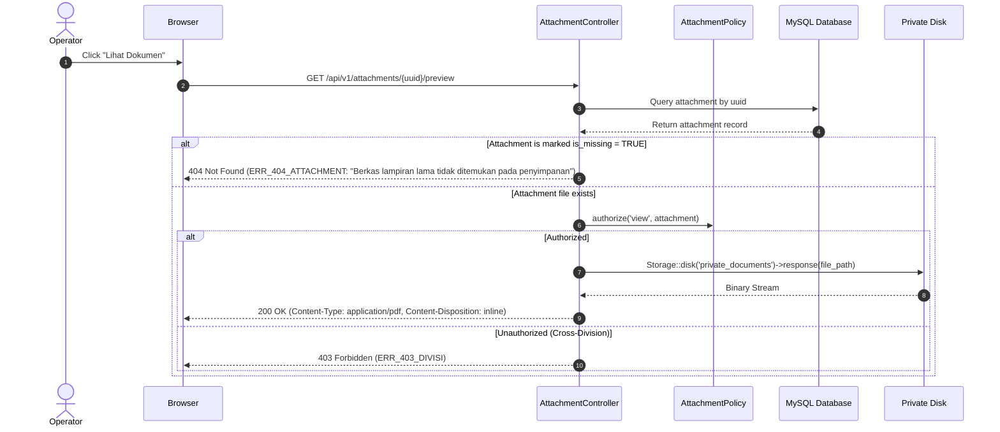

# 10. FILE STORAGE CONTRACT

## 1. System Overview & Target Principles

In legacy SISURAT, file storage relied entirely on Google Drive API via Google Apps Script (`backend/05_Drive.js` and `backend/10_UploadService.js`). Files uploaded were made public to the entire internet using `file.setSharing(DriveApp.Access.ANYONE_WITH_LINK, DriveApp.Permission.VIEW)` and exposed direct Google Drive preview/download URLs. Due to GAS payload limits (100KB per request cache limit), legacy implemented a fragile 72KB chunk-upload mechanism over sequential HTTP POST requests.

In the Laravel target system (initial baseline: Laravel ^12.0 / PHP ^8.2), file storage is completely overhauled under strict enterprise digital archiving and data security principles:

1. **Private by Default:** No document attachment or signature file shall ever be stored in a public directory (e.g., `public/storage`). All files are saved to private disks (`storage/app/private/`).
2. **Authorized Streaming Only:** Files must never have static permanent URLs accessible without authentication. All downloads and previews must be mediated through an authorized Laravel controller endpoint that verifies tenant division scope and role permissions before streaming bytes with appropriate `Content-Type` and `Content-Disposition` headers.
3. **Generated Obfuscated Storage Names:** User-provided filenames must never be used directly on the filesystem. Storage filenames are strictly generated UUIDv4 or SHA-256 hashes (`{uuid}.{ext}`).
4. **Original Filename as Metadata:** The original uploaded filename (`original_name`), MIME type, and byte size are stored as database metadata in the `attachments` table.
5. **No Chunked Upload Workaround:** Standard HTTP multipart/form-data upload via `Illuminate\Http\UploadedFile` replaces the legacy 72KB chunking mechanism.
6. **Transactional Compensation:** File write and database persistence must be synchronized. If database commit fails, the uploaded file is purged from disk. If a file cannot be written, the database transaction rolls back.
7. **Durable Handling of Missing Attachments:** Legacy letters are never discarded solely because a Google Drive file is missing or inaccessible. A durable database record tracks missing attachments with non-fatal operational degradation.

---

## 2. File Attachment Matrix & Cardinality

| Entity | Field / Relationship | Cardinality | Permitted MIME Types | Max Size | Legacy Mechanism | Target Strategy |
| :--- | :--- | :--- | :--- | :--- | :--- | :--- |
| **Incoming Letter** (`incoming_letters`) | Polymorphic relation via `attachments` table (`attachable_type`, `attachable_id`) | 1 attachment per letter (legacy baseline); extensible to multiple | `application/pdf`, `application/msword`, `application/vnd.openxmlformats-officedocument.wordprocessingml.document`, `image/jpeg`, `image/png` | 2 MB (Main Doc) / 5 MB (Total Photos) | Drive upload, public link stored in `upload_file` column | Private disk streaming (`/api/v1/attachments/{uuid}/preview`) |
| **Outgoing Letter** (`outgoing_letters`) | Polymorphic relation via `attachments` table | 1 attachment per letter (legacy baseline); extensible to multiple | `application/pdf`, `application/msword`, `application/vnd.openxmlformats-officedocument.wordprocessingml.document`, `image/jpeg`, `image/png` | 2 MB (Main Doc) / 5 MB (Total Photos) | Drive upload, public link stored in `upload_file` column | Private disk streaming (`/api/v1/attachments/{uuid}/preview`) |
| **Piagam Signature** (`piagams`) | Polymorphic relation via `attachments` table | Exactly 1 per piagam record | `image/png`, `image/jpeg` (Canvas Base64 export) | 2 MB | Canvas Base64 decoded to Drive blob, link stored in `ttd_pengambil` | Decoded Base64 stored on private disk, linked to piagam record |
| **Piagam Certificate File** (`piagams`) | Polymorphic relation via `attachments` table | 0..1 (Optional scanned certificate) | `application/pdf`, `image/jpeg`, `image/png` | 2 MB | Not consistently implemented in legacy | Private disk streaming |

---

## 3. Storage Hierarchy & Disk Configuration

### 3.1 Laravel Disk Definition (`config/filesystems.php`)
```php
'disks' => [
    'private_documents' => [
        'driver' => 'local',
        'root' => storage_path('app/private/documents'),
        'throw' => true,
        'visibility' => 'private',
    ],
    'private_signatures' => [
        'driver' => 'local',
        'root' => storage_path('app/private/signatures'),
        'throw' => true,
        'visibility' => 'private',
    ],
],
```

### 3.2 Directory Layout
```text
storage/app/private/
├── documents/
│   ├── DIKDAS/
│   │   ├── 2026/
│   │   │   ├── 09/
│   │   │   │   └── 3f8a4e21-0a4b-4b02-9e90-2e40f1a94e80.pdf
│   ├── PAUD/
│   │   └── 2026/
│   │       └── ...
└── signatures/
    ├── DIKDAS/
    │   └── 2026/
    │       └── 8c4a1122-77bb-43e9-a212-00b84f32c91a.png
```

---

## 4. Upload, Streaming & Deletion Lifecycles

### 4.1 Authorized Secure Streaming Workflow


---

## 5. Attachment Database Entity Contract & Missing File Resilience

All attachments are tracked via the `attachments` table specified in `07-DATABASE-CONTRACT.md`:

```sql
CREATE TABLE `attachments` (
    `id` BIGINT UNSIGNED AUTO_INCREMENT PRIMARY KEY,
    `uuid` CHAR(36) NOT NULL UNIQUE,
    `division_id` BIGINT UNSIGNED NOT NULL,
    `attachable_type` VARCHAR(191) NOT NULL,
    `attachable_id` BIGINT UNSIGNED NOT NULL,
    `file_path` VARCHAR(500) NULL COMMENT 'Storage path; NULL if legacy file is missing',
    `original_name` VARCHAR(255) NOT NULL,
    `file_size_bytes` BIGINT UNSIGNED NOT NULL DEFAULT 0,
    `mime_type` VARCHAR(100) NOT NULL DEFAULT 'application/octet-stream',
    `file_hash` CHAR(64) NULL COMMENT 'SHA-256 checksum for integrity',
    `is_missing` BOOLEAN NOT NULL DEFAULT 0 COMMENT '1 if referenced file is missing or 404',
    `migration_status` ENUM(
        'migrated',
        'missing_drive_file',
        'inaccessible_drive_file',
        'download_failed',
        'validation_rejected',
        'no_attachment_expected'
    ) NOT NULL DEFAULT 'migrated',
    `missing_reason` VARCHAR(255) NULL,
    `legacy_drive_file_id` VARCHAR(100) NULL,
    `legacy_drive_url` TEXT NULL,
    `created_by_user_id` BIGINT UNSIGNED NULL,
    `created_at` TIMESTAMP NOT NULL DEFAULT CURRENT_TIMESTAMP,
    `updated_at` TIMESTAMP NOT NULL DEFAULT CURRENT_TIMESTAMP ON UPDATE CURRENT_TIMESTAMP,
    `deleted_at` TIMESTAMP NULL,
    INDEX `idx_attachments_polymorphic` (`attachable_type`, `attachable_id`),
    INDEX `idx_attachments_division` (`division_id`),
    INDEX `idx_attachments_uuid` (`uuid`),
    INDEX `idx_attachments_missing` (`is_missing`, `migration_status`),
    CONSTRAINT `fk_attachments_division` FOREIGN KEY (`division_id`) REFERENCES `divisions` (`id`) ON UPDATE CASCADE ON DELETE RESTRICT,
    CONSTRAINT `fk_attachments_created_by` FOREIGN KEY (`created_by_user_id`) REFERENCES `users` (`id`) ON UPDATE CASCADE ON DELETE SET NULL
) ENGINE=InnoDB DEFAULT CHARSET=utf8mb4 COLLATE=utf8mb4_unicode_ci;
```

### 5.1 Detailed Missing File Conditions & Remediation
The migration ETL and application distinguish between explicit attachment states:

1. **`no_attachment_expected`:** The legacy sheet row had an empty `upload_file` cell. No missing-file error is logged.
2. **`missing_drive_file`:** The legacy Google Drive file ID returns HTTP 404 Not Found or has been permanently trashed in Google Drive.
3. **`inaccessible_drive_file`:** The file exists on Google Drive but returns HTTP 403 Forbidden due to restricted ownership permissions.
4. **`download_failed`:** A temporary network dropout or rate limit interrupted the download during migration.
5. **`validation_rejected`:** The file binary was successfully downloaded, but failed MIME verification or antivirus checks.
6. **`migrated`:** The binary was verified, hashed with SHA-256, and stored safely on the private disk.

**Operational UI Behavior:**
- When `is_missing = TRUE`, the letter detail view renders all metadata normally, accompanied by a non-fatal warning badge: *"Lampiran lama tidak tersedia di Drive (404/Dihapus)"*.
- The preview button is disabled or provides a safe explanation dialog, preventing unhandled server 500 crashes.
- Division Admins and Super Admins can click *"Unggah Ulang Lampiran"* to remediate the missing attachment with a fresh scan.
- A secondary export report (`missing_attachments.json`) is generated during migration for archival auditing, while the database remains the authoritative operational record.
