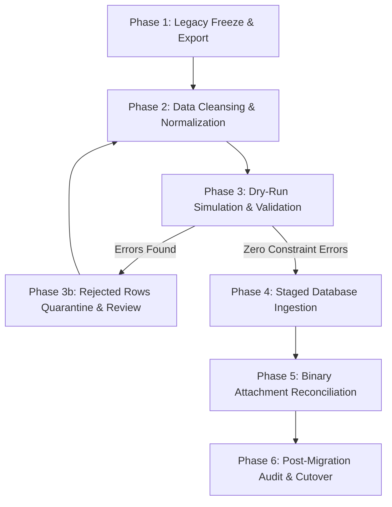

# 16. DATA MIGRATION STRATEGY

## 1. Scope & Execution Principles

This document defines the Extract, Transform, Load (ETL) strategy for migrating legacy Google Sheets data and Google Drive attachments into the Laravel (initial baseline: Laravel ^12.0 / PHP ^8.2) relational MySQL database. 

**Execution Principle:** Migration scripts must **never be executed** during the contract phase. This document serves as the normative specification for migration tooling to be developed in a future implementation phase.

---

## 2. Phased Migration Workflow



---

## 3. Detailed Step-by-Step Strategy

### Step 1: Legacy Freeze & Extraction
1. **Administrative Announcement:** Establish a maintenance window; notify all operators of the write freeze.
2. **Access Revocation:** Temporarily restrict GAS deployment or set web app access to Super Admin only.
3. **Data Extraction:** Export all legacy sheets from Google Sheets into UTF-8 encoded CSV / JSON dumps:
   - Global sheets: `db_divisi.csv`, `db_users.csv`, `db_config.csv`, `ref_sekolah.csv`, `db_audit_log.csv`.
   - Division sheets: Iterate through all active divisions and export `{KODE}_surat_masuk.csv`, `{KODE}_surat_keluar.csv`, `{KODE}_piagam.csv`, `{KODE}_ref_pengambilan.csv`, `{KODE}_ref_jenis.csv`.
4. **Drive Snapshot:** Perform a full archival backup of all files in the designated Google Drive folders.

### Step 2: Normalization & Pre-Ingestion Transformation
1. **Date Parsing:** Normalize dates to standard ISO `YYYY-MM-DD` or `YYYY-MM-DD HH:mm:ss`. If a date is unparseable, flag the record for quarantine.
2. **Outgoing Letter Year Extraction:** For outgoing letters, extract `letter_year = YEAR(tanggal_surat)` to populate the explicit division-year unique constraint.
3. **Incoming Letters Non-Uniqueness:** Ingest incoming letter numbers without universal uniqueness rejection. Identical external numbers from different senders are staged successfully.
4. **Division Mapping:** Inject the relational `division_id` onto each record extracted from division-scoped sheets (`{KODE}_...`). Enforce immutable single-division ownership (`DEC-TEN-001`).
5. **Trim & Sanitize:** Trim all leading/trailing whitespace, eliminate zero-width spaces, and strip formula injection characters (`=`, `+`, `-`, `@`) from user-provided text.
6. **Status Normalization:** Map text variations (`"TRUE"`, `"true"`, `"1"`, `1`, `"AKTIF"`) to boolean `1`, and (`"FALSE"`, `"false"`, `"0"`, `0`, `""`, `null`) to boolean `0`.

### Step 3: Strict Dependency-Ordered Ingestion & Password Ingestion
Database tables must be populated in strict foreign-key dependency order:
```text
1. divisions
2. settings
3. users (foreign key to divisions) -> Insecure legacy passwords rejected (DEC-AUTH-001). Set must_reset_password = 1, assign unguessable random hash.
4. schools (ref_sekolah)
5. pickup_categories & competition_categories (foreign keys to divisions)
6. incoming_letters & outgoing_letters (foreign keys to divisions and users)
7. piagams (foreign keys to divisions, schools, and categories)
8. attachments (polymorphic foreign keys to letters and piagams)
9. audit_logs (foreign keys to users and divisions)
```

### Step 4: Attachment & Binary Reconciliation (DEC-FILE-003)
1. **Drive ID Extraction:** Parse Google Drive URL regex `/(?:id=|\/d\/)([a-zA-Z0-9_-]+)/`.
2. **File Ingestion:**
   - *If File Download Succeeds:* Store binary in `storage/app/private/attachments/{DIVISION}/{YEAR}/{uuid}.{ext}`, compute SHA-256 hash, insert `attachments` record with `is_missing = 0`, `migration_status = 'migrated'`.
   - *If Drive Returns 404 / Trashed:* **The letter record is preserved.** Insert `attachments` row with `file_path = NULL`, `is_missing = 1`, `migration_status = 'missing_drive_file'`, `missing_reason = 'Google Drive HTTP 404'`.
   - *If Drive Returns 403 Forbidden:* Insert `attachments` row with `file_path = NULL`, `is_missing = 1`, `migration_status = 'inaccessible_drive_file'`.
   - *If Download Fails Temporarily:* Flag `migration_status = 'download_failed'`.
3. **Reconciliation Reporting:** A secondary audit report `missing_attachments.json` is exported summarizing all missing files, while the database `attachments` table serves as the primary operational source of truth.

### Step 5: Dry-Run Simulation & Quarantining
- Migration commands must support a `--dry-run` flag that wraps the entire import sequence in a database transaction:
  ```bash
  php artisan sisurat:migrate-legacy --dry-run
  ```
- If any unhandled foreign key violation or corrupted constraint collision occurs:
  - The transaction rolls back completely.
  - Offending rows are exported to `storage/migration/quarantine_{table}.json` along with the validation error.
  - Migration engineers resolve anomalies in the source export before re-running.

---

## 4. Post-Migration Verification & Reconciliation Gates

Before production sign-off, the migration verification tool must run automated reconciliation checks against the inspected legacy dataset:

| Metric | Acceptance Threshold | Failure Action |
| :--- | :--- | :--- |
| **Record Count Reconciliation** | 100% of non-empty legacy sheet rows in the inspected snapshot must exist in MySQL (or be accounted for in quarantine log). | Abort cutover |
| **Referential Integrity** | Zero orphan records (`division_id`, `school_id`, `created_by_user_id`). | Abort cutover |
| **Attachment Reconciliation** | Total legacy rows with non-empty `upload_file` == Count of `attachments` records (`migrated` + `is_missing`). | Flag discrepancies for review |
| **Outgoing Number Uniqueness** | Zero unhandled collisions within the same division and calendar year (`letter_year`). | Quarantine duplicate rows |
| **Account Credential Audit** | 100% of migrated user accounts have `must_reset_password = 1` and unusable password hashes. | Review user table |

---

## 5. Rollback & Cutover Plan

1. **Cutover Window:** Execute final delta sync during non-operational hours; run verification checks; point DNS / web server to the new Laravel application.
2. **Rollback Plan:** If critical defects are discovered within 24 hours of cutover, switch DNS back to legacy Google Apps Script frontend and re-enable Google Sheets write permissions.
