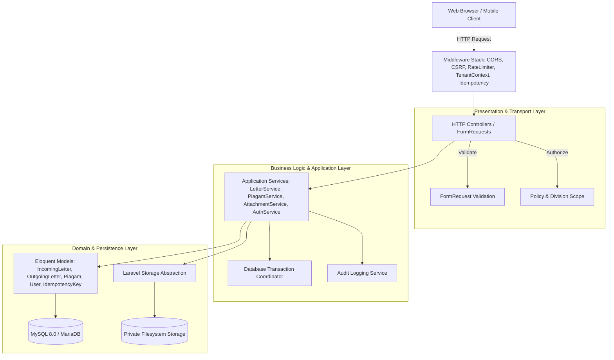

# 22. TARGET ARCHITECTURE BOUNDARIES

## 1. Architectural Philosophy & Principles

The target Laravel architecture (initial baseline: Laravel ^12.0 / PHP ^8.2) is structured around **clean separation of concerns**, **strict tenant isolation**, and **pragmatic maintainability**. It avoids speculative enterprise over-engineering (such as superfluous repository wrappers over Eloquent) while guaranteeing that critical business workflows, security checks, and transactional file writes are decoupled from the HTTP transport layer.

---

## 2. Conceptual Layer Architecture

---

## 3. Layer Boundary Contracts & Responsibilities

### 3.1 Middleware Layer (Transport & Protection)
- **Responsibility:** CORS, CSRF verification, rate limiting, active division context resolution, and server-side request deduplication (`IdempotencyMiddleware`).
- **Idempotency Contract:** For state-mutating endpoints (`POST /letters/incoming`, `POST /letters/outgoing`, `POST /piagam`), the middleware intercepts the `Idempotency-Key` header, enforces a 24-hour lock, replays cached 201/200 responses on duplicate calls, and aborts conflicting concurrent requests with HTTP 409.

### 3.2 HTTP / Controller Layer
- **Responsibility:** Request routing, HTTP status negotiation, extracting validated inputs, delegating to application services, and returning JSON responses or Blade view renders.
- **Strict Boundary:** Controllers must **never**:
  - Execute direct database queries using `DB::table()` or inline raw SQL.
  - Directly invoke filesystem write/unlink operations.
  - Contain nested business rules or transaction management.

### 3.3 FormRequest Validation Layer
- **Responsibility:** Field-level syntax checks, data type casting, string normalization, and domain boundary constraints (e.g. max file size, allowed MIME types).
- **Strict Boundary:** FormRequests execute **prior** to controller action dispatch. If validation fails, execution is halted immediately, returning HTTP 422 with a structured error envelope. Separate rules govern incoming vs outgoing letter numbers (incoming letters permit collisions; outgoing enforce annual uniqueness).

### 3.4 Authorization & Policy Layer
- **Responsibility:** Verify whether the authenticated actor possesses permission to perform the requested operation on the targeted resource within their active division context.
- **Strict Boundary:** Division scoping is strictly enforced here. Every division-owned record has exactly one owning `division_id` in v1. Cross-division access by non-super-admins is rejected with HTTP 403 Forbidden.

### 3.5 Application Service Layer
- **Responsibility:** Orchestrate multi-step business transactions. Coordinates database inserts/updates, file storage writes, checksum generation, and audit log generation.
- **Strict Boundary:** Services are transport-agnostic (callable from HTTP controllers, Artisan CLI commands, or background queue jobs). Services encapsulate `DB::beginTransaction()` and `DB::commit()` / `DB::rollBack()`.

### 3.6 Domain & Persistence Layer (Eloquent)
- **Responsibility:** Represent domain entities, define database relationships (`belongsTo`, `hasMany`, `morphOne`), encapsulate entity invariants, and provide reusable query scopes (e.g. `scopeForDivision($query, $divisionId)`).
- **Model Invariants:** 
  - `IncomingLetter`: PK `id` is authoritative; `nomor_surat` has no unique constraint.
  - `OutgoingLetter`: Explicit `letter_year` column populated on save and protected by `UNIQUE (division_id, letter_year, nomor_surat)`.
  - `User`: `must_reset_password` boolean gates normal session usage until activation/reset is fulfilled.
  - `Attachment`: Supports `is_missing = true` with `migration_status` ENUM for durable missing legacy Drive files.

### 3.7 Storage Layer
- **Responsibility:** Safe write, read, streaming, and deletion of physical file binaries on disk. Enforces generated UUID naming and prevents directory index saturation via date-based subdirectories. Handles missing legacy file requests gracefully (HTTP 404 with structured error envelope, no fatal exceptions).

### 3.8 Audit & Telemetry Layer
- **Responsibility:** Listen to domain events (`LetterCreated`, `LetterDeleted`, `DivisionSwitched`, `PasswordResetRequested`) and append immutable, redacted records to the `audit_logs` table (never logging passwords or activation tokens).
