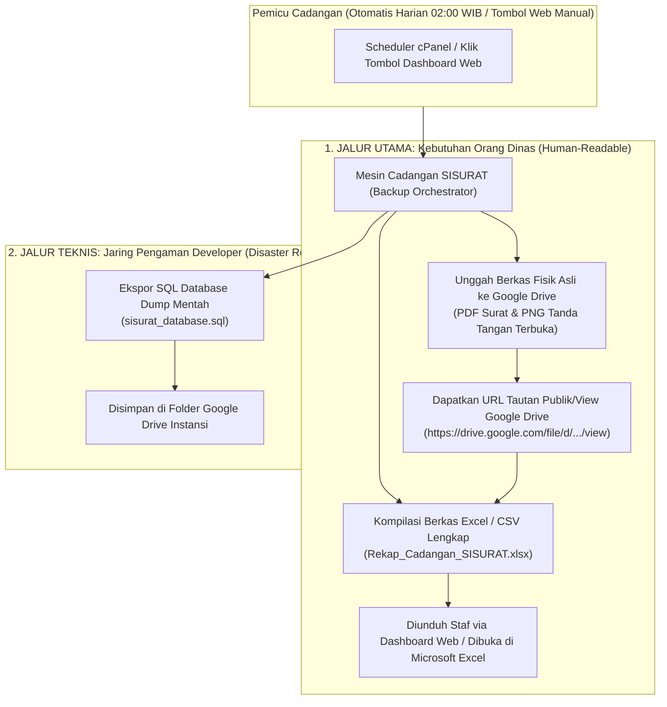

# 30. SPESIFIKASI BACKUP SPREADSHEET & GOOGLE DRIVE LINK (UX-FIRST UNTUK DINAS)

> **Dokumen Adendum & Desain Evolusi Sistem Cadangan SISURAT**  
> **Status:** `PROPOSED / APPROVED BY STAKEHOLDER`  
> **Target Pengguna:** Pegawai ASN, Staf Tata Usaha, dan Pengelola IT Dinas (Non-Developer / Awam)  
> **Dokumen Induk:** [`docs/backup.md`](backup.md) · [`AGENTS.md`](../AGENTS.md)

---

## 1. Latar Belakang & Motivasi Perubahan (User-Centric Shift)

Pada perancangan awal (*Blueprint V1.0* di `docs/backup.md`), sistem cadangan dibangun dengan filosofi *Enterprise Disaster Recovery* militer: membungkus seluruh database dan berkas ke dalam satu arsip terenkripsi biner `AES-256-GCM` berekstensi `.enc`, yang hanya dapat dibuka melalui baris perintah terminal (`php artisan sisurat:restore`).

Namun, berdasarkan audit operasional riil dan arahan langsung dari penanggung jawab instansi:
1. **Persona Pengguna Nyata:** Pengguna harian dan penanggung jawab di lingkungan dinas adalah pegawai ASN dan staf administrasi umum. Mereka **tidak menguasai terminal command-line**, tidak memiliki akses SSH pada shared hosting cPanel, dan tidak memahami konsep dekripsi kriptografi.
2. **Kebutuhan Format Berkas:** Ketika staf dinas meminta "backup", yang mereka bayangkan dan butuhkan adalah **berkas Spreadsheet (Excel / CSV)** yang dapat langsung diklik ganda dan dibuka di Microsoft Excel laptop kantor mereka.
3. **Kebutuhan Akses Lampiran Langsung:** Di dalam file Excel tersebut, staf membutuhkan **kolom tautan langsung (Link Google Drive)** di ujung kanan setiap baris surat atau tanda tangan. Jika tautan tersebut diklik, browser langsung membuka pindaian PDF surat asli atau foto tanda tangan di Google Drive tanpa hambatan login atau izin rumit.
4. **Keputusan Stakeholder:** Pihak instansi secara sadar memilih untuk **mengorbankan enkripsi simetrik biner kaku** demi **kemudahan operasional (User Experience nomor 1)** dan transparansi arsip yang bisa dibaca manusia kapan pun dibutuhkan.

---

## 2. Arsitektur Dua Jalur (Dual-Tier Backup Architecture)

Untuk memenuhi kebutuhan orang dinas tanpa kehilangan jaring pengaman teknis bagi developer, sistem mengadopsi **Arsitektur Dua Jalur**:



### 2.1 Jalur 1: Jalur Orang Dinas (*Human-Readable & Spreadsheet-First*)
* Menghasilkan file Excel/CSV rekapitulasi data persuratan dan piagam yang ramah pengguna.
* Berkas fisik (PDF surat dan PNG tanda tangan) diunggah sebagai file asli ke Google Drive instansi (bukan file biner `.enc`).
* Di kolom paling kanan Excel, tercantum link Google Drive yang dapat diklik langsung oleh siapa pun pemegang Excel.

### 2.2 Jalur 2: Jalur Developer (*Disaster Recovery Safeguard*)
* Tetap menyertakan 1 file database SQL mentah (`sisurat_database.sql`) di folder Google Drive instansi.
* Jika sewaktu-waktu server hosting rusak total, developer dapat langsung mengimpor kembali database dalam 5 detik tanpa perlu repot.

### 2.3 Prinsip Koeksistensi: Mengapa Sistem Lama (Fase 01–06) TIDAK Dihapus?

Implementasi spesifikasi ramah dinas ini **TIDAK MENGHAPUS** modul backup teknis yang telah dibangun sebelumnya, melainkan **menjadikannya mesin penggerak di bawah kap (*engine under the hood*)**:

1. **Fondasi Mesin Inti Tetap Dipakai 100%:**
   * **`DatabaseDumperService`:** Tetap menjadi mesin yang mengekstrak dump SQL konsisten secara atomik.
   * **`GoogleDriveStorageService`:** Tetap menjadi jembatan OAuth 2.0 yang mengelola token refresh dan pengunggahan ke Google Drive.
   * **`BackupConsistencyService`:** Tetap menjamin pencegahan tabrakan proses (*concurrency lock*) saat backup berjalan.
   * **`routes/console.php`:** Tetap menjadi scheduler otomatis cPanel harian tanpa perlu konfigurasi ulang.
   * **`BackupRun` Model & Tabel:** Tetap menjadi pencatat riwayat, durasi, dan status eksekusi.
   * **64 Automated Tests:** Tetap aktif untuk menjamin stabilitas dan mencegah regresi bug pada sistem.
2. **Ibarat Mobil:**
   * *Sistem Lama* adalah **Mesin di Balik Kap**: Menjamin mesin database andal, aman dari server crash, dan terpelihara secara otomatis.
   * *Sistem Baru* adalah **Dashboard & Kemudi**: Menampilkan antarmuka yang cantik, file Excel yang langsung bisa dibuka di laptop dinas, dan link Google Drive yang bisa diklik langsung.
3. **Hasil Sinergi:**
   * Pegawai dinas mendapatkan kemudahan 100% (bisa baca Excel dan buka file surat di Google Drive tanpa pusing).
   * Developer dan instansi tetap memiliki jaring pengaman teknis jika server shared hosting mengalami kerusakan total.

---

## 3. Struktur Berkas & Folder di Google Drive Instansi

Di dalam Google Drive resmi instansi, sistem menyusun direktori yang bersih, rapi, dan mudah dijelajahi manusia:

```text
📁 SISURAT_ARCHIVE_2026/                       <-- Folder Utama Cadangan Tahun Berjalan
│
├── 📁 01_Surat_Masuk/                         <-- Folder Berkas Asli Surat Masuk
│   ├── SM_0001_421.3-012-2026_Undangan_Bupati.pdf
│   ├── SM_0002_800-045-2026_Edaran_Sekda.pdf
│   └── ...
│
├── 📁 02_Surat_Keluar/                        <-- Folder Berkas Asli Surat Keluar
│   ├── SK_0001_005-001-2026_Undangan_Rapat.pdf
│   ├── SK_0002_421-002-2026_Pemberitahuan.pdf
│   └── ...
│
├── 📁 03_Tanda_Tangan_Piagam/                 <-- Folder Bukti Tanda Tangan Digital Piagam
│   ├── TTD_Resi_0001_Budi_Santoso.png
│   ├── TTD_Resi_0002_Siti_Aminah.png
│   └── ...
│
├── 📊 Rekap_Cadangan_SISURAT_2026_Terbaru.xlsx <-- File Excel Utama (Dengan Link GDrive)
└── 💾 sisurat_database_backup.sql             <-- Salinan Database SQL Mentah (Cadangan Teknis)
```

---

## 4. Struktur Kolom Spreadsheet (Excel / CSV)

Spreadsheet cadangan dirancang agar dapat dibuka di **Microsoft Excel**, **Google Sheets**, maupun **LibreOffice Calc** dengan karakter bahasa Indonesia sempurna (UTF-8 with BOM).

### 4.1 Sheet 1: Buku Agenda Surat Masuk
| Kolom | Nama Header | Contoh Isi Data | Keterangan |
| :---: | :--- | :--- | :--- |
| **A** | No | `1` | Nomor urut baris |
| **B** | Divisi / Bidang | `Bidang Pembinaan SD` | Nama unit kerja pemilik |
| **C** | Nomor Surat | `421.3/012/DISDIK/2026` | Nomor resmi surat dari instansi luar |
| **D** | Asal Pengirim | `Bupati Semarang` | Instansi pengirim surat |
| **E** | Tanggal Surat | `15/01/2026` | Tanggal yang tertera pada surat |
| **F** | Tanggal Diterima | `16/01/2026` | Tanggal fisik surat masuk ke dinas |
| **G** | Perihal | `Undangan Rakor Pembinaan Sekolah` | Pokok isi surat |
| **H** | Petugas Input | `Siti Rahayu` | Nama staf yang mencatat |
| **I** | Waktu Pencatatan | `16/01/2026 09:15` | Waktu sistem mencatat transaksi |
| **J** | **Tautan Berkas Surat (Google Drive)** | `https://drive.google.com/file/d/1a2B.../view` | **Link langsung untuk melihat/unduh PDF di Google Drive** |

### 4.2 Sheet 2: Buku Agenda Surat Keluar
| Kolom | Nama Header | Contoh Isi Data | Keterangan |
| :---: | :--- | :--- | :--- |
| **A** | No | `1` | Nomor urut baris |
| **B** | Divisi / Bidang | `Sekretariat` | Nama unit kerja penerbit |
| **C** | Nomor Surat | `005/001/2026` | Nomor resmi keluar yang diterbitkan |
| **D** | Tanggal Surat | `18/01/2026` | Tanggal resmi surat keluar |
| **E** | Perihal | `Penyelenggaraan Lomba OSN 2026` | Pokok isi surat |
| **F** | Tujuan / Diseminasi | `Seluruh Kepala SMP Negeri/Swasta` | Pihak yang dituju |
| **G** | Petugas Input | `Ahmad Fauzi` | Nama operator penerbit nomor |
| **H** | Waktu Terbit | `18/01/2026 11:30` | Waktu sistem mencatat surat |
| **I** | **Tautan Berkas Surat (Google Drive)** | `https://drive.google.com/file/d/3c4D.../view` | **Link langsung untuk melihat/unduh PDF di Google Drive** |

### 4.3 Sheet 3: Buku Ekspedisi Digital Piagam Penghargaan
| Kolom | Nama Header | Contoh Isi Data | Keterangan |
| :---: | :--- | :--- | :--- |
| **A** | No Resi | `#0024` | Nomor bukti pengambilan digital |
| **B** | Tanggal Ambil | `20/01/2026 13:45` | Tanggal & jam tamu mengambil di loket |
| **C** | Divisi Penyerah | `Bidang Pembinaan SMP` | Unit kerja yang melayani |
| **D** | Asal Sekolah / Instansi | `SMP Negeri 2 Ungaran` | Sekolah/unit kerja tamu |
| **E** | Nama Siswa / Kegiatan | `Ananda Pratama (Juara 1 FLS2N)` | Identitas piagam yang diserahkan |
| **F** | Nama Penerima Tamu | `Bambang Wijaya, S.Pd.` | Nama orang yang datang mengambil |
| **G** | Jabatan / Status | `Guru Pembina / Perwakilan Sekolah` | Hubungan pengambil dengan siswa |
| **H** | Nomor Telepon / WA | `081234567890` | Kontak aktif penerima |
| **I** | **Tautan Tanda Tangan (Google Drive)** | `https://drive.google.com/file/d/5e6F.../view` | **Link langsung melihat gambar tanda tangan digital** |

---

## 5. Pengaturan Izin Tautan Google Drive (*Drive Sharing Permissions*)

Agar tautan Google Drive di dalam berkas Excel dapat langsung dibuka oleh pimpinan, pengawas, atau pemeriksa tanpa muncul jendela peringatan *"You need access / Minta Izin Akses"*:

1. **Auto-Set Permission Saat Pengunggahan:**  
   Setiap berkas surat (PDF) dan tanda tangan (PNG) yang berhasil diunggah ke Google Drive otomatis diberikan izin baca publik dengan tautan (*reader with link*):
   ```json
   {
     "role": "reader",
     "type": "anyone"
   }
   ```
2. **Format Tautan Seragam:**  
   Format tautan yang dimasukkan ke Excel adalah URL pratinjau resmi Google Drive:  
   `https://drive.google.com/file/d/{google_drive_file_id}/view`

---

## 6. Antarmuka Dashboard Web yang Diperbarui (`/admin/backups`)

Halaman antarmuka Super Admin disederhanakan total agar mencerminkan kebutuhan dinas:

```text
+----------------------------------------------------------------------------------------------------+
|  SISURAT - Panel Cadangan Data & Arsip                                                              |
+----------------------------------------------------------------------------------------------------+
|                                                                                                    |
|  [Status Google Drive: TERHUBUNG KE GMAIL DINAS]       [Penyimpanan Hosting: 1.2 GB / 4.0 GB (Aman)]|
|                                                                                                    |
|  +-------------------------------------+   +----------------------------------------------------+   |
|  |  [BUTTON HIJAU BESAR]               |   |  [BUTTON BIRU]                                     |   |
|  |  UNDUH CADANGAN EXCEL TERBARU (.xlsx)|  |  BUKA FOLDER GOOGLE DRIVE INSTANSI                 |   |
|  |  (Lengkap dengan link surat)        |   |  (Lihat seluruh file PDF & TTD asli di cloud)      |   |
|  +-------------------------------------+   +----------------------------------------------------+   |
|                                                                                                    |
|  RIWAYAT SINKRONISASI ARSIP KE GOOGLE DRIVE:                                                       |
|  +---------------+-------------+-----------------------+---------------------+-------------------+  |
|  | Tanggal       | Total Surat | Status Sinkronisasi   | Rekap Excel         | Aksi Pemulihan    |  |
|  +---------------+-------------+-----------------------+---------------------+-------------------+  |
|  | 16/10/2026    | 124 berkas  | Selesai Tersinkron    | [Unduh Excel]       | [Pulihkan Data]   |  |
|  | 15/10/2026    | 118 berkas  | Selesai Tersinkron    | [Unduh Excel]       | [Pulihkan Data]   |  |
|  +---------------+-------------+-----------------------+---------------------+-------------------+  |
+----------------------------------------------------------------------------------------------------+
```

---

## 7. Rencana Penyesuaian Komponen Sistem (Roadmap Teknis)

Untuk mengaktifkan model *Spreadsheet-First* ini tanpa merusak fondasi teknis yang sudah dibangun:

| Komponen | Tugas Penyesuaian |
| :--- | :--- |
| **`GoogleDriveStorageService`** | Tambahkan fungsi `uploadIndividualFile(path, filename, folderType)` yang mengunggah file PDF/PNG asli, menyetel izin `anyone:reader`, dan mengembalikan tautan `view_url`. |
| **`Attachment` Model & Schema** | Tambahkan kolom `google_drive_file_id` dan `google_drive_view_url` pada tabel `attachments` untuk menyimpan tautan Google Drive permanen setiap berkas. |
| **`SpreadsheetBackupService`** | Service baru yang mengompilasi data transaksi (Surat Masuk, Surat Keluar, Piagam) menjadi berkas Excel/CSV ber-link Google Drive. |
| **`BackupOrchestrator`** | Saat proses backup harian/manual berjalan: mengunggah file-file yang belum tersinkron ke Google Drive, memperbarui tautan, dan men-generate berkas Excel terbaru. |
| **`BackupController` & Blade UI** | Sediakan tombol langsung: *"Unduh Rekap Cadangan Excel"* dan tautan langsung ke folder Google Drive instansi. |

---

## 8. Kesimpulan

Spesifikasi ini mengubah modul backup SISURAT dari sistem teknis yang kaku menjadi **solusi arsip digital yang nyata, bersahabat, dan langsung memberi manfaat harian bagi dinas**. Pimpinan dan staf tidak lagi terbebani oleh istilah teknis enkripsi, dan data persuratan tersimpan dengan rapi dalam format spreadsheet yang siap diakses kapan saja.
