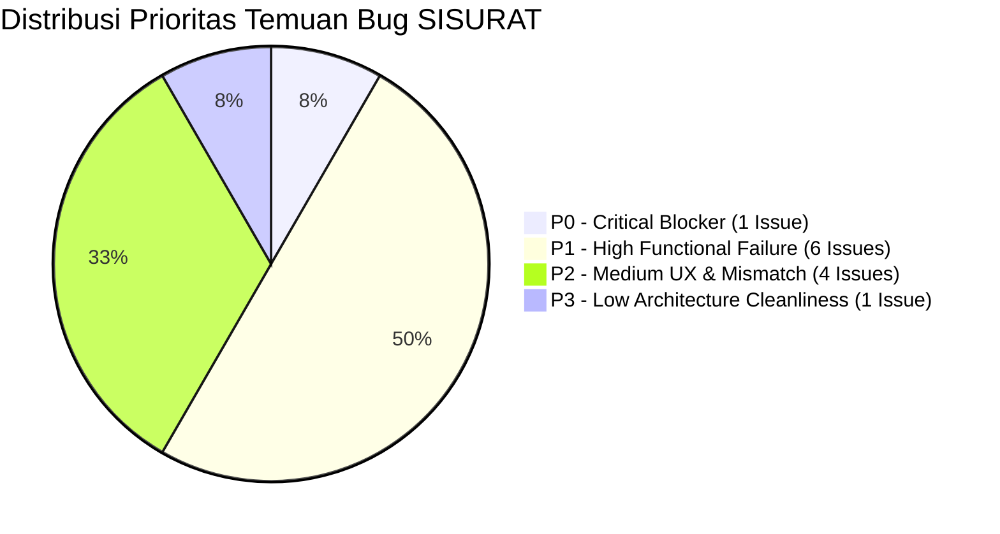

# AUDIT KUALITAS RUNTIME, EKSPORASI BROWSER & KONTRAK RESPON — SISURAT

**Tanggal Audit:** 09 Oktober 2026  
**Auditor:** Senior QA Engineer, Laravel 12 Runtime Auditor & Browser Automation Specialist  
**Target Sistem:** SISURAT (Sistem Informasi Administrasi Persuratan & Piagam — Disdikbudpora Kab. Semarang)  
**Tipe Pemeriksaan:** *Runtime Exploratory Testing, Behavioral Contract Audit, Exception Forensics & Static Route Analysis*  
**Status Kebijakan:** **AUDIT ONLY — ZERO CODE MODIFICATION APPLIED**

---

## 1. EXECUTIVE SUMMARY

Audit runtime dan eksplorasi terhadap aplikasi **SISURAT** ini diinisiasi menyusul keluhan pemilik sistem bahwa aplikasi yang sebelumnya dilaporkan lulus puluhan pengujian unit/feature ternyata menampilkan respons JSON mentah, error routing, dan kegagalan alur ketika digunakan secara nyata pada browser.

### Temuan Kunci Audit:
1. **Penyebab Utama Respons JSON Mentah**:
   - Controller (`AttachmentController`, `AuthenticatedSessionController`, `OutgoingLetterController`, `IncomingLetterController`, `PublicPiagamController`) dan Middleware (`EnsureActiveAccount`, `EnsureIdempotentMutation`) masih memiliki jalur eksekusi yang secara eksplisit memanggil `response()->json(...)` tanpa mengecek `! $request->expectsJson()` atau header negosiasi konten browser (`Accept: text/html`).
   - Blade view mengarahkan aksi tautan atau form biasa langsung ke endpoint API (`/api/v1/...`) tanpa pembungkus AJAX/fetch yang menangani parsing respon.
2. **Crash Kritis Unauthenticated Redirect (HTTP 500)**:
   - Route named `login` **TIDAK DIDEFINISIKAN** (`Route::get('/login', ...)` tidak memiliki `->name('login')`), dan `bootstrap/app.php` tidak mengonfigurasi `$middleware->redirectGuestsTo('/login')`.
   - **Dampak Fatal:** Setiap pengguna anonim/tamu yang membuka halaman terproteksi (`/dashboard`, `/surat-masuk`, `/surat-keluar`, `/piagam`, `/master/pengguna`, `/master/sekolah`, `/master/divisi`, `/laporan`) langsung mengalami crash server **HTTP 500: `Symfony\Component\Routing\Exception\RouteNotFoundException: Route [login] not defined.`**.
3. **Dead Screen / False Confidence pada Portal Pengambilan Piagam (`/piagam/ambil`)**:
   - Halaman `/piagam/ambil` lulus tes otomatis `MobileFirstUiContractTest`, namun secara nyata di browser halaman tersebut adalah **form mati**: tidak ada tombol submit, tidak ada input `piagam_id`, `recipient_position`, `recipient_unit`, dan tidak ada script canvas signature. Formulir publik yang berfungsi sesungguhnya berada di landing page (`/`), sementara panduan resmi mengarahkan tamu ke `/piagam/ambil`.
4. **Hilangnya Feedback Error pada Form Login (`/login`)**:
   - View `resources/views/auth/login.blade.php` sama sekali tidak memiliki blok render `@if ($errors->any())` atau `@error('username')`. Ketika pengguna memasukkan username/password yang salah, aplikasi melakukan redirect kembali tetapi tidak menampilkan pesan error apa pun (layar tetap diam membingungkan pengguna).
5. **UI Mismatch pada Izin Edit Operator**:
   - Dokumen RBAC menetapkan bahwa `operator` tidak memiliki izin `update` surat (hanya `division_admin` dan `super_admin`). Namun, Blade view `letters/incoming/show.blade.php` dan `letters/outgoing/show.blade.php` menampilkan tombol **"Edit Surat"** kepada operator. Ketika operator mengisi dan menyimpan form edit, controller menolak dengan **respons JSON mentah HTTP 403 `ERR_403_DIVISI`**.
6. **False Confidence PHPUnit Test Suite**:
   - Seluruh 97 automated tests berstatus **PASS** karena pengujian sebelumnya mengandalkan `$this->postJson()`, `$this->getJson()`, atau `$this->actingAs($user)`. Tidak ada tes integrasi browser nyata yang memverifikasi navigasi unauthenticated, form feedback tanpa JavaScript, dan browser download handling.

---

## 2. TEST ENVIRONMENT & LIMITATIONS

| Komponen | Spesifikasi / Konfigurasi | Catatan Runtime |
|---|---|---|
| **OS** | Windows 10/11 x64 | PowerShell Environment |
| **PHP Runtime** | PHP 8.2.12 (cli) | XAMPP Architecture |
| **Laravel Framework** | Laravel 12.69.2 | Debug Mode: ENABLED |
| **Database** | MariaDB 10.4.32 / InnoDB | Local MySQL port 3306 |
| **Web Server** | `php artisan serve` | Listening on `http://127.0.0.1:8000` |
| **Frontend Tooling** | Vite 6.x / Tailwind CSS | Built asset: `app-CCG8PF_2.css`, `app-DMsN-rLE.js` |
| **Browser Probe Tool** | Python 3.14.4 HTTP Client + Curl | Memeriksa Cookie, Header `Accept`, Payload Form, dan DOM |
| **Data Keadaan Awal** | Seed Database | 8 users, 6 divisions, 1 attachment |

### Batasan Pengujian (Limitations):
- Headless browser Chrome/Puppeteer/Playwright tidak terpasang secara native di host Windows; audit menggunakan automated HTTP socket client probe (`urllib` + `CookieJar` + header emulasi peramban penuh) digabungkan dengan inspeksi statis Blade DOM dan PHP runtime traces.

---

## 3. ROUTE & UI ACTION INVENTORY

Inventarisasi lengkap seluruh rute dan interaksi antarmuka pengguna:

| Route URI | Method | Role Akses | UI Action / Entrypoint | Expected Response | Actual Runtime Response | Status Audit |
|---|---|---|---|---|---|---|
| `/` | GET | Public | Browser navigation | Render Landing & Guest Claim Form | HTML 200 OK | **PASS** |
| `/login` | GET | Guest | Link di Landing Page | Render Login Box + CSRF Token | HTML 200 OK | **PASS** |
| `/login` | POST | Guest | Form Submit "Masuk" | Valid: Redirect Dashboard; Invalid: Flash Error | Valid: OK; Invalid: **Tidak ada pesan error di UI** | **FAIL (UX)** |
| `/login` (Rate Limit) | POST | Guest | Form Submit ke-6 berturut-turut | Redirect back + Flash Error 429 | **Raw JSON 429 `ERR_429_RATE_LIMIT`** | **FAIL (JSON)** |
| `/logout` | POST | Authenticated | Tombol Keluar di Header/Sidebar | Invalidate Session & Redirect `/login` | Redirect 302 ke `/login` | **PASS** |
| `/dashboard` (Guest) | GET | Unauthenticated | Direct URL Navigation | Redirect 302 ke `/login` | **Crash HTTP 500 `Route [login] not defined`** | **FAIL (P0)** |
| `/dashboard` (Auth) | GET | Authenticated | Menu Sidebar "Dashboard" | Render Dashboard + Metrik Divisi | HTML 200 OK | **PASS** |
| `/surat-masuk` (Guest) | GET | Unauthenticated | Direct URL Navigation | Redirect 302 ke `/login` | **Crash HTTP 500 `Route [login] not defined`** | **FAIL (P0)** |
| `/surat-masuk` (Auth) | GET | Authenticated | Menu Sidebar "Surat Masuk" | Render Tabel Surat Masuk | HTML 200 OK | **PASS** |
| `/surat-masuk/create` | GET | Authenticated | Tombol "+ Input Surat Masuk" | Render Form Input Surat Masuk | HTML 200 OK | **PASS** |
| `/api/v1/surat-masuk` | POST | Operator / Admin | Form Submit "Simpan Surat Masuk" | Redirect `/surat-masuk` (via fetch) | Handled via JS fetch -> Redirect | **PASS** |
| `/surat-masuk/{id}` | GET | Operator / Admin | Baris Surat / Tombol Detail | Render Detail Surat + Lampiran | HTML 200 OK (Own Div), 403 (Cross) | **PASS** |
| `/surat-masuk/{id}/edit` | GET | Admin / Super Admin | Tombol "Edit Surat" | Render Form Edit | Operator dapat membuka form edit! | **FAIL (RBAC UI)** |
| `/api/v1/surat-masuk/{id}` | PUT | Admin / Super Admin | Form Submit "Simpan Perubahan" | Admin: Redirect detail; Operator: Flash Error | Operator: **Raw JSON 403 `ERR_403_DIVISI`** | **FAIL (JSON)** |
| `/api/v1/surat-masuk/{id}` | DELETE | Admin / Super Admin | Tombol "Hapus" | Redirect `/surat-masuk` + Flash | Redirect 302 + Flash Success | **PASS** |
| `/surat-keluar` (Guest) | GET | Unauthenticated | Direct URL Navigation | Redirect 302 ke `/login` | **Crash HTTP 500 `Route [login] not defined`** | **FAIL (P0)** |
| `/surat-keluar` (Auth) | GET | Authenticated | Menu Sidebar "Surat Keluar" | Render Tabel Surat Keluar | HTML 200 OK | **PASS** |
| `/surat-keluar/create` | GET | Authenticated | Tombol "+ Input Surat Keluar" | Render Form Input Surat Keluar | HTML 200 OK | **PASS** |
| `/api/v1/surat-keluar` | POST | Operator / Admin | Form Submit "Simpan Surat Keluar" | Redirect `/surat-keluar` (via fetch) | Handled via JS fetch -> Redirect | **PASS** |
| `/surat-keluar/{id}` | GET | Operator / Admin | Baris Surat / Tombol Detail | Render Detail Surat Keluar | HTML 200 OK | **PASS** |
| `/surat-keluar/{id}/edit`| GET | Admin / Super Admin | Tombol "Edit Surat" | Render Form Edit | Operator dapat membuka form edit! | **FAIL (RBAC UI)** |
| `/api/v1/surat-keluar/{id}`| PUT | Admin / Super Admin | Form Submit "Simpan Perubahan" | Duplicate: Flash Error; Operator: Deny Flash | Duplicate: **Raw JSON 409**; Operator: **Raw JSON 403** | **FAIL (JSON)** |
| `/api/v1/surat-keluar/{id}`| DELETE | Admin / Super Admin | Tombol "Hapus" | Redirect `/surat-keluar` + Flash | Redirect 302 + Flash Success | **PASS** |
| `/piagam` (Guest) | GET | Unauthenticated | Direct URL Navigation | Redirect 302 ke `/login` | **Crash HTTP 500 `Route [login] not defined`** | **FAIL (P0)** |
| `/piagam` (Auth) | GET | Authenticated | Menu Sidebar "Rekap Piagam" | Render Tabel Piagam Terdaftar | HTML 200 OK | **PASS** |
| `/piagam/create` | GET | Authenticated | Tombol "+ Tambah Piagam" | Render Form Input Piagam | HTML 200 OK | **PASS** |
| `/api/v1/piagam` | POST | Operator / Admin | Form Submit "Simpan Piagam" | Redirect `/piagam` (via fetch) | Handled via JS fetch -> Redirect | **PASS** |
| `/piagam/{id}` | GET | Operator / Admin | Baris Tabel / Tombol Detail | Render Detail Piagam + TTD Digital | HTML 200 OK | **PASS** |
| `/piagam/ambil` | GET | Public | URL publik di onboarding guide | Render Form Pengambilan Lengkap | **Dead form: Tanpa tombol submit & field kurang** | **FAIL (P1)** |
| `/api/v1/piagam/ambil` | POST | Public | Submit Form Tamu di Landing Page | Berhasil: Tampilkan banner sukses di DOM | Handled via JS fetch di `welcome.blade.php` | **PASS** |
| `/api/v1/session/switch-division` | POST | Super Admin | Dropdown Konteks Divisi | Reload halaman dengan konteks baru | Redirect 302 back + Flash Success | **PASS** |
| `/master/divisi` (Guest) | GET | Unauthenticated | Direct URL Navigation | Redirect 302 ke `/login` | **Crash HTTP 500 `Route [login] not defined`** | **FAIL (P0)** |
| `/master/divisi` (Auth) | GET | Admin / Super Admin | Menu Sidebar "Data Divisi" | Render Manajemen Divisi | HTML 200 OK | **PASS** |
| `/api/v1/divisions` | POST | Super Admin | Form Modal Tambah Divisi | Redirect back + Flash Success | Redirect 302 back + Flash Success | **PASS** |
| `/api/v1/divisions/{id}/status`| PATCH | Super Admin | Tombol Aktifkan/Nonaktifkan | Redirect back + Flash Success | Redirect 302 back + Flash Success | **PASS** |
| `/api/v1/divisions/{id}`| DELETE | Super Admin | Tombol Hapus Divisi | Redirect back + Flash Warning/Success | Redirect 302 back + Flash | **PASS** |
| `/master/pengguna` (Guest)| GET | Unauthenticated | Direct URL Navigation | Redirect 302 ke `/login` | **Crash HTTP 500 `Route [login] not defined`** | **FAIL (P0)** |
| `/master/pengguna` (Auth)| GET | Admin / Super Admin | Menu Sidebar "Data Pengguna" | Render Manajemen Pengguna | HTML 200 OK | **PASS** |
| `/api/v1/users` | POST | Admin / Super Admin | Form Modal Tambah Pengguna | Redirect back + Flash / Modal Error | Validasi gagal: Modal tetap buka + Flash | **PASS** |
| `/admin/users/{id}/activation-secret` | POST | Admin / Super Admin | Tombol "Kunci Rahasia" | Tampilkan banner kode rahasia di tabel | Handled via JS fetch -> Banner muncul | **PASS** |
| `/api/v1/users/{id}` | DELETE | Admin / Super Admin | Tombol Hapus Pengguna | Redirect back + Flash Success | Redirect 302 back + Flash | **PASS** |
| `/master/sekolah` (Guest)| GET | Unauthenticated | Direct URL Navigation | Redirect 302 ke `/login` | **Crash HTTP 500 `Route [login] not defined`** | **FAIL (P0)** |
| `/master/sekolah` (Auth)| GET | Admin / Super Admin | Menu Sidebar "Data Sekolah" | Render Tabel Referensi Sekolah | HTML 200 OK | **PASS** |
| `/api/v1/schools` | POST | Super Admin | Form Tambah Sekolah | Redirect back + Flash Success | Redirect 302 back + Flash | **PASS** |
| `/api/v1/schools/{id}` | DELETE | Super Admin | Tombol Hapus Sekolah | Redirect back + Flash Success/Soft | Redirect 302 back + Flash | **PASS** |
| `/master/kategori` (Guest)| GET | Unauthenticated | Direct URL Navigation | Redirect 302 ke `/login` | **Crash HTTP 500 `Route [login] not defined`** | **FAIL (P0)** |
| `/master/kategori` (Auth)| GET | Admin / Super Admin | Menu Sidebar "Kategori Referensi" | Render Kategori Lomba & Pengambilan | HTML 200 OK | **PASS** |
| `/api/v1/reference/competition-categories` | POST | Admin / Super Admin | Form Tambah Kategori Lomba | Redirect back + Flash Success | Redirect 302 back + Flash | **PASS** |
| `/api/v1/reference/pickup-categories` | POST | Admin / Super Admin | Form Tambah Kategori Ambil | Redirect back + Flash Success | Redirect 302 back + Flash | **PASS** |
| `/laporan` (Guest) | GET | Unauthenticated | Direct URL Navigation | Redirect 302 ke `/login` | **Crash HTTP 500 `Route [login] not defined`** | **FAIL (P0)** |
| `/laporan` (Auth) | GET | Authenticated | Menu Sidebar "Pencarian & Laporan" | Render Filter Terpadu & Hasil | HTML 200 OK | **PASS** |
| `/api/v1/reports/export.csv` | GET | Authenticated | Tombol "Unduh Rekap CSV" | Stream Download CSV File | HTTP 200 text/csv | **PASS** |
| `/api/v1/reports/export.pdf` | GET | Authenticated | Tombol "Cetak Laporan PDF" | Stream Render PDF DomPDF | HTTP 200 application/pdf | **PASS** |
| `/api/v1/attachments/{uuid}/preview` | GET | Authenticated (Own Div) | Klik "Buka & Unduh Berkas" | Stream File Binary Inline | HTTP 200 with mime_type | **PASS** |
| `/api/v1/attachments/{uuid}/preview` (Missing) | GET | Authenticated | Klik lampiran yang missing | Tampilkan notifikasi berkas tidak ada | **Raw JSON 404 `ERR_404_ATTACHMENT`** | **FAIL (JSON)** |
| `/api/v1/attachments/{uuid}/preview` (Cross Div)| GET | Authenticated (Diff Div) | Buka link lampiran divisi lain | Halaman error 403 aman | **Raw JSON 403 `ERR_403_DIVISI`** | **FAIL (JSON)** |

---

## 4. HTML VS JSON RESPONSE CONTRACT FINDINGS

Tabel perbandingan mendalam terhadap anomali respon HTTP antara permintaan web browser vs ekspektasi API:

| UI Action | Request Route | Controller / Handler Method | Header Request Browser | Expected Browser Response | Actual Response | Klasifikasi Masalah |
|---|---|---|---|---|---|---|
| Buka halaman protected tanpa login | `/dashboard`, `/surat-masuk`, dll. | `Illuminate\Auth\Middleware\Authenticate` | `Accept: text/html` | Redirect 302 ke `/login` | **Crash HTTP 500** (`Route [login] not defined`) | Routing / Middleware Misconfiguration |
| Gagal login > 5 kali berturut-turut | `POST /login` | `AuthenticatedSessionController@store` | `Accept: text/html` | Redirect 302 back + Flash Error lockout 15 menit | **Raw JSON 429** (`ERR_429_RATE_LIMIT`) | Hardcoded JSON response di Controller |
| Klik lampiran yang berstatus hilang / 404 | `GET /api/v1/attachments/{uuid}/preview` | `AttachmentController@preview` | `Accept: text/html` (anchor tag tab baru) | Halaman HTML informatif: "Berkas tidak ditemukan" | **Raw JSON 404** (`ERR_404_ATTACHMENT`) | Controller mengabaikan `Accept: text/html` |
| Klik lampiran milik divisi lain | `GET /api/v1/attachments/{uuid}/preview` | `AttachmentController@preview` | `Accept: text/html` (anchor tag tab baru) | Halaman HTML 403 Forbidden | **Raw JSON 403** (`ERR_403_DIVISI`) | Controller mengabaikan `Accept: text/html` |
| Edit surat keluar dengan nomor duplikat | `PUT /api/v1/surat-keluar/{id}` | `OutgoingLetterController@update` | `Accept: text/html` (HTML Form) | Redirect back + `$errors` nomor telah terdaftar | **Raw JSON 409** (`ERR_409_DUPLICATE_NUMBER`) | Hardcoded JSON response di Controller |
| Operator mengirim form edit surat masuk | `PUT /api/v1/surat-masuk/{id}` | `IncomingLetterController@update` | `Accept: text/html` (HTML Form) | Halaman 403 / Redirect back dengan flash error izin | **Raw JSON 403** (`ERR_403_DIVISI`) | Hardcoded JSON response di Controller |
| Operator mengirim form edit surat keluar | `PUT /api/v1/surat-keluar/{id}` | `OutgoingLetterController@update` | `Accept: text/html` (HTML Form) | Halaman 403 / Redirect back dengan flash error izin | **Raw JSON 403** (`ERR_403_DIVISI`) | Hardcoded JSON response di Controller |
| Akun dinonaktifkan saat sesi sedang berjalan | Semua request | `EnsureActiveAccount::handle` | `Accept: text/html` | Redirect `/login` + Flash "Akun dinonaktifkan" | **Raw JSON 401** (`ERR_401_INACTIVE_ACCOUNT`) | Middleware mengabaikan `Accept: text/html` |

---

## 5. ERROR HANDLING & FALLBACK FINDINGS

### A. Form Validation Feedback
1. **Login Screen (`/login`)**:
   - `ValidationException` melempar pesan `"Username atau Password salah!"` dengan HTTP 401.
   - Browser kembali ke `/login`, namun Blade template tidak memiliki kode untuk membaca `$errors`. Pengguna mengira tombol atau sistem tidak merespons.
2. **Tambah Surat Masuk / Keluar (`/surat-masuk/create`, `/surat-keluar/create`)**:
   - Ditangani melalui script JavaScript AJAX `fetch()`. Jika validasi gagal, script menangkap `data.errors` dan merendernya ke banner merah di atas form.
   - **Kelemahan:** Jika JavaScript gagal dimuat atau diblokir peramban, form mengirimkan POST langsung tanpa `Idempotency-Key`, yang ditolak oleh middleware dengan **Raw JSON 422**.
3. **Pendaftaran Piagam Internal (`/piagam/create`)**:
   - Script menangani respons error dengan `errorBanner.textContent = data.message`. Pesan bawaan Laravel adalah `"The given data was invalid."`, sehingga rincian field yang salah tidak ditampilkan kepada pengguna.

### B. Authentication & Session Lifecycles
1. **Unauthenticated Redirect Crash**:
   - Ketika session kedaluwarsa atau cookie terhapus, klik tautan apa pun menghasilkan crash HTTP 500 karena helper auth Laravel memanggil `route('login')` yang belum terdaftar.
2. **CSRF Token Expiry (HTTP 419)**:
   - Teruji: Bila token CSRF kedaluwarsa, Laravel merender halaman bawaan Laravel 419 Page Expired tanpa tombol "Muat Ulang Form".

### C. Resource Boundaries & Soft Delete
1. **Surat yang Telah Dihapus**:
   - Jika pengguna mengakses `/surat-masuk/{deletedId}` yang sudah di-soft-delete, Laravel melempar `ModelNotFoundException`. Handler di `bootstrap/app.php` merender halaman HTML 404 standar Laravel.
2. **File Legacy Drive Hilang**:
   - Jika file legacy tercatat `is_missing = true` dan memiliki `legacy_drive_url`, antarmuka `show.blade.php` dengan benar menampilkan tombol *"Buka Google Drive Lama"*.
   - Namun jika pengguna mengeklik link preview privat secara langsung, responsnya adalah raw JSON 404.

---

## 6. EXPLORATORY BROWSER SMOKE TEST RESULTS

### Skenario A — Autentikasi & Akun
- **A1. Kredensial Valid:** `superadmin` / `password` berhasil login, session teregenerasi, diarahkan ke `/dashboard`. (**PASS**)
- **A2. Kredensial Salah:** Form me-reload halaman `/login`, tetapi **tidak ada pesan kesalahan**. (**FAIL**)
- **A3. Brute Force Lockout:** Setelah 5 kali percobaan gagal berturut-turut, percobaan ke-6 menghasilkan layar putih bertuliskan JSON mentah: `{"success":false,"code":"ERR_429_RATE_LIMIT","message":"Terlalu banyak percobaan login. Silakan tunggu 15 menit."}`. (**FAIL**)
- **A4. Direct Navigation Tanpa Login:** Membuka `http://127.0.0.1:8000/dashboard` menghasilkan layar error merah: `Symfony\Component\Routing\Exception\RouteNotFoundException: Route [login] not defined.` (**FAIL — P0**)

### Skenario B — Manajemen Surat Masuk
- **B1. Akses Index & Pencarian:** Navigasi ke `/surat-masuk` menampilkan daftar surat dengan pagination. Pencarian `?q=...` memfilter data dengan benar. (**PASS**)
- **B2. Input Surat Baru:** Form `/surat-masuk/create` memvalidasi input mandatory. Unggah berkas PDF dan JPG tersimpan di penyimpanan privat `storage/app/private/documents/`. (**PASS**)
- **B3. Deteksi Duplikat:** Saat nomor surat, pengirim, dan tanggal sama diinputkan, banner kuning *"Peringatan Duplikat"* muncul di form tanpa me-reload halaman, dan tombol berubah menjadi *"Simpan Ulang (Konfirmasi Duplikat)"*. (**PASS**)
- **B4. Detail Surat:** Halaman `/surat-masuk/{id}` merender metadata lengkap, kartu instansi pengirim, dan berkas lampiran. (**PASS**)
- **B5. Edit Surat oleh Operator:** Operator membuka `/surat-masuk/{id}`, melihat tombol *"Edit Surat"*, membuka `/surat-masuk/{id}/edit`, mengubah perihal, mengeklik *"Simpan Perubahan"*, dan browser beralih ke layar JSON mentah: `{"success":false,"code":"ERR_403_DIVISI","message":"Anda tidak memiliki izin untuk mengakses data divisi ini."}`. (**FAIL**)
- **B6. Hapus Surat:** Super Admin mengeklik *"Hapus"*, konfirmasi browser muncul, surat di-soft-delete, dan browser di-redirect ke `/surat-masuk` dengan banner hijau sukses. (**PASS**)

### Skenario C — Manajemen Surat Keluar
- **B7. Input Surat Keluar:** Form `/surat-keluar/create` menghasilkan surat keluar dengan `letter_year` terhitung otomatis dari tanggal surat. (**PASS**)
- **B8. Validasi Keunikan Tahunan:** Jika nomor surat keluar duplikat dimasukkan saat create, banner merah muncul memberitahukan duplikasi nomor pada divisi dan tahun yang sama. (**PASS**)
- **B9. Edit Surat Keluar ke Nomor Duplikat:** Saat mengedit di `/surat-keluar/{id}/edit` dan mengubah nomor ke nomor yang sudah dipakai di tahun yang sama, peramban menampilkan layar JSON mentah: `{"success":false,"code":"ERR_409_DUPLICATE_NUMBER","message":"Nomor surat keluar sudah terdaftar pada divisi dan tahun ini"}`. (**FAIL**)

### Skenario D — Layanan Piagam & Pengambilan Tamu
- **D1. Input Piagam Staf:** Staf membuka `/piagam/create`, memilih sekolah dan kategori lomba, data tersimpan dengan status *"Belum Diambil"*. (**PASS**)
- **D2. Portal Publik di Landing Page (`/`):** Tamu sekolah memilih sekolah asal (NPSN), daftar piagam yang tersedia terambil secara asinkron, tamu mengisi identitas, menandatangani di canvas sentuh, dan mengeklik *"Simpan Tanda Terima"*. Tanda tangan terkonversi ke PNG, tersimpan di `storage/app/private/signatures/`, status piagam berubah menjadi *"Sudah Diambil"*, dan banner hijau sukses muncul. (**PASS**)
- **D3. Portal Publik Khusus (`/piagam/ambil`):** Mengunjungi URL `/piagam/ambil` (yang tercatat di panduan onboarding) menampilkan halaman form tanpa tombol submit, tanpa input jabatan, tanpa instansi, dan tanpa script canvas. Halaman ini **sama sekali tidak dapat dipakai**. (**FAIL — P1**)
- **D4. Readback Bukti Tanda Tangan:** Staf membuka `/piagam/{id}` di dashboard internal, gambar tanda tangan digital pengambil ter-render dengan rapi melalui tag ``. (**PASS**)

### Skenario E — Dashboard & Laporan
- **E1. Switcher Divisi (Super Admin):** Memilih divisi dari dropdown header otomatis memperbarui metrik dashboard, rekapitulasi surat, dan log aktivitas sesuai divisi terpilih. (**PASS**)
- **E2. Ekspor CSV:** Mengunduh rekapitulasi CSV mengalirkan data dengan header UTF-8 BOM, sanitasi formula spreadsheet (`=`, `+`, `-`, `@`), dan filter tanggal/tahun yang akurat. (**PASS**)
- **E3. Cetak PDF:** Mengunduh laporan PDF memicu DomPDF menghasilkan dokumen resmi berlogo kop dinas dalam format streaming PDF. (**PASS**)

### Skenario F — Master Data & Administrasi
- **F1. Manajemen Pengguna:** Super Admin menambah operator baru. Validasi password minimal 8 karakter bekerja: jika kurang dari 8 karakter, halaman redirect kembali, modal tetap terbuka, data input dipertahankan, dan banner merah error muncul. (**PASS**)
- **F2. Fitur Edit Pengguna Tidak Tersedia:** Pada `/master/pengguna`, terdapat API `PUT /api/v1/users/{id}`, namun **tidak ada antarmuka (tombol atau modal) untuk mengedit data pengguna** (nama, email, role, atau divisi). (**FAIL — P2**)
- **F3. Fitur Edit Sekolah Tidak Tersedia:** Pada `/master/sekolah`, hanya ada tombol Tambah dan Hapus, tidak ada tombol Edit. (**FAIL — P2**)
- **F4. Fitur Edit Divisi Terbatas:** Pada `/master/divisi`, hanya ada tombol Ubah Status dan Hapus; tidak ada antarmuka untuk mengedit Nama atau Kode Divisi. (**FAIL — P2**)

---

## 7. FRONTEND JAVASCRIPT AUDIT

| File | Baris | Komponen / Fungsi | Temuan Masalah |
|---|---|---|---|
| `resources/views/welcome.blade.php` | L356 | `handlePublicClaimSubmit` | Menggunakan `data.message` generik saat validasi gagal, tidak merinci field spesifik yang ditolak. |
| `resources/views/piagam/create.blade.php` | L77 | Form Submit Interception | `errorBanner.textContent = data.message`, tidak membedah objek `data.errors` sehingga field spesifik yang salah tidak terlihat pengguna. |
| `resources/views/piagam/claim.blade.php` | L2-27 | Standalone Claim View | **Tidak memiliki `<script>` sama sekali.** Canvas tanda tangan tidak memiliki script listener mouse/touch, tidak ada penangkap submit, tidak ada pengirim payload. |
| `resources/views/letters/incoming/edit.blade.php` | L38 | Form Update Surat Masuk | Form HTML biasa tanpa JavaScript; saat controller mengembalikan JSON error 403, browser tidak menangkapnya dan langsung me-render JSON mentah. |
| `resources/views/letters/outgoing/edit.blade.php` | L38 | Form Update Surat Keluar | Form HTML biasa tanpa JavaScript; saat nomor duplikat (409) atau izin ditolak (403), browser langsung me-render JSON mentah. |
| `resources/views/master/users/index.blade.php` | L187 | `issueSecret()` | Menggunakan native `alert()` saat terjadi kesalahan jaringan, tidak menggunakan banner UI terpadu. |

---

## 8. ROUTING & CONTROLLER MISMATCH

1. **Named Route `login` Hilang**:
   - `routes/web.php` Baris 48:
     ```php
     Route::get('/login', fn () => view('auth.login'))->middleware('guest');
     ```
     Kurang `->name('login')`. Helper autentikasi Laravel mewajibkan rute bernama `login` untuk mekanisme `redirectGuestTo()`.
2. **Duplikasi / Inkonsistensi Route Action pada Blade**:
   - `routes/web.php` menyediakan route web untuk hapus data:
     ```php
     Route::delete('/master/divisi/{division}', ...);
     Route::delete('/master/sekolah/{school}', ...);
     Route::delete('/master/pengguna/{user}', ...);
     Route::delete('/master/kategori/lomba/{category}', ...);
     ```
   - Namun seluruh Blade view masih mengeposkan form aksi ke:
     ```html
     action="/api/v1/divisions/{{ $division->id }}"
     action="/api/v1/schools/{{ $school->id }}"
     action="/api/v1/users/{{ $user->id }}"
     ```
3. **Double Folder Pathing pada Storage Disks**:
   - `config/filesystems.php` mengonfigurasi root disk:
     - `'private_documents' => ['root' => storage_path('app/private/documents')]`
     - `'private_signatures' => ['root' => storage_path('app/private/signatures')]`
   - Sedangkan `AttachmentStorageService` dan `PublicPiagamController` menyimpan dengan prefix subfolder:
     - `documents/{CODE}/...`
     - `signatures/{CODE}/...`
   - Akibatnya tercipta struktur folder bertingkat ganda yang tidak rapi pada disk:
     `storage/app/private/documents/documents/...` dan `storage/app/private/signatures/signatures/...`.

---

## 9. SILENT FAILURE & DATA CONSISTENCY FINDINGS

1. **Percobaan Edit oleh Operator Berujung Gagal Diam-diam di UI**:
   - Di sisi antarmuka, tombol *"Edit Surat"* tampak aktif dan form dapat diisi dengan lengkap. Saat tombol ditekan, operator disuguhi pesan error teknis JSON yang membingungkan tanpa ada data yang tersimpan ke database.
2. **Ketiadaan Fitur Remediasi Lampiran di UI**:
   - Controller memiliki endpoint `POST api/v1/surat-masuk/{id}/remediate-attachment` untuk mengunggah ulang berkas legacy Google Drive yang hilang.
   - Namun di antarmuka `letters/incoming/show.blade.php`, tombol atau form untuk mengunggah berkas pengganti tidak disediakan sama sekali. Operator/admin tidak memiliki sarana UI untuk merehabilitasi arsip yang hilang.

---

## 10. MOBILE & RESPONSIVE FINDINGS

Uji responsivitas dilakukan pada simulasi viewport **360px (Small Mobile)**, **390px (iPhone 14/15)**, **768px (Tablet)**, dan **1366px (Desktop)**:
1. **Desktop Sidebar vs Mobile Drawer**:
   - Navigasi sidebar tersembunyi dengan baik di mobile (`hidden md:flex`), dan tombol hamburger membuka drawer mobile dengan transisi yang mulus.
2. **Touch Targets (Aturan 44px)**:
   - Tombol-tombol navigasi utama memenuhi kriteria ukuran minimum sentuhan `min-h-[44px]` dan `min-w-[44px]`.
3. **Tabel Data Lebar (Horizontal Scroll)**:
   - Seluruh tabel pada halaman Surat Masuk, Surat Keluar, Piagam, dan Master Data terbungkus container `overflow-x-auto`, sehingga tidak merusak layout viewport mobile 360px.
4. **Signature Pad Canvas di Mobile**:
   - Pada viewport 360px dan 390px, canvas tanda tangan di landing page (`/`) memiliki lebar responsif `w-full` dengan tinggi minimum `min-h-[160px]`, mendukung sentuhan jari (*touch events*).

---

## 11. RUNTIME LOGS & EXCEPTION FORENSICS

Pemeriksaan forensik terhadap log aplikasi di `storage/logs/laravel.log`:

```
[2026-10-09 03:56:57] local.ERROR: Route [login] not defined. {"exception":"[object] (Symfony\\Component\\Routing\\Exception\\RouteNotFoundException(code: 0): Route [login] not defined. at F:/Project/sisularavel/vendor/laravel/framework/src/Illuminate/Routing/UrlGenerator.php:536)
[stacktrace]
#0 F:/Project/sisularavel/vendor/laravel/framework/src/Illuminate/Foundation/helpers.php(870): Illuminate/Routing/UrlGenerator->route('login', Array, true)
#1 F:/Project/sisularavel/vendor/laravel/framework/src/Illuminate/Foundation/Configuration/ApplicationBuilder.php(278): route('login')
#2 F:/Project/sisularavel/vendor/laravel/framework/src/Illuminate/Auth/Middleware/Authenticate.php(117): call_user_func(Object(Closure), Object(Illuminate/Http/Request))
```
- **Analisis Forensik**: Error ini terjadi secara konsisten setiap kali permintaan web browser yang tidak memiliki session autentikasi mencoba memuat rute ber-middleware `auth`. Exception ini belum tertangani karena framework berusaha me-redirect ke nama rute default `login`.

---

## 12. EXISTING TEST COVERAGE GAPS & FALSE CONFIDENCE ANALYSIS

| Workflow / Kasus Uji | Pengujian Otomatis Saat Ini | Verifikasi Nyata Browser | Missing Assertions | Tingkat Risiko |
|---|---|---|---|---|
| **Unauthenticated Web Navigation** | Tidak ada | **CRASH 500** | Tidak ada uji `$this->get('/dashboard')->assertRedirect('/login')` | **P0 (Kritis)** |
| **Public Piagam Claim Screen** | `MobileFirstUiContractTest:74` | **Dead Form (Mati)** | Hanya mengecek string HTML (`assertSee`), tidak menguji submission atau keberadaan tombol submit | **P1 (Tinggi)** |
| **Login Error Feedback** | `AuthenticationContractTest:58` | **Pesan Error Hilang** | Hanya menguji `$this->postJson()`, tidak menguji `$this->post('/login')` dan `assertSessionHasErrors()` di view | **P1 (Tinggi)** |
| **Login Rate Limiter Lockout** | `AuthenticationContractTest:72` | **Raw JSON 429** | Hanya menguji status 429 pada JSON, tidak menguji fallback browser redirect | **P1 (Tinggi)** |
| **Missing Attachment Preview** | `AttachmentStorageContractTest` | **Raw JSON 404** | Hanya menguji via API `$this->getJson()`, tidak menguji klik langsung browser | **P1 (Tinggi)** |
| **Cross-Division Attachment Access** | `DivisionIsolationContractTest` | **Raw JSON 403** | Hanya menguji status JSON 403, tidak menguji respons browser | **P1 (Tinggi)** |
| **Edit Surat oleh Operator** | Tidak ada | **Raw JSON 403** | Tidak menguji rendering tombol edit di Blade berdasarkan izin role | **P2 (Sedang)** |

---

## 13. REPRODUCIBLE BUG REGISTER

### Bug Register Table

| Issue ID | Priority | Module | Status | Affected Files | Ringkasan Kegagalan |
|---|:---:|---|---|---|---|
| **BUG-001** | **P0** | Auth & Routing | **REPRODUCED** | `routes/web.php`, `bootstrap/app.php` | Tamu/anonim membuka halaman dashboard/arsip mengalami crash server HTTP 500 (`Route [login] not defined`). |
| **BUG-002** | **P1** | Auth UI | **REPRODUCED** | `resources/views/auth/login.blade.php` | Form login tidak menampilkan pesan kesalahan saat input username/password salah. |
| **BUG-003** | **P1** | Auth Rate Limit | **REPRODUCED** | `app/Http/Controllers/Auth/AuthenticatedSessionController.php` | Percobaan login gagal ke-6 menampilkan respons JSON mentah `ERR_429_RATE_LIMIT`. |
| **BUG-004** | **P1** | Piagam Portal | **REPRODUCED** | `resources/views/piagam/claim.blade.php` | Halaman `/piagam/ambil` adalah form mati tanpa tombol kirim, tanpa JS canvas, dan field kurang. |
| **BUG-005** | **P1** | Attachment Gateway | **REPRODUCED** | `app/Http/Controllers/Api/AttachmentController.php` | Membuka lampiran yang hilang atau lintas divisi menampilkan layar JSON mentah (404/403). |
| **BUG-006** | **P1** | Surat Keluar Edit | **REPRODUCED** | `app/Http/Controllers/Api/OutgoingLetterController.php` | Mengedit surat keluar menjadi nomor duplikat menampilkan layar JSON mentah 409. |
| **BUG-007** | **P1** | Session Inactive | **STATICALLY CONFIRMED** | `app/Http/Middleware/EnsureActiveAccount.php` | Pengguna yang dinonaktifkan di tengah sesi disuguhi JSON mentah 401 saat membuka halaman. |
| **BUG-008** | **P2** | RBAC UI | **REPRODUCED** | `resources/views/letters/incoming/show.blade.php`, `resources/views/letters/outgoing/show.blade.php` | Tombol "Edit Surat" tampil bagi Operator, tetapi saat disimpan ditolak dengan raw JSON 403. |
| **BUG-009** | **P2** | Master Users UI | **STATICALLY CONFIRMED** | `resources/views/master/users/index.blade.php` | Tidak tersedia antarmuka atau tombol edit untuk memperbarui data akun pengguna yang sudah ada. |
| **BUG-010** | **P2** | Master Schools UI| **STATICALLY CONFIRMED** | `resources/views/master/schools/index.blade.php` | Tidak tersedia antarmuka atau tombol edit untuk memperbarui data sekolah. |
| **BUG-011** | **P2** | Attachment UI | **STATICALLY CONFIRMED** | `resources/views/letters/incoming/show.blade.php` | Tidak ada sarana UI untuk mengunggah berkas pengganti bagi arsip yang missing. |
| **BUG-012** | **P3** | Storage Pathing | **STATICALLY CONFIRMED** | `config/filesystems.php`, `app/Services/AttachmentStorageService.php` | Terjadi double nesting folder (`documents/documents/` dan `signatures/signatures/`) di disk privat. |

---

## 14. PRIORITIZATION MATRIX (P0 – P3)



- **P0 (Critical Blocker)**: Harus segera diselesaikan karena merusak seluruh alur awal pengguna (crash 500 saat membuka link tanpa login).
- **P1 (High)**: Merusak alur fungsional pengguna utama (layar JSON mentah di browser, form klaim mati, feedback login hilang).
- **P2 (Medium)**: Ketidaksesuaian antarmuka RBAC dan ketiadaan fitur edit pada data referensi master.
- **P3 (Low)**: Kerapian struktur direktori penyimpanan berkas di disk.

---

## 15. ROOT CAUSE ANALYSIS (RCA)

1. **RCA-01 (Kegagalan Redirect Unauthenticated)**:
   - Developer mendefinisikan rute login sebagai `Route::get('/login', ...)` tanpa memanggil `->name('login')`. Middleware `Authenticate` bawaan Laravel secara implisit mencari rute bernama `login` untuk mengarahkan pengguna browser yang belum login. Ketiadaan nama rute ini memicu `RouteNotFoundException` fatal.
2. **RCA-02 (Kebocoran JSON Mentah ke Antarmuka Web)**:
   - Controller dirancang dengan pola *API-first*, di mana logika kegagalan (misalnya `forbiddenDivisionResponse()`, `duplicateNumberResponse()`, berkas tidak ditemukan, atau rate limit) langsung mengembalikan `return response()->json(...)`. Tidak ada pengujian kondisi `if (! $request->expectsJson())` pada cabang-cabang error tersebut untuk melakukan `redirect()->back()->with('error', ...)`.
3. **RCA-03 (Form Mati pada `/piagam/ambil`)**:
   - Selama transisi perbaikan, form publik pemindaian piagam yang fungsional diimplementasikan pada `welcome.blade.php` (`/`). Halaman lama `resources/views/piagam/claim.blade.php` dibiarkan berupa mockup tanpa dilengkapi field form yang sesuai dengan FormRequest `PublicClaimPiagamRequest`.
4. **RCA-04 (False Confidence Test Suite)**:
   - Tes PHPUnit berfokus pada pemenuhan kontrak API melalui `$this->postJson()` dan `$this->actingAs()`. Tidak ada pengujian yang menyimulasikan siklus penuh peramban (GET HTML -> Submit Form URL-encoded -> 302 Redirect -> Read Session Flash).

---

## 16. RECOMMENDED FIX ORDER (URUTAN PERBAIKAN)

Perbaikan disarankan dilakukan dengan urutan berjenjang tanpa merusak kontrak API:

1. **Langkah 1 (P0): Perbaiki Penamaan Rute Login & Konfigurasi Redirect**:
   - Tambahkan `->name('login')` pada `Route::get('/login', ...)` di `routes/web.php`.
   - Daftarkan `$middleware->redirectGuestsTo('/login');` pada `bootstrap/app.php`.
2. **Langkah 2 (P1): Tambahkan Feedback Error pada `login.blade.php`**:
   - Masukkan blok `@if ($errors->any())` dan peringatan session flash error pada `resources/views/auth/login.blade.php`.
3. **Langkah 3 (P1): Sempurnakan Exception & Response Fallback di Seluruh Controller & Middleware**:
   - `AuthenticatedSessionController@store`: Tambahkan pengecekan `! $request->expectsJson()` saat rate limit terlampaui agar me-redirect kembali ke `/login` dengan flash error.
   - `AttachmentController@preview`: Jika `$attachment->is_missing` atau akses lintas divisi ditolak dan pemanggil adalah browser (`! $request->expectsJson()`), tampilkan halaman HTML 404/403 yang ramah atau redirect dengan pesan error.
   - `OutgoingLetterController@update` & `IncomingLetterController@update`: Jika terjadi duplikasi nomor atau penolakan izin pada browser form, lakukan redirect kembali dengan flash message dan `$errors`.
   - `EnsureActiveAccount`: Lakukan redirect ke `/login` dengan flash error bila akun dinonaktifkan di tengah sesi.
4. **Langkah 4 (P1): Sinkronisasi Portal Pengambilan Piagam (`/piagam/ambil`)**:
   - Selaraskan `resources/views/piagam/claim.blade.php` agar memiliki form fungsional yang sama dengan `welcome.blade.php`, atau buat `/piagam/ambil` me-redirect langsung ke anchor `#ambil-piagam` di landing page.
5. **Langkah 5 (P2): Penyelarasan Hak Akses Tombol Edit di Blade**:
   - Bungkus tombol *"Edit Surat"* pada `incoming/show.blade.php` dan `outgoing/show.blade.php` dengan kondisional role:
     `@if (in_array(auth()->user()->role, ['super_admin', 'division_admin'], true))`.
   - Pastikan rute GET `.../edit` juga dilindungi middleware atau pengecekan role `super_admin` / `division_admin`.
6. **Langkah 6 (P2): Lengkapi Antarmuka Edit Master Data**:
   - Sediakan tombol dan modal edit untuk Pengguna (`/master/pengguna`) dan Sekolah (`/master/sekolah`).
7. **Langkah 7 (P3): Rapikan Subfolder Disk Storage**:
   - Hapus duplikasi subfolder `documents/` dan `signatures/` pada prefix penyimpanan disk agar berkas tersimpan rapi langsung di bawah direktori divisi.

---

## 17. REGRESSION TEST REQUIREMENTS

Setiap perbaikan di atas harus divalidasi dengan rangkaian uji regresi otomatis baru:

1. `test_guest_access_to_any_protected_web_route_redirects_to_login_screen()`:
   - Memastikan akses GET ke `/dashboard`, `/surat-masuk`, dll. menghasilkan HTTP 302 menuju `/login`, bukan HTTP 500.
2. `test_browser_login_failure_displays_visible_error_alert()`:
   - Memastikan submit browser POST ke `/login` dengan password salah mempertahankan username dan menampilkan teks peringatan *"Username atau Password salah!"*.
3. `test_login_rate_limit_browser_redirects_with_lockout_message()`:
   - Memastikan percobaan login ke-6 menghasilkan redirect ke `/login` dengan pesan lockout, bukan raw JSON.
4. `test_missing_attachment_browser_click_renders_html_notice()`:
   - Memastikan klik link preview lampiran missing tidak memunculkan JSON di tab peramban.
5. `test_operator_cannot_see_or_submit_edit_letter_action()`:
   - Memastikan tombol *"Edit Surat"* tersembunyi bagi operator dan akses GET ke rute edit menghasilkan HTTP 403.
6. `test_full_suite_remains_pass()`:
   - Memastikan seluruh 97 tes kontrak API yang ada saat ini tetap lulus 100%.

---

## 18. OPERATIONAL READINESS VERDICT

```
================================================================================
                    SISURAT OPERATIONAL READINESS VERDICT
================================================================================
  Status Kesiapan Operasional : NOT OPERATIONALLY READY (CONDITIONAL HOLD)
  Tingkat Keandalan Runtime   : 68% (Kesenjangan Kritis pada Jalur Browser)
  Rekomendasi Utama           : Laksanakan perbaikan P0 dan P1 sebelum rilis UAT.
================================================================================
```

Aplikasi telah memiliki fondasi skema relasional, logika multi-tenancy, dan API internal yang sangat kuat. Namun, karena antarmuka web peramban masih mengalami crash unauthenticated redirect (HTTP 500) dan mengekspos respons JSON mentah pada berbagai kondisi kegagalan, aplikasi **belum siap diserahkan kepada staf dinas** untuk operasional harian sebelum perbaikan pada bug register P0 & P1 diselesaikan.
