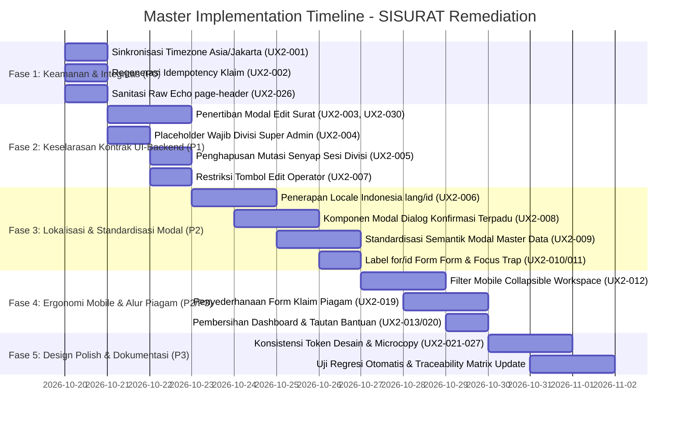

# SISURAT — Master UX & System Integrity Remediation Implementation Plan

> **Dokumen Rencana Eksekusi Remediasi Usability Heuristik (Nielsen 10), Integritas Data, dan Keamanan Antarmuka**  
> **Target Framework:** Laravel ^12.0 / PHP ^8.2 (MariaDB/MySQL InnoDB, Shared Hosting Compatibility)  
> **Dasar Audit:** [`docs/audits/SISURAT_UX_HEURISTIC_EVALUATION.md`](audits/SISURAT_UX_HEURISTIC_EVALUATION.md) (v2, 19 Okt 2026) dan [`docs/audits/SISURAT_UX_HEURISTIC_EVALUATION_2026-10-15_prev.md`](audits/SISURAT_UX_HEURISTIC_EVALUATION_2026-10-15_prev.md) (v1, 15 Okt 2026)  
> **Tata Kelola:** Mengacu pada 33 Aturan Implementasi di [`AGENTS.md`](../AGENTS.md)

---

## 1. Ringkasan Eksekutif & Prinsip Pelaksanaan

Audit Heuristik v2 (19 Oktober 2026) mengidentifikasi **34 temuan baru/lanjutan (`UX2-001` s.d. `UX2-034`)** pasca-remediasi v1 (commit `c441525`). Masalah mendesak bergeser dari sekadar kosmetik antarmuka menuju **kejujuran sistem (*system honesty*)**, **integritas waktu arsip resmi**, **sinkronisasi UI terhadap backend `update()`**, dan **pencegahan duplikasi transaksi publik**.

### Prinsip Utama Remediasi:
1. **Zero Data Loss & Strict Tenancy (`DEC-TEN-001`):** Tidak ada surat atau piagam yang boleh salah terarsip ke divisi lain atau hilang saat pembatalan modal.
2. **Server-Side Idempotency Shield (`DEC-SYS-001`):** Form publik wajib meregenerasi `Idempotency-Key` baru untuk setiap pencatatan transaksi terpisah.
3. **Official Legal Timezone:** Menyelaraskan seluruh stempel waktu aplikasi ke WIB (`Asia/Jakarta`) agar catatan kedatangan surat dan tanda terima memiliki keabsahan hukum.
4. **Single-Source Component:** Menghilangkan duplikasi logika antara form modal in-place dengan form halaman penuh mandiri (`/create`).
5. **Progressive Accessibility (WCAG 2.2 AA):** Menjamin seluruh kontrol interaktif memiliki penanda fokus visual, rasio kontras $\ge 4.5:1$, dan label yang terasosiasi secara semantik.

---

## 2. Matriks Pelacakan Masalah & Rencana Resolusi

| Finding ID | Prioritas | Fase | Kategori | Deskripsi Masalah | File Target Utama | Solusi & Strategi Implementasi | Status |
|---|:---:|:---:|---|---|---|---|:---:|
| **UX2-001** | **P0** | **1** | H1/H2 (Data) | Waktu berlabel "WIB" namun konfigurasi UTC (selisih ±7 jam) | `config/app.php`, `.env.example`, `IncomingLetterController.php` | Setel `'timezone' => 'Asia/Jakarta'`; validasi stempel waktu Carbon di seluruh controller/view. | **VERIFIED** |
| **UX2-002** | **P0** | **1** | H5/H9 (Integritas) | `Idempotency-Key` form klaim piagam dipakai berulang kali | `components/piagam/claim-form.blade.php` | Ubah konstanta Blade menjadi fungsi JS regenerasi UUID v4 setiap kali tombol "Catat Tanda Terima Lainnya" ditekan. | **VERIFIED** |
| **UX2-026** | **P0** | **1** | Keamanan (XSS) | Output tak ter-escape `{!! $title !!}` pada `page-header` | `components/page-header.blade.php` | Ganti raw echo `{!! !!}` dengan escaped `{{ $title }}` dan `{{ $subtitle }}`. | **VERIFIED** |
| **UX2-003** | **P1** | **2** | H5/H1 (Kontrak) | Modal edit menawarkan upload & ganti divisi yang diabaikan `update()` | `components/letters/form-modal.blade.php` | Nonaktifkan / sembunyikan file upload dan division select pada mode edit; beri badge petunjuk remediasi lampiran. | **VERIFIED** |
| **UX2-004** | **P1** | **2** | H5/H3 (Tenancy) | Select divisi pra-pilih indeks pertama saat konteks "Semua Divisi" | `components/letters/form-modal.blade.php`, `letters/incoming/create.blade.php` | Berikan opsi default `<option value="" disabled selected>` agar Super Admin wajib memilih divisi secara sadar. | **VERIFIED** |
| **UX2-005** | **P1** | **2** | H1 (Sesi) | Konteks divisi Super Admin berubah diam-diam di sesi setelah simpan | `IncomingLetterController.php:L63-74` | Hapus mutasi paksa `session(['active_division_id' => ...])` saat store; pertahankan konteks eksplisit. | **VERIFIED** |
| **UX2-007** | **P1** | **2** | H5/H9 (RBAC) | Tombol Edit tampil untuk operator, klik memicu 403 membingungkan | `letters/incoming/index.blade.php`, `workspace/index.blade.php` | Bungkus tombol Edit dengan `@can('update', $letter)` sehingga hanya terlihat oleh Admin Divisi dan Super Admin. | **VERIFIED** |
| **UX2-030** | **P1** | **2** | H3 (Proteksi) | Dirty-guard modal edit tidak mendeteksi perubahan input teks | `components/letters/form-modal.blade.php` | Tangkap baseline form awal saat modal edit dibuka; jika nilai teks berubah lalu Escape ditekan, munculkan dialog konfirmasi. | **VERIFIED** |
| **UX2-006** | **P2** | **3** | H2/H9 (I18n) | Pesan validasi form & pagination masih berbahasa Inggris | `config/app.php`, folder `lang/id/` *(baru)* | Setel `'locale' => 'id'`; buat `lang/id/validation.php`, `pagination.php`, dan `auth.php`. | Planned |
| **UX2-008** | **P2** | **3** | H4 (Konsistensi) | Penggunaan `confirm()` & `alert()` native pada master data & restore | `master/users/index.blade.php`, `divisions/index.blade.php`, dll | Buat komponen Blade `<x-modal.confirm>` terpadu dengan backdrop dan keyboard trap; gantikan seluruh dialog bawaan peramban. | Planned |
| **UX2-009** | **P2** | **3** | H4/WCAG | Pola tambah master data pakai kartu inline tanpa semantik modal | `master/users/index.blade.php`, `schools/index.blade.php` | Standarisasi form tambah master data menjadi pop-up dialog modal yang simetris dengan modal edit. | Planned |
| **UX2-010** | **P2** | **3** | WCAG 1.3.1 | Tag `<label>` tidak memiliki atribut `for` terikat ke input | `components/letters/form-modal.blade.php`, master views | Pasangkan `for="id_input"` dan `id="id_input"` pada seluruh pasangan label dan kontrol formulir. | Planned |
| **UX2-012** | **P2** | **4** | H7/H6 (Mobile) | Filter workspace menumpuk tinggi (~700px) sebelum baris data pertama | `workspace/index.blade.php` | Buat filter mobile collapsible (dapat dilipat); tambahkan label teks eksplisit pada filter tanggal. | Planned |
| **UX2-013** | **P2** | **4** | H8/H7 (IA) | Dashboard redundan (~5 alur ke tujuan sama) & teks "disposisi" palsu | `dashboard.blade.php` | Hapus janji fitur disposisi yang belum ada; sederhanakan shortcut; prioritaskan aktivitas terbaru berlabel manusiawi. | Planned |
| **UX2-019** | **P2** | **4** | H6/H5 (Kognitif) | Form klaim piagam panjang & memiliki 3 input sekolah | `components/piagam/claim-form.blade.php` | Sederhanakan alur pemilihan sekolah dengan typeahead combobox terpadu; hapus 8 teks bantuan redundan. | Planned |
| **UX2-020** | **P2** | **4** | H10 (Akses) | Halaman login tidak menyediakan petunjuk lupa sandi / kontak admin | `auth/login.blade.php` | Tambahkan tautan bantuan pemulihan akun / petunjuk aktivasi Path B. | Planned |
| **UX2-021** | **P3** | **5** | H2 (Microcopy) | Role slug mentah ("DIVISION_ADMIN") pada tabel pengguna | `master/users/index.blade.php` | Petakan badge peran ke teks resmi bahasa Indonesia ("Admin Divisi", "Operator Divisi"). | Planned |
| **UX2-022** | **P3** | **5** | H2 (Terminologi) | Istilah campur ("Tanggal Share", "Kunci Rahasia", event codes) | `master/users/index.blade.php`, `letters/outgoing/create.blade.php` | Ubah "Kunci Rahasia" &rarr; "Token Aktivasi Staf"; "Tanggal Share" &rarr; "Tanggal Pengiriman / Diseminasi". | Planned |
| **UX2-024** | **P3** | **5** | H4 (Kontrak UI) | Glyph HTML mentah dan prefiks ganda "+ +" pada tombol surat | `letters/incoming/index.blade.php`, `workspace/index.blade.php` | Bersihkan string tombol agar tidak ada duplikasi tanda tambah visual. | Planned |
| **UX2-025** | **P3** | **5** | H4/H8 (Token) | Fragmentasi token desain (campuran hex acak dan variasi hijau) | `resources/css/app.css`, views | Standarisasi class utilitas tombol (`.btn-primary`, `.btn-secondary`, `.btn-danger`) mengacu pada tema resmi. | Planned |
| **UX2-027** | **P3** | **5** | WCAG 1.4.3 | Kontras rendah teks `text-slate-400` pada latar putih | `layouts/app.blade.php`, views | Ganti seluruh `text-slate-400` fungsional dengan `text-slate-500` (#64748B) atau token `#657184`. | Planned |

---

## 3. Rencana Eksekusi Bertahap (Phased Roadmap)



---

## 4. Rincian Teknis Work Package

### Fase 1: Keamanan & Integritas Data (P0)

#### WP 1.1: Standarisasi Waktu Resmi Dinas (UX2-001)
- **Tujuan:** Memastikan setiap arsip, audit trail, dan bukti tanda tangan dicatat dalam Waktu Indonesia Barat (WIB / GMT+7).
- **Langkah Kerja:**
  1. Buka `config/app.php` baris 68, ganti `'timezone' => 'UTC'` menjadi `'timezone' => 'Asia/Jakarta'`.
  2. Tambahkan `APP_TIMEZONE=Asia/Jakarta` di `.env.example`.
  3. Lakukan audit pada `IncomingLetterController.php` dan `PiagamController.php` untuk memastikan serialisasi JSON menggunakan format standar `d/m/Y H:i` WIB tanpa hardcoded string palsu.
- **Verifikasi:**
  - `php artisan tinker --execute="echo now()->timezoneName . ' | ' . now()->toDateTimeString();"` &rarr; `Asia/Jakarta | <Jam Sesuai Jam Dinding>`.

#### WP 1.2: Regenerasi Idempotency Key pada Form Klaim Piagam (UX2-002)
- **Tujuan:** Mengizinkan petugas loket mencatat tanda terima beberapa kali berturut-turut tanpa kegagalan teknis.
- **Langkah Kerja:**
  1. Buka `resources/views/components/piagam/claim-form.blade.php`.
  2. Ganti `const idempotencyKey = '...'` menjadi variabel dinamis yang diperbarui oleh fungsi `crypto.randomUUID()` (atau generator UUID v4 fallback).
  3. Panggil regenerasi key di dalam fungsi `resetFormForNewReceipt()`.
  4. Perbarui penanganan galat HTTP 409 pada blok AJAX agar menampilkan pesan informatif berbahasa Indonesia jika terjadi tabrakan permintaan.
- **Verifikasi:**
  - Submit form tanda terima 1 &rarr; klik "Catat Tanda Terima Lainnya" &rarr; submit form tanda terima 2 &rarr; kedua record tersimpan dengan UUID berbeda di tabel `piagam_handovers`.

#### WP 1.3: Sanitasi Output Page Header (UX2-026)
- **Tujuan:** Mencegah kerentanan Stored XSS melalui input nomor surat atau nama sekolah yang dirender pada judul halaman.
- **Langkah Kerja:**
  1. Buka `resources/views/components/page-header.blade.php`.
  2. Ubah `{!! $title !!}` &rarr; `{{ $title }}` dan `{!! $subtitle !!}` &rarr; `{{ $subtitle }}`.
  3. Periksa seluruh pemanggil `<x-page-header>` untuk memastikan tidak ada pemanggil yang menyuntikkan tag HTML yang tidak diinginkan.
- **Verifikasi:**
  - Me-render judul `<script>alert(1)</script>` menghasilkan teks string biasa di browser, bukan alert pop-up.

---

### Fase 2: Keselarasan Kontrak UI–Backend & Akses Peran (P1)

#### WP 2.1: Harmonisasi Modal Edit Persuratan (UX2-003 & UX2-030)
- **Tujuan:** Mencegah ilusi bahwa divisi atau file lampiran dapat diedit lewat form modal biasa.
- **Langkah Kerja:**
  1. Di `resources/views/components/letters/form-modal.blade.php`, periksa mode pembukaan modal (`currentMode === 'edit'`).
  2. Sembunyikan bagian upload berkas/galeri foto kamera dan tampilkan notice banner: *"Perubahan berkas lampiran hanya dapat dilakukan melalui menu Remediasi Lampiran pada halaman detail surat."*
  3. Kunci (*disabled/readonly*) input Divisi Pengarsip.
  4. Perbaiki pendeteksi status kotor `isLetterFormDirty()`: simpan snapshot nilai awal field saat data diedit. Jika ada perbedaan antara nilai form saat ini dengan snapshot awal, cegah penutupan modal tanpa konfirmasi.
- **Verifikasi:**
  - Mengubah teks nomor surat pada modal edit lalu menekan Escape memicu konfirmasi pembatalan.
  - Seluruh field yang dapat diedit di modal tersimpan secara persisten oleh backend `update()`.

#### WP 2.2: Perlindungan Pemilihan Divisi oleh Super Admin (UX2-004 & UX2-005)
- **Tujuan:** Mencegah salah arsip ke divisi yang tidak dimaksudkan saat Super Admin membuat surat.
- **Langkah Kerja:**
  1. Pada form modal dan form mandiri tambah surat, bila pengguna adalah Super Admin pada konteks global, tambahkan opsi kosong wajib: `<option value="" disabled selected>-- Pilih Divisi Pengarsip (Wajib) --</option>`.
  2. Di `app/Http/Controllers/Api/IncomingLetterController.php:L63-74`, hapus penulisan diam-diam ke session `session(['active_division_id' => ...])` saat Super Admin menyimpan surat baru.
- **Verifikasi:**
  - Super Admin yang menyimpan surat masuk untuk Divisi PAUD tetap berada dalam konteks global (atau diberi notifikasi toast yang jelas).

#### WP 2.3: Restriksi Tombol Edit Berdasarkan Kebijakan Peran (UX2-007)
- **Tujuan:** Menyelaraskan UI dengan aturan bisnis kearsipan (Operator hanya mencatat, Admin Divisi/Super Admin yang berwenang mengubah).
- **Langkah Kerja:**
  1. Buka tabel indeks surat (`resources/views/letters/incoming/index.blade.php`, `resources/views/workspace/index.blade.php`).
  2. Bungkus tombol aksi "Edit" dengan pengecekan otorisasi: `@can('update', $letter) ... @endcan`.
- **Verifikasi:**
  - Login sebagai `op_dikdas01` &rarr; tombol Edit tidak muncul di daftar surat masuk/keluar.

---

### Fase 3: Lokalisasi & Konsistensi Pola Antarmuka (P2)

#### WP 3.1: Lokalisasi Penuh Bahasa Indonesia (UX2-006)
- **Tujuan:** Menjamin seluruh pesan sistem menggunakan Bahasa Indonesia resmi yang sopan dan jelas.
- **Langkah Kerja:**
  1. Setel `'locale' => 'id'` di `config/app.php`.
  2. Buat direktori `lang/id/` dan lengkapi file:
     - `lang/id/validation.php` (terjemahan aturan validasi: required, digits, max, mimetypes, unique).
     - `lang/id/pagination.php` ("&laquo; Sebelumnya", "Berikutnya &raquo;").
     - `lang/id/auth.php` (pesan gagal login dan batas percobaan).
- **Verifikasi:**
  - Mengirim form dengan input NPSN 5 digit menampilkan: *"Kolom NPSN harus terdiri dari 8 digit angka."*

#### WP 3.2: Standardisasi Komponen Modal Konfirmasi Terpadu (UX2-008 & UX2-009)
- **Tujuan:** Membuang seluruh dialog `confirm()` dan `alert()` native peramban yang tidak ramah sentuh dan inkonsisten.
- **Langkah Kerja:**
  1. Buat komponen Blade reusable: `resources/views/components/modal/confirm.blade.php`.
  2. Implementasikan atribut semantik dialog (`role="dialog"`, `aria-modal="true"`, focus-trap, tombol Escape, backdrop buram).
  3. Gantikan 17 pemanggilan `confirm(...)` di master pengguna, divisi, kategori, dan pemulihan arsip surat dengan pemanggilan modal ini.
  4. Ubah form tambah master data pengguna dan sekolah menjadi modal dialog pop-up yang simetris dengan modal edit.
- **Verifikasi:**
  - Menghapus akun pengguna atau memulihkan arsip surat memunculkan modal konfirmasi kustom bertema dinas dengan navigasi keyboard lengkap.

#### WP 3.3: Aksesibilitas Label & Focus Loop (UX2-010 & UX2-011)
- **Tujuan:** Menjamin kepatuhan WCAG 2.2 Level AA pada form input dan navigasi modal.
- **Langkah Kerja:**
  1. Tautkan seluruh `<label for="...">` dengan `id` elemen input yang bersangkutan pada modal form dan modul master data.
  2. Tambahkan event listener saat modal dibuka untuk otomatis memfokuskan kursor ke elemen interaktif pertama (`autofocus` / `.focus()`).
- **Verifikasi:**
  - Menekan tombol Tab di dalam modal hanya memutar siklus fokus di antara elemen-elemen di dalam modal, tidak pernah bocor ke background.

---

### Fase 4: Ergonomi Mobile & Alur Kerja Pengambilan Piagam (P2/P3)

#### WP 4.1: Optimasi Ruang Pandang Workspace Mobile (UX2-012)
- **Tujuan:** Mengurangi beban gulir pada layar ponsel 375px–390px sehingga data arsip langsung terlihat.
- **Langkah Kerja:**
  1. Pada `resources/views/workspace/index.blade.php`, kemas form pencarian dan filter tanggal ke dalam kontainer lipat (*collapsible panel*) dengan tombol toggle *"Filter & Pencarian"*.
  2. Berikan label visual ringkas pada input tanggal mulai dan tanggal selesai.
- **Verifikasi:**
  - Pada viewport mobile 390px, tab dan 2 kartu arsip teratas terlihat langsung pada layar pertama (*above the fold*).

#### WP 4.2: Restrukturisasi Form Pengambilan Piagam Loket (UX2-019, UX-004, UX2-034)
- **Tujuan:** Mempercepat waktu pengisian tanda terima di meja loket dinas dari 2 menit menjadi < 45 detik.
- **Langkah Kerja:**
  1. Hapus 8 baris teks bantuan berulang yang menjelaskan hal yang sudah jelas pada `claim-form.blade.php`.
  2. Gantikan dropdown ratusan sekolah dengan komponen input pencarian teks interaktif (*typeahead combobox*) yang otomatis menyetel nilai NPSN.
  3. Tambahkan `aria-label="Kanvas Tanda Tangan Digital"` dan pertahankan goresan tanda tangan saat keyboard virtual muncul.
- **Verifikasi:**
  - Formulir tanda terima dapat diselesaikan dalam 1–2 kali scroll pada ponsel dengan pencarian sekolah instan.

#### WP 4.3: Perampingan Dashboard & Bantuan Akses Akun (UX2-013 & UX2-020)
- **Tujuan:** Menghilangkan kebingungan alur navigasi bagi operator dan memberikan jalur pemulihan akun bagi staf.
- **Langkah Kerja:**
  1. Hapus klausa teks "dan disposisi" pada kartu dashboard yang menjanjikan fitur yang belum ada.
  2. Sederhanakan tombol tindakan dashboard agar mengarah langsung ke tab yang relevan di `/persuratan`.
  3. Tambahkan informasi bantuan kontak administrator pada halaman `resources/views/auth/login.blade.php`.
- **Verifikasi:**
  - Operator loket disajikan antarmuka kerja harian yang ringkas dan bebas ornamen menyesatkan.

---

### Fase 5: Design Polish, Dokumentasi, & Uji Regresi (P3)

#### WP 5.1: Standarisasi Token Desain & Glosarium Administrasi (UX2-021 s.d. UX2-027)
- **Tujuan:** Menghadirkan identitas visual institusi yang berwibawa, konsisten, dan memenuhi syarat keterbacaan mata.
- **Langkah Kerja:**
  1. Di `resources/css/app.css`, definisikan utility button konsisten:
     - `.btn-primary`: Teal instansional (`bg-[#147D73] hover:bg-[#0F635B] text-white`).
     - `.btn-secondary`: Slate border (`border-slate-300 bg-white hover:bg-slate-50 text-slate-700`).
     - `.btn-danger`: Rose lembut (`bg-rose-600 hover:bg-rose-700 text-white`).
  2. Ganti seluruh teks berukuran `text-[10px]` dan `text-[11px]` yang memuat informasi kritis menjadi minimal `text-xs` (12px).
  3. Ganti kelas teks `text-slate-400` pada latar putih dengan `text-slate-500` (#64748B) untuk menjamin rasio kontras 4.5:1.
  4. Perbarui istilah administrasi: ganti "Kunci Rahasia" &rarr; "Token Aktivasi Staf"; "Tanggal Share" &rarr; "Tanggal Pengiriman / Diseminasi".
- **Verifikasi:**
  - Audit visual menunjukkan keseragaman warna tombol dan keterbacaan teks di seluruh modul.

#### WP 5.2: Pembaruan Dokumen Keputusan & Matriks Ketertelusuran
- **Tujuan:** Menjaga kepatuhan tata kelola kearsipan software engineering sesuai [AGENTS.md](../AGENTS.md).
- **Langkah Kerja:**
  1. Catat keputusan arsitektur di `docs/24-DECISION-LOG.md`:
     - `DEC-SYS-002`: Penetapan timezone resmi aplikasi ke `Asia/Jakarta`.
     - `DEC-LET-003`: Batasan immutabilitas divisi dan lampiran pada modal edit metadata persuratan.
  2. Perbarui matriks ketertelusuran di `docs/27-TRACEABILITY-MATRIX.md` untuk menghubungkan kode perbaikan dengan Requirement ID terkait.
- **Verifikasi:**
  - Dokumen keputusan tercatat rapi dan seluruh automated test lulus 100%.

---

## 5. Gerbang Verifikasi & Kriteria Keberhasilan (Definition of Done)

Sebelum seluruh implementasi disetujui sebagai selesai (*Production Ready*), kriteria gerbang berikut wajib dipenuhi:

1. **Automated Test Suite (100% Green):**
   ```powershell
   php artisan test
   ```
   Seluruh 163+ pengujian unit dan fitur lulus tanpa ada yang dilewati (*zero failures, zero errors*).
2. **Code Quality & Formatting:**
   ```powershell
   ./vendor/bin/pint --test
   ```
   Tidak ada pelanggaran standar gaya kode Laravel Pint.
3. **Frontend Bundle Integrity:**
   ```powershell
   npm run build
   ```
   Aset Tailwind CSS dan JavaScript terkompilasi bersih tanpa peringatan dependensi.
4. **Idempotency Multi-Transaction Test:**
   Pengujian manual form `/piagam/ambil` membuktikan 3 pencatatan tanda terima berturut-turut tersimpan tanpa galat 409 dan tanpa data ganda.
5. **Timezone Audit Verification:**
   Membuat record surat baru dan memverifikasi kolom `created_at` serta tampilan UI tepat menunjukkan jam WIB setempat.
