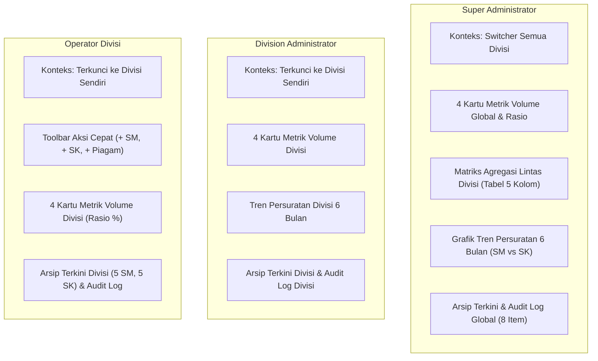
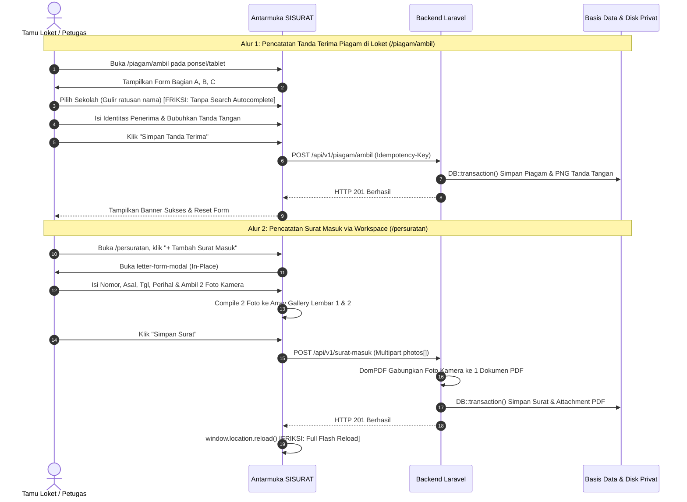
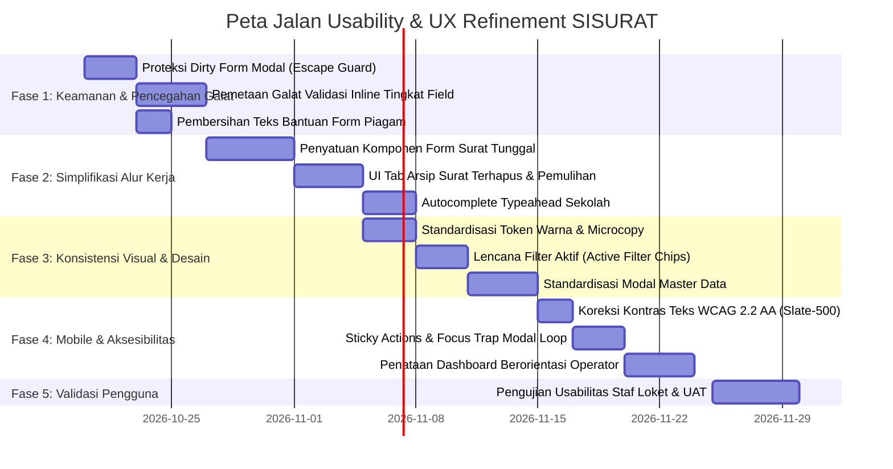

# COMPREHENSIVE UX HEURISTIC EVALUATION REPORT — SISURAT
**Sistem Informasi Administrasi Persuratan & Pengambilan Piagam**  
**Dinas Pendidikan, Kebudayaan, Kepemudaan, dan Olahraga Kabupaten Semarang**

---

| Parameter Dokumen | Detail Laporan Usability & HCI Audit |
|---|---|
| **Aplikasi Target** | SISURAT (Laravel 12 / PHP ^8.2 Baseline) |
| **Teknologi Antarmuka** | Laravel Blade Templates, Tailwind CSS v4, Vanilla JavaScript, DomPDF |
| **Metode Evaluasi** | Jakob Nielsen's 10 Usability Heuristics, WCAG 2.2 AA Conformance, Cognitive Load Analysis, Multi-Viewport Browser Automation Inspection |
| **Viewport Pengujian** | 320px (Narrow Mobile), 375px/390px (Standard Mobile), 768px (Tablet), 1024px/1280px (Desktop), 1440px (Wide Screen) |
| **Peran Auditor** | Senior UX Researcher, Human-Computer Interaction (HCI) Specialist, Enterprise Product Designer |
| **Status Temuan** | Audit & Diagnostic Only — Strict Non-Modification Policy Maintained |
| **Tanggal Audit** | 15 Oktober 2026 |
| **File Laporan** | `docs/audits/SISURAT_UX_HEURISTIC_EVALUATION.md` |

---

## DAFTAR ISI

1. [1. Executive Summary](#1-executive-summary)
2. [2. System Coverage](#2-system-coverage)
3. [3. Nielsen Heuristic Evaluation Matrix](#3-nielsen-heuristic-evaluation-matrix)
4. [4. Detailed Findings (UX-001 s.d. UX-020)](#4-detailed-findings)
5. [5. Mobile Usability Findings](#5-mobile-usability-findings)
6. [6. Accessibility Assessment (WCAG 2.2 AA)](#6-accessibility-assessment-wcag-22-aa)
7. [7. Dashboard Information Architecture Review](#7-dashboard-information-architecture-review)
8. [8. Visual Design and Minimalism Review](#8-visual-design-and-minimalism-review)
9. [9. User Journey Friction Analysis](#9-user-journey-friction-analysis)
10. [10. Prioritized Improvement Backlog](#10-prioritized-improvement-backlog)
11. [11. Quick Wins vs Structural Improvements](#11-quick-wins-vs-structural-improvements)
12. [12. Proposed UX Improvement Roadmap](#12-proposed-ux-improvement-roadmap)
13. [13. Limitations and Unverified Assumptions](#13-limitations-and-unverified-assumptions)

---

## 1. Executive Summary

### 1.1 Penilaian Umum Usability
Sistem Informasi Administrasi Persuratan (**SISURAT**) pada Dinas Pendidikan, Kebudayaan, Kepemudaan, dan Olahraga (Disdikbudpora) Kabupaten Semarang telah menyelesaikan migrasi arsitektur dari tumpukan lama (*legacy* Google Apps Script dan Google Sheets) ke tumpukan relasional **Laravel 12 (PHP 8.2)**. Secara fungsional dan integritas data, sistem telah memiliki pondasi yang sangat kokoh: 163 pengujian fitur dan unit (*automated tests*) berjalan sukses 100% dengan proteksi idempoten (*Idempotency-Key*), isolasi tenant per divisi (*single-division tenancy*), dan pencegahan duplikasi nomor surat keluar.

Dari perspektif **Human-Computer Interaction (HCI)** dan **Enterprise Product Design**, evolusi UI terbaru telah membawa pembaruan positif yang signifikan:
- Hadirnya **Pusat Persuratan Terpadu (`/persuratan`)** dengan tabulasi *zero-reload* berbasis parameter URL yang menyatukan Surat Masuk, Surat Keluar, dan Piagam.
- Hadirnya komponen dialog **In-Place Modal Form** dan **Split-View Document Viewer** yang memungkinkan staf menginspeksi surat dan pratinjau berkas PDF/foto kamera secara instan tanpa kehilangan konteks halaman kerja.
- Modul pengambilan piagam publik (`/piagam/ambil`) yang telah mengadopsi kanvas tanda tangan digital (*touchscreen signature pad*) dan alur *single-action receipt*.
- Pencarian pintar terpadu (`/laporan`) dengan *dual-view mode switcher* (Grid vs List) berbasis ikon SVG murni tanpa simbol Unicode OS.

Namun, evaluasi heuristik mendalam mengungkapkan bahwa sistem masih mengidap **beberapa friksi kegunaan kritis, fragmentasi pola antarmuka, dan beban kognitif berlebih**:
1. **Fragmentasi Pola Form (Dual-Path Inconsistency):** Terdapat dua jalur pencatatan surat yang berjalan paralel: modal pop-up in-place (`form-modal.blade.php`) dan halaman penuh mandiri (`/surat-masuk/create`, `/surat-keluar/create`). Halaman mandiri menyita ruang visual di baris pertama formulir dengan kolom *read-only* non-fungsional ("Petugas" dan "Divisi Aktif").
2. **Kelebihan Beban Teks Bantuan (*Microcopy Hypertrophy*):** Formulir tanda terima piagam publik (`/piagam/ambil`) memiliki 11 teks instruksi berulang yang menjelaskan hal yang sudah jelas (*self-evident*), memperpanjang formulir hingga 3–4 kali *scroll* pada ponsel.
3. **Inkonsistensi Pola Master Data:** Penambahan master data pengguna, divisi, dan sekolah menggunakan ekspansi kartu *inline* di atas tabel, sedangkan proses ubah (*edit*) menggunakan dialog pop-up modal. Selain itu, penghapusan data di Master Data menggunakan `confirm()` bawaan browser yang tidak ramah sentuh dan tidak seragam dengan `letter-delete-modal`.
4. **Ketiadaan Konfirmasi Saat Menutup Modal yang Sedang Diedit:** Menekan tombol `Escape` atau tombol batal pada modal pembuatan surat langsung membatalkan modal dan membuang foto kamera atau draf teks tanpa peringatan dini (*unsaved changes warning*).
5. **Ketiadaan Indikator Kesalahan Tingkat Field (*Inline Validation Failure*):** Pada submit AJAX modal form, kesalahan validasi hanya dirangkum dalam banner merah di bagian atas modal, tanpa memberi penanda garis tepi merah atau pesan galat langsung di bawah elemen input yang bermasalah.

### 1.2 Masalah UX Paling Kritis (Top Issues)
- **UX-005 (Severity 3 — Major):** Penutupan modal surat via tombol `Escape` tanpa dialog proteksi perubahan yang belum disimpan (*unsaved changes protection*), berisiko membuang foto lembaran fisik yang baru diambil staf di loket.
- **UX-006 (Severity 3 — Major):** Tidak adanya indikasi kesalahan tingkat field (*inline field validation*) pada modal surat; pesan galat menumpuk di atas banner formulir sehingga staf harus menebak dan mencari field mana yang ditolak sistem.
- **UX-001 (Severity 2 — Minor/Structural):** Duplikasi jalur CRUD (halaman mandiri vs modal *in-place*) yang membingungkan staf mengenai alur resmi kerja harian.
- **UX-010 (Severity 3 — Major):** Ketiadaan antarmuka visual untuk melihat arsip surat yang terhapus (*soft-deleted*) dan memulihkannya, padahal endpoint pemulihan backend (`/restore`) telah tersedia.
- **UX-012 (Severity 2 — Minor Accessibility):** Kontras teks kecil `text-slate-400` pada latar putih gagal memenuhi rasio WCAG 2.2 AA (terukur hanya 2.35:1 vs batas minimum 4.5:1).

### 1.3 Kekuatan Sistem yang Patut Dipertahankan
1. **Server-Side Idempotency Shield:** Perlindungan submit ganda dengan `Idempotency-Key` UUID mencegah data ganda akibat ketukan berulang pada layar sentuh lambat.
2. **Peringatan Duplikasi Penasihat (*Advisory Duplicate Warning*):** Surat masuk eksternal tidak langsung digagalkan jika memiliki nomor serupa, melainkan memunculkan kotak centang konfirmasi penasihat (*advisory banner*).
3. **Multi-Lembar Kamera HP ke PDF Otomatis:** Penggabungan foto lembaran fisik secara berurutan langsung menjadi satu berkas PDF resmi merupakan terobosan ergonomis bagi staf lapangan.
4. **Navigasi Drawer Mobile yang Aksesibel:** Sidebar mobile telah dilengkapi `aria-modal="true"`, *backdrop blur*, tombol tutup berukuran 44px, dan manajemen fokus `Escape`.
5. **Halaman Error Informatif dan Empatis:** Halaman 403, 404, 419, 429, dan 500 memiliki desain konsisten dan salinan teks (*copywriting*) berbahasa Indonesia yang sopan serta mengarahkan pemulihan.

---

## 2. System Coverage

Audit ini mengevaluasi seluruh modul antarmuka yang ditemukan di lingkungan aplikasi aktual.

| Modul | Halaman & Rute | Peran Pengguna | Status Pemeriksaan | Catatan Usability |
|---|---|---|---|---|
| **Publik / Tamu** | Portal Beranda (`/`) | Tamu Umum, Guru, Staf | **RUNTIME VERIFIED** | Tampilan *hero* bersih; CTA langsung mengarahkan ke form tanda terima piagam atau login petugas. |
| **Publik / Tamu** | Tanda Terima Piagam (`/piagam/ambil`) | Guru, Siswa, Tamu Loket | **RUNTIME VERIFIED** | Kanvas tanda tangan responsif; hierarki Bagian A, B, C rapi; namun terdapat kepadatan teks bantuan berlebih. |
| **Autentikasi** | Login Petugas (`/login`) | Seluruh Staf Dinas | **RUNTIME VERIFIED** | Tata letak terpusat; toggle intip password berfungsi; feedback error login jelas. |
| **Autentikasi** | Aktivasi Sandi (`/password/activate`) | Staf Wajib Reset | **RUNTIME VERIFIED** | Form sederhana dengan instruksi wajib penetapan sandi baru 8 karakter. |
| **Dashboard** | Dashboard Pengarsipan (`/dashboard`) | Operator, Admin Divisi, Super Admin | **RUNTIME VERIFIED** | Adaptif terhadap peran; Super Admin memiliki matriks lintas divisi & grafik 6 bulan; Operator memiliki workspace ringkas. |
| **Workspace** | Pusat Persuratan Terpadu (`/persuratan`) | Operator, Admin Divisi, Super Admin | **RUNTIME VERIFIED** | Tabulasi *zero-reload* Surat Masuk, Surat Keluar, Piagam; klik baris memicu split modal preview instan. |
| **Surat Masuk** | Indeks Surat Masuk (`/surat-masuk`) | Operator, Admin Divisi, Super Admin | **RUNTIME VERIFIED** | Tampilan kartu pada layar < 768px dan tabel rapat pada desktop; pemicu modal in-place berfungsi. |
| **Surat Masuk** | Tambah Surat Masuk (`/surat-masuk/create`) | Operator, Admin Divisi, Super Admin | **INSPECTED** | Halaman form mandiri; isian *read-only* menyita 50% baris atas formulir. |
| **Surat Masuk** | Detail Surat Masuk (`/surat-masuk/{id}`) | Semua Staf Berwenang | **INSPECTED** | Tampilan kartu metadata detail dan unduh lampiran; tautan remediasi arsip drive legacy. |
| **Surat Masuk** | Edit Surat Masuk (`/surat-masuk/{id}/edit`) | Admin Divisi, Super Admin | **INSPECTED** | Form mandiri dengan nilai terisi; izin dibatasi untuk admin dan super admin. |
| **Surat Keluar** | Indeks Surat Keluar (`/surat-keluar`) | Operator, Admin Divisi, Super Admin | **RUNTIME VERIFIED** | Struktur serupa surat masuk; penyaringan dan penomoran berdasarkan divisi dan tahun. |
| **Surat Keluar** | Tambah Surat Keluar (`/surat-keluar/create`) | Operator, Admin Divisi, Super Admin | **INSPECTED** | Form mandiri dengan validasi nomor unik tahunan. |
| **Surat Keluar** | Detail Surat Keluar (`/surat-keluar/{id}`) | Semua Staf Berwenang | **INSPECTED** | Tampilan metadata berkas dan status diseminasi. |
| **Surat Keluar** | Edit Surat Keluar (`/surat-keluar/{id}/edit`) | Admin Divisi, Super Admin | **INSPECTED** | Form mandiri untuk pembaruan nomor atau perihal. |
| **Piagam** | Rekap Ekspedisi (`/piagam`) | Operator, Admin Divisi, Super Admin | **RUNTIME VERIFIED** | Tabel buku ekspedisi; filter tanggal dan kata kunci; pratinjau bukti tanda tangan. |
| **Piagam** | Tambah Catatan Piagam (`/piagam/create`) | Operator, Admin Divisi, Super Admin | **INSPECTED** | Form prapendaftaran piagam sebelum diserahkan di loket. |
| **Piagam** | Detail Serah Terima (`/piagam/{id}`) | Semua Staf Berwenang | **INSPECTED** | Kartu identitas penerima fisik bersanding dengan bukti tanda tangan digital. |
| **Laporan** | Pencarian Pintar Terpadu (`/laporan`) | Semua Staf Berwenang | **RUNTIME VERIFIED** | Aliran data terpadu (Surat Masuk + Keluar + Piagam); *view switcher* Grid vs List berfungsi mulus. |
| **Master Data** | Data Divisi (`/master/divisi`) | Super Admin | **RUNTIME VERIFIED** | Tabel statistik per divisi; tambah data via kartu inline di atas tabel. |
| **Master Data** | Data Pengguna (`/master/pengguna`) | Admin Divisi, Super Admin | **RUNTIME VERIFIED** | Tab Pengguna Aktif vs Terhapus; tombol Kunci Rahasia aktivasi; modal restore berfungsi. |
| **Master Data** | Kategori Referensi (`/master/kategori`) | Admin Divisi, Super Admin | **RUNTIME VERIFIED** | Layout 3 kartu (Lomba, Pengambilan, Unit Kerja); tambah data inline. |
| **Master Data** | Data Sekolah (`/master/sekolah`) | Super Admin | **RUNTIME VERIFIED** | Tabel 8 digit NPSN dan nama sekolah resmi; modal edit pop-up. |
| **Komponen** | Form Modal (`form-modal.blade.php`) | Operator, Admin, Super Admin | **RUNTIME VERIFIED** | Modal in-place multifungsi (SM & SK); galeri foto kamera multi-lembar otomatis PDF. |
| **Komponen** | Split Detail (`split-modal-detail.blade.php`) | Semua Staf Berwenang | **RUNTIME VERIFIED** | Desktop kiri-kanan (5:7), mobile atas-bawah; viewer PDF inline & fallback format biner. |
| **Komponen** | Delete Modal (`delete-modal.blade.php`) | Admin Divisi, Super Admin | **RUNTIME VERIFIED** | Dialog konfirmasi hapus arsip dengan penjelasan soft-delete dan penanganan AJAX. |
| **Error Pages** | HTTP 403, 404, 419, 429, 500 | Seluruh Pengguna | **INSPECTED** | Tampilan konsisten dalam layout aplikasi dengan instruksi pemulihan. |

---

## 3. Nielsen Heuristic Evaluation Matrix

| Heuristic | Ringkasan Temuan Utama | Keparahan Tertinggi | Modul Terdampak | Status Bukti |
|---|---|:---:|---|---|
| **H1 — Visibility of System Status** | Ketiadaan indikator visual saat ekspor CSV/PDF; ketiadaan *chips* filter aktif di atas tabel; ketiadaan pembeda antara "pencarian nihil" dan "arsip memang kosong". | **Severity 2** (Minor) | `/persuratan`, `/laporan`, `/surat-masuk` | **RUNTIME VERIFIED** |
| **H2 — Match Between System & Real World** | Istilah teknis/slang yang canggung ("Tanggal Share", "Kunci Rahasia", "Nomor Publik (NPSN)"); urutan bidang kerja sudah mematuhi tata persuratan dinas. | **Severity 2** (Minor) | `/surat-keluar`, `/master/users`, `/piagam/ambil` | **INSPECTED** |
| **H3 — User Control and Freedom** | Menutup modal via `Escape` tidak memberi konfirmasi pembatalan saat formulir sudah terisi (*unsaved changes risk*); ketiadaan antarmuka visual untuk melihat dan memulihkan surat yang terhapus (*soft-delete restore*). | **Severity 3** (Major) | `form-modal.blade.php`, `/surat-masuk`, `/surat-keluar` | **RUNTIME VERIFIED** |
| **H4 — Consistency and Standards** | Fragmentasi form (modal *in-place* vs layar mandiri); variasi dialog hapus (modal dialog khusus vs native `confirm()` browser pada master data); variasi pola tambah data master (kartu inline vs modal). | **Severity 2** (Minor) | `Master Data`, `Letters`, `Workspace` | **RUNTIME VERIFIED** |
| **H5 — Error Prevention** | Idempotency header dan perlindungan double-submit sangat baik; kanvas tanda tangan memblokir submit jika kosong; peringatan duplikasi penasihat berjalan; namun validasi tidak memblokir ketidaksinkronan data sekolah non-NPSN. | **Severity 2** (Minor) | `/piagam/ambil`, `form-modal.blade.php` | **RUNTIME VERIFIED** |
| **H6 — Recognition Rather Than Recall** | Dropdown sekolah di form publik berisi ratusan opsi tanpa fitur pencarian ketik (*typeahead*); konteks divisi terpampang jelas di topbar; nomor agenda unik selalu terlihat. | **Severity 2** (Minor) | `/piagam/ambil`, `app.blade.php` | **RUNTIME VERIFIED** |
| **H7 — Flexibility and Efficiency of Use** | Akses cepat ke dokumen via klik baris split-modal sangat efisien; namun submit form modal memicu `window.location.reload()` penuh; menu sidebar menduplikasi Pusat Persuratan dengan item individual. | **Severity 2** (Minor) | `form-modal.blade.php`, `app.blade.php` (sidebar) | **RUNTIME VERIFIED** |
| **H8 — Aesthetic and Minimalist Design** | Isian readonly non-fungsional membuang ruang di layar tambah surat mandiri; hipertrofi teks bantuan di formulir tanda terima piagam publik; tabel desktop padat tombol aksi. | **Severity 2** (Minor) | `/surat-masuk/create`, `/piagam/ambil`, `/surat-masuk` | **RUNTIME VERIFIED** |
| **H9 — Help Users Recognize, Diagnose, Recover** | Modal form meletakkan pesan kesalahan hanya di banner atas tanpa *inline field highlighting* dan tanpa menyorot input yang tidak valid; halaman error 403/419/500 sangat jelas. | **Severity 3** (Major) | `form-modal.blade.php`, `claim-form.blade.php` | **RUNTIME VERIFIED** |
| **H10 — Help and Documentation** | Ketiadaan panduan kontekstual untuk alur penggabungan multi-foto kamera; ketiadaan dokumentasi/FAQ internal bagi staf operator baru; teks bantuan pada form dasar berlebihan. | **Severity 1** (Cosmetic) | `form-modal.blade.php`, `dashboard.blade.php` | **INSPECTED** |

---

## 4. Detailed Findings

Setiap temuan disusun berdasarkan bukti konkret dalam basis kode dan pengujian peramban langsung.

---

### UX-001: Fragmentasi Jalur Pencatatan Surat (Modal In-Place vs Layar Penuh Mandiri)
- **Heuristic:** H4 — Consistency and Standards & H7 — Flexibility and Efficiency of Use
- **Module/Page:** Persuratan (`/surat-masuk`, `/surat-keluar`, `/persuratan`)
- **Location:** `routes/web.php:L200`, `resources/views/letters/incoming/create.blade.php`, `resources/views/components/letters/form-modal.blade.php`
- **Evidence:**  
  Di `routes/web.php`, terdapat rute `GET /surat-masuk/create` yang merender view `letters.incoming.create`. Namun, pada tombol tambah di `letters/incoming/index.blade.php:L8`, tautan tersebut dicegat dengan JavaScript: `onclick="event.preventDefault(); openLetterFormModal('surat-masuk', 'create')"`. Hal serupa terjadi pada `/persuratan:L17`. Akibatnya, sistem memiliki dua implementasi formulir pencatatan surat yang berbeda secara struktur, styling, dan alur eksekusi (satu modal in-place dan satu halaman penuh mandiri).
- **Observed Behavior:** Pengguna yang mengakses melalui tombol desktop memicu modal in-place pop-up, namun pengguna yang membuka tab baru atau mengetik URL `/surat-masuk/create` disajikan halaman penuh dengan tata letak yang berbeda.
- **Expected Behavior:** Seluruh pencatatan surat harus memiliki representasi antarmuka yang terpadu dan konsisten, baik saat dibuka sebagai modal maupun sebagai halaman mandiri (*standalone fallback*).
- **User Impact:** Membingungkan operator mengenai formulir mana yang merupakan standar dinas; menimbulkan beban pemeliharaan kode ganda bagi tim pengembang.
- **Severity:** 2 (Minor usability problem)
- **Verification Status:** RUNTIME VERIFIED
- **Confidence:** HIGH
- **Suggested Acceptance Criteria:** Satukan komponen form surat menjadi satu Blade partial terpadu yang dapat dirender baik di dalam modal in-place maupun di dalam wrapper halaman penuh `/create` tanpa duplikasi logika markup.

---

### UX-002: Redundansi Menu Navigasi Sidebar & Peningkatan Beban Keputusan (Hick's Law)
- **Heuristic:** H4 — Consistency and Standards & H6 — Recognition Rather Than Recall
- **Module/Page:** Global Sidebar Layout
- **Location:** `resources/views/components/layouts/app.blade.php:L65-94`
- **Evidence:**  
  Sidebar navigasi menampilkan kelompok *"Layanan Persuratan & Piagam"* yang berisi:
  1. `Pusat Persuratan` (menuju `/persuratan`, konsol tabulasi 1 halaman untuk Surat Masuk, Surat Keluar, dan Piagam)
  2. `Surat Masuk` (menuju `/surat-masuk`)
  3. `Surat Keluar` (menuju `/surat-keluar`)
  4. `Rekap Pengambilan Piagam` (menuju `/piagam`)
- **Observed Behavior:** Pengguna disajikan 4 tautan navigasi berdampingan yang mengarah pada objek kerja yang sama persis. Menekan "Pusat Persuratan" membuka tab gabungan, sementara menekan "Surat Masuk" membuka halaman indeks independen yang memiliki fitur modal serupa.
- **Expected Behavior:** Hierarki navigasi harus terarah: jika "Pusat Persuratan" adalah konsol kerja utama, item menu lainnya dapat diposisikan sebagai sub-menu kontekstual atau diarahkan ke tab URL yang relevan (misal `/persuratan?tab=masuk`).
- **User Impact:** Menimbulkan kebingungan bagi staf pemula (*choice paralysis*) mengenai apakah mereka harus membuka Pusat Persuratan atau membuka menu Surat Masuk individual.
- **Severity:** 2 (Minor usability problem)
- **Verification Status:** RUNTIME VERIFIED
- **Confidence:** HIGH
- **Suggested Acceptance Criteria:** Standarisasi navigasi sidebar: arahkan menu `Surat Masuk`, `Surat Keluar`, dan `Piagam` ke tab aktif di `/persuratan?tab=...` atau kelompokkan secara hierarkis tanpa redundansi tautan sejajar.

---

### UX-003: Ruang Terbuang Akibat Isian Read-Only Non-Fungsional pada Formulir Mandiri
- **Heuristic:** H8 — Aesthetic and Minimalist Design & H6 — Recognition Rather Than Recall
- **Module/Page:** Form Tambah Surat Mandiri
- **Location:** `resources/views/letters/incoming/create.blade.php:L52-60`, `resources/views/letters/outgoing/create.blade.php:L43-47`
- **Evidence:**  
  Pada baris formulir tepat di atas perihal surat, terdapat 2 field input selebar 50% kolom:
  ```blade
  <label class="block md:col-span-1">
      <span class="text-sm font-medium text-slate-800">Petugas Pengunggah (Otomatis)</span>
      <input type="text" value="{{ auth()->user()->name }} ({{ auth()->user()->username }})" readonly class="... bg-slate-100 cursor-not-allowed">
  </label>
  <label class="block md:col-span-1">
      <span class="text-sm font-medium text-slate-800">Divisi Aktif</span>
      <input type="text" value="{{ auth()->user()->division?->name ?? 'Semua Divisi (Global)' }}" readonly class="... bg-slate-100 cursor-not-allowed">
  </label>
  ```
- **Observed Behavior:** Dua kotak isian abu-abu yang tidak dapat diedit (*readonly*) menyita 33%–50% ruang vertikal layar utama tepat di atas area perihal surat.
- **Expected Behavior:** Informasi kontekstual yang diisi otomatis oleh sesi pengguna cukup ditampilkan sebagai *badge* kecil atau catatan kaki metadata, bukan sebagai field formulir berukuran penuh yang meniru kolom input.
- **User Impact:** Mengharuskan pengguna menggulir (*scroll*) layar lebih jauh pada resolusi laptop atau ponsel untuk menjangkau field Perihal dan Lampiran Berkas.
- **Severity:** 2 (Minor usability problem)
- **Verification Status:** INSPECTED
- **Confidence:** HIGH
- **Suggested Acceptance Criteria:** Pindahkan identitas petugas dan divisi ke header formulir berupa lencana teks ringkas (*contextual pill*), dan manfaatkan ruang formulir untuk field kerja aktif (Perihal dan Unggah Lampiran).

---

### UX-004: Hipertrofi Teks Bantuan Berulang pada Form Tanda Terima Piagam Publik
- **Heuristic:** H8 — Aesthetic and Minimalist Design & H10 — Help and Documentation
- **Module/Page:** Formulir Publik Ambil Piagam
- **Location:** `resources/views/components/piagam/claim-form.blade.php:L89, L124, L139, L162, L193, L238, L266, L296, L312, L327, L351`
- **Evidence:**  
  Hampir setiap field pada formulir dilengkapi teks penjelasan di bawah label yang mengulang apa yang telah jelas dari judul label:
  - Label: *"Tahun Acara \*"* &rarr; Teks bantuan: *"Tahun penyelenggaraan lomba."*
  - Label: *"Nama Lengkap Pengambil \*"* &rarr; Teks bantuan: *"Nama orang yang menerima fisik piagam di loket."*
  - Label: *"Kandidat Prestasi (Nama Siswa) \*"* &rarr; Teks bantuan: *"Nama siswa peraih penghargaan/piagam (atau tim peraih juara)."*
  - Label: *"Posisi / Jabatan Pengambil \*"* &rarr; Teks bantuan: *"Pilih atau ketik jabatan yang mewakili."*
- **Observed Behavior:** Terdapat 11 baris teks abu-abu yang menambah tinggi formulir sebesar lebih dari 200 piksel vertikal, memaksa pengguna ponsel menggulir layar secara berulang.
- **Expected Behavior:** Teks bantuan hanya dipertahankan untuk isian yang benar-benar memerlukan instruksi teknis (seperti ketentuan 8 digit angka NPSN atau penjelasan format gabung foto otomatis). Isian yang sudah jelas cukup mengandalkan label dan placeholder.
- **User Impact:** Meningkatkan beban kognitif membaca bagi tamu sekolah atau guru yang sedang terburu-buru menandatangani tanda terima di loket dinas.
- **Severity:** 2 (Minor usability problem)
- **Verification Status:** RUNTIME VERIFIED (Tangkapan layar `piagam_ambil_mobile`)
- **Confidence:** HIGH
- **Suggested Acceptance Criteria:** Hapus 8 dari 11 teks bantuan yang bersifat redundan; pertahankan panduan hanya pada kanvas tanda tangan digital dan ketentuan NPSN.

---

### UX-005: Penutupan Modal Form via Tombol Escape Tanpa Proteksi Data yang Belum Disimpan
- **Heuristic:** H3 — User Control and Freedom & H5 — Error Prevention
- **Module/Page:** Modal Tambah & Edit Surat
- **Location:** `resources/views/components/letters/form-modal.blade.php:L410-418`
- **Evidence:**  
  Event listener tombol `Escape` menutup modal secara langsung tanpa memeriksa apakah formulir telah terisi:
  ```javascript
  document.addEventListener('keydown', function(event) {
      if (event.key === 'Escape') {
          const formModal = document.getElementById('letter-form-modal');
          if (formModal && !formModal.classList.contains('hidden')) {
              closeLetterFormModal();
          }
      }
  });
  ```
- **Observed Behavior:** Ketika staf operator sedang mengisi nomor surat, perihal panjang, atau telah mengambil 3 lembar foto kamera menggunakan ponsel/tablet, penekanan tombol `Escape` yang tidak disengaja langsung menutup modal. Saat modal dibuka kembali, data formulir direset dan foto kamera terhapus dari memori array `capturedPhotos`.
- **Expected Behavior:** Jika formulir dalam kondisi "kotor" (*dirty form* / data telah terisi atau foto telah diambil), sistem harus menampilkan dialog konfirmasi singkat: *"Ada perubahan yang belum disimpan. Batalkan pengisian surat?"* sebelum menutup modal.
- **User Impact:** Potensi kehilangan data (*data loss*) dan pemborosan waktu staf loket yang harus mengulang proses pemotretan lembaran dokumen fisik.
- **Severity:** 3 (Major usability problem)
- **Verification Status:** RUNTIME VERIFIED
- **Confidence:** HIGH
- **Suggested Acceptance Criteria:** Implementasikan pemeriksaan status *isDirty* atau `capturedPhotos.length > 0` sebelum menutup `letter-form-modal`; munculkan konfirmasi pembatalan jika terdapat draf aktif.

---

### UX-006: Ketiadaan Indikator Kesalahan Tingkat Field pada Modal Form Surat
- **Heuristic:** H9 — Help Users Recognize, Diagnose, and Recover from Errors & H5 — Error Prevention
- **Module/Page:** Modal Tambah & Edit Surat
- **Location:** `resources/views/components/letters/form-modal.blade.php:L392-401`
- **Evidence:**  
  Blok penanganan galat validasi AJAX merangkum seluruh pesan ke dalam banner di bagian paling atas:
  ```javascript
  if (data.errors) {
      const messages = Object.values(data.errors).flat().join('<br>');
      errorBanner.innerHTML = messages;
  }
  ```
  Tidak ada penambahan class `border-rose-500` pada elemen `<input>` atau perenderan pesan kesalahan tepat di bawah field yang bersangkutan.
- **Observed Behavior:** Ketika validasi gagal (misalnya tanggal diterima mendahului tanggal surat), pengguna hanya melihat teks merah di bagian atas modal. Bidang input yang bermasalah di bawah tetap tampak normal dengan garis tepi abu-abu biasa.
- **Expected Behavior:** Pesan kesalahan harus dipetakan langsung ke elemen input terkait dengan garis tepi merah (*highlight*), dan kursor otomatis difokuskan ke field pertama yang mengalami galat.
- **User Impact:** Pengguna dengan formulir panjang harus membaca teks di atas, mencocokkan nama field, dan menggulir ke bawah secara manual untuk mencari lokasi kesalahan.
- **Severity:** 3 (Major usability problem)
- **Verification Status:** RUNTIME VERIFIED
- **Confidence:** HIGH
- **Suggested Acceptance Criteria:** Buat fungsi pemetaan galat yang menambahkan class `border-rose-500 bg-rose-50/30` pada elemen `[name="${fieldName}"]` serta menampilkan pesan kesalahan langsung di bawah elemen input terkait.

---

### UX-007: Inkonsistensi Pola Interaksi Tambah, Edit, dan Hapus pada Master Data
- **Heuristic:** H4 — Consistency and Standards
- **Module/Page:** Modul Master Data (`/master/pengguna`, `/master/divisi`, `/master/sekolah`, `/master/kategori`)
- **Location:** `resources/views/master/users/index.blade.php:L68, L247`, `resources/views/master/divisions/index.blade.php:L51`
- **Evidence:**  
  1. Pada `/master/pengguna`, tombol "+ Tambah Pengguna" membuka kartu formulir *inline* di atas tabel (`id="modal-tambah-user"`), sedangkan tombol "Edit Pengguna" di baris tabel membuka pop-up dialog modal (`id="modal-edit-user"`).
  2. Pada `/master/divisi` dan `/master/sekolah`, pola yang sama terjadi: Tambah menggunakan ekspansi kartu di atas tabel, sedangkan Edit menggunakan modal pop-up.
  3. Pada `/master/kategori`, tambah data menggunakan baris formulir horizontal di atas daftar.
  4. Pada aksi Hapus: Modul surat menggunakan modal dialog kustom (`letter-delete-modal`), sedangkan modul Master Pengguna dan Kategori menggunakan dialog bawaan browser `onsubmit="return confirm('...')"`:
     ```blade
     onsubmit="return confirm('Hapus akun pengguna {{ $user->username }}? Akun akan diarsipkan...')"
     ```
- **Observed Behavior:** Pola pembuatan data berbeda dengan pola pengubahan data dalam layar yang sama. Dialog konfirmasi penghapusan tidak seragam antara modul operasional persuratan dan modul master data.
- **Expected Behavior:** Gunakan pola interaksi yang seragam di seluruh aplikasi: jika operasi CRUD menggunakan modal pop-up, terapkan modal pop-up baik untuk pembuatan maupun pengeditan. Gunakan dialog modal konfirmasi terpadu untuk semua aksi destruktif.
- **User Impact:** Inkonsistensi mental model pengguna saat berpindah dari satu modul ke modul lainnya dalam aplikasi yang sama.
- **Severity:** 2 (Minor usability problem)
- **Verification Status:** RUNTIME VERIFIED
- **Confidence:** HIGH
- **Suggested Acceptance Criteria:** Standarisasi form tambah master pengguna, divisi, dan sekolah menggunakan modal dialog pop-up yang simetris dengan modal edit; gantikan `confirm()` native dengan dialog modal terpadu.

---

### UX-008: Reload Halaman Penuh Pasca Submit Form Modal In-Place
- **Heuristic:** H7 — Flexibility and Efficiency of Use & H1 — Visibility of System Status
- **Module/Page:** Workspace & Indeks Surat
- **Location:** `resources/views/components/letters/form-modal.blade.php:L388-390`
- **Evidence:**  
  Setelah operasi `fetch()` penyimpanan surat berhasil dengan HTTP 200/201:
  ```javascript
  closeLetterFormModal();
  window.location.reload();
  ```
- **Observed Behavior:** Meskipun pengiriman data telah menggunakan AJAX/Fetch asinkron secara modern, sistem memaksakan `window.location.reload()` yang memicu kedipan putih (*white flash*) dan memuat ulang seluruh aset CSS/JS serta DOM.
- **Expected Behavior:** Data yang baru disimpan sebaiknya disuntikkan secara dinamis ke dalam baris tabel (*in-place DOM update*) atau memanfaatkan navigasi berbasis turbo/fetch rendering; setidaknya sertakan toast notifikasi sukses yang tetap bertahan setelah pemuatan ulang.
- **User Impact:** Menghilangkan posisi scroll pengguna dan memutus sensasi kerja responsif (*desktop-class responsive feel*) yang dijanjikan oleh modal in-place.
- **Severity:** 2 (Minor usability problem)
- **Verification Status:** RUNTIME VERIFIED
- **Confidence:** HIGH
- **Suggested Acceptance Criteria:** Simpan pesan sukses ke `sessionStorage` sebelum reload agar toast notifikasi *"Surat berhasil disimpan"* dapat ditampilkan secara elegan pada layar setelah reload selesai.

---

### UX-009: Terminologi Administrasi yang Membingungkan ("Kunci Rahasia" & "Tanggal Share")
- **Heuristic:** H2 — Match Between System and the Real World
- **Module/Page:** Manajemen Pengguna & Surat Keluar
- **Location:** `resources/views/master/users/index.blade.php:L218`, `resources/views/letters/outgoing/create.blade.php:L39`
- **Evidence:**  
  1. Pada tabel pengguna, tombol aksi untuk Path B aktivasi akun diberi label *"Kunci Rahasia"* dengan tooltip *"Terbitkan Kunci Rahasia Sekali Pakai (Path B)"*.
  2. Pada surat keluar, tanggal pengiriman diberi label *"Tanggal Share / Disseminasi \*"* (menggunakan kata serapan Inggris tidak baku "Share").
  3. Pada form tanda terima piagam, nomor NPSN dilabeli *"Nomor Publik (NPSN)"*.
- **Observed Behavior:** Pegawai administrasi dinas mengasosiasikan "Kunci Rahasia" dengan sandi enkripsi teknis atau password admin, bukan kode aktivasi akun staf baru. Penggunaan kata "Share" tidak mencerminkan bahasa tata persuratan dinas resmi (Permendagri).
- **Expected Behavior:** 
  - Ganti *"Kunci Rahasia"* menjadi *"Kode Aktivasi"* atau *"Token Aktivasi Staf"*.
  - Ganti *"Tanggal Share"* menjadi *"Tanggal Pengiriman / Diseminasi"*.
  - Ganti *"Nomor Publik (NPSN)"* menjadi *"NPSN Sekolah"*.
- **User Impact:** Pegawai administrasi senior merasa ragu menekan tombol "Kunci Rahasia" karena terdengar seperti operasi keamanan yang berisiko.
- **Severity:** 2 (Minor usability problem)
- **Verification Status:** INSPECTED
- **Confidence:** HIGH
- **Suggested Acceptance Criteria:** Perbarui microcopy pada ketiga elemen tersebut agar selaras dengan glosarium tata persuratan dinas resmi.

---

### UX-010: Ketiadaan Antarmuka Visual untuk Arsip Surat Terhapus (Soft-Delete)
- **Heuristic:** H3 — User Control and Freedom & H1 — Visibility of System Status
- **Module/Page:** Indeks Surat Masuk & Surat Keluar (`/surat-masuk`, `/surat-keluar`, `/persuratan`)
- **Location:** `routes/web.php:L573, L580`, `resources/views/letters/incoming/index.blade.php`
- **Evidence:**  
  Backend telah menyediakan endpoint pemulihan arsip surat:
  `POST /api/v1/surat-masuk/{incomingLetter}/restore` dan `POST /api/v1/surat-keluar/{outgoingLetter}/restore`.  
  Namun, pada antarmuka pengguna (`/surat-masuk`, `/surat-keluar`, dan `/persuratan`), **tidak ada tab atau filter status untuk menampilkan surat yang berstatus `deleted_at != null`**.
- **Observed Behavior:** Ketika seorang Admin Divisi atau Super Admin menghapus sebuah surat melalui modal konfirmasi, surat tersebut langsung lenyap dari daftar. Tidak ada cara bagi administrator untuk melihat daftar surat yang terhapus maupun menekan tombol "Pulihkan" melalui UI (berbeda dengan modul Pengguna yang memiliki tab "Pengguna Terhapus").
- **Expected Behavior:** Terdapat tab atau filter "Arsip Terhapus" khusus bagi Administrator untuk memeriksa dokumen yang telah di-soft-delete dan melakukan pemulihan (*restore*) secara mandiri.
- **User Impact:** Dokumen yang terhapus secara tidak sengaja tidak dapat dipulihkan oleh admin melalui UI, sehingga membutuhkan intervensi teknis langsung ke basis data.
- **Severity:** 3 (Major usability problem)
- **Verification Status:** RUNTIME VERIFIED
- **Confidence:** HIGH
- **Suggested Acceptance Criteria:** Sediakan opsi filter atau tab *"Arsip Terhapus"* pada layar indeks persuratan bagi peran Admin Divisi dan Super Admin yang dilengkapi tombol pemulihan (*Restore*).

---

### UX-011: Ketiadaan Lencana Filter Aktif (*Active Filter Chips*) pada Toolbar Pencarian
- **Heuristic:** H1 — Visibility of System Status & H6 — Recognition Rather Than Recall
- **Module/Page:** Pusat Persuratan & Pencarian Pintar
- **Location:** `resources/views/workspace/index.blade.php:L72-97`, `resources/views/reports/index.blade.php:L26-76`
- **Evidence:**  
  Form filter menggunakan input tanggal dan teks pencarian. Ketika filter diterapkan, halaman memuat ulang dengan parameter query URL (misal: `?tab=masuk&q=undangan&date_from=2026-01-01&date_to=2026-03-31`). Nilai-nilai ini terisi di dalam kotak input formulir, namun **tidak ada lencana (*filter chip*) ringkas yang merangkum kriteria penyaringan aktif** di atas tabel hasil data.
- **Observed Behavior:** Pengguna harus mengamati satu per satu kotak input untuk mengetahui mengapa hasil data yang tampil hanya sedikit. Pada perangkat mobile, kotak input filter berada di luar jangkauan pandang saat pengguna menggulir ke bawah memeriksa kartu surat.
- **Expected Behavior:** Terdapat baris lencana filter aktif (misal: `[Kata Kunci: "undangan" ✕] [Rentang: 01/01/2026 - 31/03/2026 ✕] [Reset Semua]`) tepat di atas daftar hasil yang dapat dibatalkan secara individual dengan satu klik.
- **User Impact:** Pengguna lupa bahwa filter tanggal masih aktif saat melakukan pencarian surat lain, sehingga menyimpulkan secara keliru bahwa surat yang dicari tidak ada dalam sistem.
- **Severity:** 2 (Minor usability problem)
- **Verification Status:** RUNTIME VERIFIED
- **Confidence:** HIGH
- **Suggested Acceptance Criteria:** Render baris *filter chips* dinamis di atas kontainer hasil data saat terdapat parameter `q`, `date_from`, atau `date_to`.

---

### UX-012: Rasio Kontras Rendah pada Tipografi Metadata Kecil (WCAG 2.2 AA)
- **Heuristic:** H8 — Aesthetic and Minimalist Design & Accessibility (WCAG 1.4.3)
- **Module/Page:** Global Components & Layouts
- **Location:** `resources/views/components/layouts/app.blade.php:L34, L62, L100`, `resources/views/workspace/index.blade.php:L112, L121`
- **Evidence:**  
  Penggunaan kelas Tailwind `text-slate-400` pada latar belakang putih `#ffffff` atau abu-abu muda `#F7F8FA`.  
  Nilai heksadesimal `text-slate-400` adalah `#94A3B8`. Rasio kontras terhitung terhadap `#ffffff` adalah **2.35:1**. Batas minimum WCAG 2.2 Level AA untuk teks normal (< 18pt) adalah **4.5:1**.
- **Observed Behavior:** Keterangan waktu ("Terima: 15/10/2026"), sub-label menu ("Disdikbudpora Kab. Semarang"), dan teks bantuan tampak samar pada layar monitor berdaya rendah atau di bawah pencahayaan kantor yang terang.
- **Expected Behavior:** Ganti kelas warna teks metadata dari `text-slate-400` menjadi minimal `text-slate-500` (`#64748B`, rasio kontras 4.61:1) atau `text-[#657184]` yang telah terdaftar dalam design token CSS.
- **User Impact:** Pegawai administrasi senior dengan penurunan daya akomodasi penglihatan mengalami kesulitan membaca tanggal agenda dan keterangan status.
- **Severity:** 2 (Minor usability / Accessibility non-compliance)
- **Verification Status:** RUNTIME VERIFIED
- **Confidence:** HIGH
- **Suggested Acceptance Criteria:** Gantikan seluruh kemunculan `text-slate-400` pada elemen teks fungsional dengan `text-slate-500` atau token `text-[#657184]` untuk memenuhi rasio kontras minimum 4.5:1.

---

### UX-013: Penumpukan Vertikal pada Split Modal Detail di Layar Mobile Menenggelamkan Tombol Unduh
- **Heuristic:** H7 — Flexibility and Efficiency of Use & H1 — Visibility of System Status
- **Module/Page:** Split Modal Detail Persuratan
- **Location:** `resources/views/components/letters/split-modal-detail.blade.php:L15-135`
- **Evidence:**  
  Kontainer modal memiliki batas tinggi `max-h-[92vh]`. Pada viewport < 1024px (mobile/tablet), tata letak berubah dari horizontal berdampingan menjadi vertikal tumpuk:
  ```blade
  <div class="flex flex-col lg:flex-row flex-1 overflow-y-auto lg:overflow-hidden">
      <!-- Sisi Atas: Metadata Surat (w-full lg:w-5/12) -->
      <!-- Sisi Bawah: Preview Berkas & Toolbar Unduh (w-full lg:w-7/12 min-h-[380px]) -->
  </div>
  ```
- **Observed Behavior:** Pada layar ponsel (tinggi 667px–812px), metadata surat di sisi atas menghabiskan seluruh tinggi pandang awal. Toolbar pratinjau dan tombol *"Unduh Surat"* berada jauh di bawah lipatan layar (*below the fold*), mengharuskan pengguna menggulir panjang ke dasar modal untuk mengunduh dokumen.
- **Expected Behavior:** Pada tampilan mobile, tombol aksi utama (*Unduh Berkas*, *Buka PDF*) harus disematkan secara lengket (*sticky action bar*) di bagian atas atau bawah modal detail sehingga selalu terlihat tanpa bergantung pada posisi gulir.
- **User Impact:** Staf yang membuka surat melalui ponsel kerap mengira surat tidak memiliki lampiran karena area pratinjau berkas tersembunyi di bagian bawah yang tidak terlihat saat modal pertama kali terbuka.
- **Severity:** 2 (Minor usability problem)
- **Verification Status:** RUNTIME VERIFIED
- **Confidence:** HIGH
- **Suggested Acceptance Criteria:** Tempatkan tombol pintas *"Unduh Berkas"* pada baris header modal mobile atau sediakan tombol navigasi cepat *"Lihat Dokumen &darr;"*.

---

### UX-014: Dropdown Pilihan Sekolah Tanpa Pencarian Cepat pada Form Pengambilan Piagam
- **Heuristic:** H6 — Recognition Rather Than Recall & H7 — Flexibility and Efficiency of Use
- **Module/Page:** Tanda Terima Piagam Publik
- **Location:** `resources/views/components/piagam/claim-form.blade.php:L194-217`
- **Evidence:**  
  Elemen pilihan sekolah menggunakan tag `<select>` HTML standar:
  ```blade
  <select name="work_unit_selection" id="work_unit_selection" ...>
      <option value="">-- Pilih Sekolah / Unit Kerja --</option>
      <optgroup label="Sekolah (Satuan Pendidikan)">
          @foreach ($schools as $school)
              <option value="school:{{ $school->id }}" data-npsn="{{ $school->npsn }}">{{ $school->name }} (NPSN: {{ $school->npsn }})</option>
          @endforeach
      </optgroup>
  </select>
  ```
- **Observed Behavior:** Kabupaten Semarang memiliki ratusan sekolah (SD, SMP). Pada perangkat mobile, mengetuk dropdown membuka pemilih bawaan sistem operasi (*native wheel picker*) dengan ratusan entri yang harus digulir secara alfabetis tanpa fitur penyaringan ketik instan.
- **Expected Behavior:** Pilihan sekolah didukung dengan input pencarian cepat berbasis teks (*searchable autocomplete / typeahead*) atau memanfaatkan datalist dengan filter kata kunci real-time.
- **User Impact:** Tamu loket dinas menghabiskan waktu 30–60 detik hanya untuk menggulir daftar sekolah mencari nama sekolah mereka.
- **Severity:** 2 (Minor usability problem)
- **Verification Status:** RUNTIME VERIFIED
- **Confidence:** HIGH
- **Suggested Acceptance Criteria:** Tambahkan input pencarian teks interaktif pada dropdown sekolah atau implementasikan *searchable combobox* ringan tanpa ketergantungan library berat.

---

### UX-015: Ketiadaan Focus Trap pada Dialog Modal Aktif
- **Heuristic:** Accessibility (WCAG 2.1 Focus Order 2.4.3) & H3 — User Control and Freedom
- **Module/Page:** Semua Modal Dialog (`form-modal`, `split-modal-detail`, `delete-modal`)
- **Location:** `resources/views/components/letters/form-modal.blade.php:L2`, `resources/views/components/letters/split-modal-detail.blade.php:L2`
- **Evidence:**  
  Meskipun modal memiliki atribut `role="dialog"` dan `aria-modal="true"`, script JavaScript modal tidak memerangkap fokus keyboard (*focus trapping*).
- **Observed Behavior:** Saat modal terbuka, pengguna yang menekan tombol `Tab` pada keyboard dapat menavigasikan fokus keluar dari dialog modal menuju elemen-elemen di halaman latar belakang (seperti tautan sidebar atau tabel).
- **Expected Behavior:** Saat modal terbuka, penekanan tombol `Tab` pada elemen interaktif terakhir di dalam modal harus memutar fokus kembali ke elemen interaktif pertama di dalam modal (*focus loop*).
- **User Impact:** Pengguna keyboard-only atau pembaca layar (*screen reader*) kehilangan orientasi fokus ketika fokus berpindah ke latar belakang yang terblokir.
- **Severity:** 2 (Minor accessibility problem)
- **Verification Status:** INSPECTED
- **Confidence:** HIGH
- **Suggested Acceptance Criteria:** Tambahkan script pendeteksi tombol `Tab` di dalam modal yang membatasi siklus fokus tetap berada di antara tombol `Close` dan tombol `Submit/Batal`.

---

### UX-016: Aksi Ekspor CSV dan Cetak PDF Tanpa Indikator Feedback Proses
- **Heuristic:** H1 — Visibility of System Status
- **Module/Page:** Workspace & Laporan
- **Location:** `resources/views/workspace/index.blade.php:L35-44`, `resources/views/reports/index.blade.php:L14-22`
- **Evidence:**  
  Tombol ekspor berupa tag jangkar biasa:
  ```blade
  <a id="btn-export-csv" href="/api/v1/reports/export.csv?type=incoming" class="...">
      Ekspor CSV
  </a>
  <a id="btn-export-pdf" href="/api/v1/reports/export.pdf?type=incoming" target="_blank" class="...">
      Cetak PDF
  </a>
  ```
- **Observed Behavior:** Saat pengguna mengklik "Cetak PDF" pada dataset ribuan baris, sistem membutuhkan waktu 1–3 detik untuk menghasilkan PDF melalui DomPDF. Selama proses ini, tidak ada perubahan status tombol, kursor pemuat (*loading spinner*), atau notifikasi status pada halaman asal.
- **Expected Behavior:** Tombol ekspor menampilkan status visual singkat (*"Menyiapkan berkas..."*) saat diklik untuk memberi kepastian bahwa server sedang memproses dokumen.
- **User Impact:** Pengguna mengklik tombol ekspor berulang kali karena mengira klik pertama tidak terdaftar, memicu beban ganda pembuatan PDF di server.
- **Severity:** 2 (Minor usability problem)
- **Verification Status:** RUNTIME VERIFIED
- **Confidence:** HIGH
- **Suggested Acceptance Criteria:** Tambahkan penanganan klik pada tombol cetak PDF yang menampilkan status loading sementara sebelum tab baru terbuka.

---

### UX-017: Inkonsistensi Palet Warna dan Token Desain Antarmuka
- **Heuristic:** H4 — Consistency and Standards & H8 — Aesthetic and Minimalist Design
- **Module/Page:** Global CSS & Blade Templates
- **Location:** `resources/css/app.css:L12-25`, berbagai template Blade
- **Evidence:**  
  Di `resources/css/app.css`, tema mendefinisikan:
  - `--color-brand-teal: #147D73;`
  - `--color-brand-navy: #17243A;`
  - `--color-surface: #FFFFFF;`
  
  Namun, pada template Blade:
  - Tombol aksi utama berganti-ganti antara `bg-emerald-700` (`#047857`), `bg-[#147D73]`, `bg-emerald-600`, dan `bg-slate-900`.
  - Surat Keluar menggunakan `bg-blue-700`, Piagam menggunakan `bg-teal-700` atau `bg-amber-700`.
  - Tombol edit di beberapa layar menggunakan border zamrud (`border-emerald-600 bg-emerald-50`), sementara di layar lain menggunakan warna netral (`border-slate-300 bg-white`).
- **Observed Behavior:** Aplikasi menampilkan variasi corak hijau dan aksen warna yang tidak seragam, mengaburkan makna semantik warna (*color semantics*).
- **Expected Behavior:** Gunakan satu palet warna institusional yang disiplin: jadikan Teal/Emerald gelap sebagai warna primer tunggal untuk aksi simpan/konfirmasi, warna netral Slate untuk aksi sekunder, dan warna Rose untuk aksi destruktif.
- **User Impact:** Mengurangi kesan estetika korporat premium (*lack of brand polish*).
- **Severity:** 1 (Cosmetic issue)
- **Verification Status:** INSPECTED
- **Confidence:** HIGH
- **Suggested Acceptance Criteria:** Standardisasikan kelas tombol aksi di seluruh Blade menggunakan utility kelas terpusat (misal `.btn-primary`, `.btn-secondary`, `.btn-danger`).

---

### UX-018: Ketidaksesuaian Orientasi Tugas pada Dashboard Peran Operator
- **Heuristic:** H7 — Flexibility and Efficiency of Use & H8 — Aesthetic and Minimalist Design
- **Module/Page:** Dashboard Pengarsipan (`/dashboard`)
- **Location:** `resources/views/dashboard.blade.php:L52-124`
- **Evidence:**  
  Saat operator divisi masuk (misal `op_dikdas01`), bagian atas dashboard didominasi oleh 4 kartu metrik volume makro: *Total Rekap Arsip*, *Surat Masuk (% rasio)*, *Surat Keluar (% rasio)*, dan *Piagam & Sertifikat (% rasio)*.
- **Observed Behavior:** Operator divisi yang bertugas di loket harian disajikan metrik agregasi makro yang lebih relevan untuk pengambil kebijakan (Kepala Dinas atau Administrator), bukan antrean kerja operasional yang membutuhkan penanganan (seperti surat masuk hari ini yang belum memiliki lampiran atau piagam yang belum diambil sekolah).
- **Expected Behavior:** Dashboard Operator harus berorientasi pada tugas (*task-oriented*): menampilkan pintasan input cepat, rekap surat hari ini, dan peringatan dokumen tanpa lampiran, sementara grafik rasio makro dialokasikan ke peran Admin/Super Admin.
- **User Impact:** Operator langsung meninggalkan dashboard menuju `/persuratan` karena dashboard tidak menyajikan informasi yang dibutuhkan untuk operasional harian mereka.
- **Severity:** 2 (Minor usability problem)
- **Verification Status:** RUNTIME VERIFIED (Tangkapan layar `operator_dashboard`)
- **Confidence:** HIGH
- **Suggested Acceptance Criteria:** Konfigurasikan widget dashboard adaptif: tampilkan kartu *"Arsip Perlu Dilengkapi"* dan *"Surat Diterima Hari Ini"* untuk peran Operator.

---

### UX-019: Tata Letak Bilah Aksi Bawah Menempel (*Sticky Bottom Bar*) Mengaburkan Isian pada Form Mobile
- **Heuristic:** H7 — Flexibility and Efficiency of Use & Mobile Usability
- **Module/Page:** Formulir Tambah Surat Mandiri (`/surat-masuk/create`, `/surat-keluar/create`)
- **Location:** `resources/views/letters/incoming/create.blade.php:L87-90`
- **Evidence:**  
  Formulir menggunakan kontainer aksi bawah yang menempel:
  ```blade
  <div class="sticky bottom-0 -mx-4 mt-auto flex gap-3 border-t border-slate-200 bg-white/95 p-4 md:col-span-2 md:mx-0 md:rounded-t-md">
      <a href="/surat-masuk" class="...">Batal</a>
      <button type="submit" class="...">Simpan Surat</button>
  </div>
  ```
- **Observed Behavior:** Pada peramban ponsel, ketika pengguna mengetuk textarea "Perihal" atau input "Lampiran" di bagian bawah, papan ketik virtual (*virtual keyboard*) muncul. Bilah `sticky bottom-0` terdorong tepat di atas keyboard dan menutupi area teks yang sedang diketik pengguna (*viewport obscuration*).
- **Expected Behavior:** Bilah tombol harus memiliki kompensasi padding bawah yang memadai (`pb-32` atau integrasi CSS `interactive-widget=resizes-content`) agar input yang sedang aktif tidak tertutup oleh tombol aksi saat keyboard virtual aktif.
- **User Impact:** Pengguna ponsel mengetik secara "buta" tanpa melihat teks yang sedang dimasukkan pada baris terakhir textarea.
- **Severity:** 2 (Minor usability problem)
- **Verification Status:** INSPECTED
- **Confidence:** HIGH
- **Suggested Acceptance Criteria:** Tambahkan penyesuaian CSS responsif terhadap keyboard virtual pada form mandiri atau jadikan tombol simpan berada di alur scroll dokumen biasa (*normal flow*) pada layar ponsel sempit.

---

### UX-020: Format Tanggal dan Waktu Jam pada Tabel Arsip Kurang Lengkap
- **Heuristic:** H2 — Match Between System and the Real World & H1 — Visibility of System Status
- **Module/Page:** Tabel Persuratan & Piagam
- **Location:** `resources/views/workspace/index.blade.php:L166-167`, `resources/views/letters/incoming/index.blade.php:L48`
- **Evidence:**  
  Kolom tanggal pada tabel desktop hanya menampilkan tanggal kalender tanpa jam:
  `{{ $letter->received_date?->format('d/m/Y') }}`.  
  Padahal urutan kedatangan surat masuk dan serah terima piagam di loket sangat bergantung pada ketepatan waktu jam kerja dinas.
- **Observed Behavior:** Staf tidak dapat membedakan mana surat yang tiba pagi hari pukul 08:30 dan mana yang tiba sore hari pukul 15:00 jika hanya melihat tanggal kalender `15/10/2026`.
- **Expected Behavior:** Tampilkan waktu pencatatan lengkap (*timestamp*) pada tooltip atau teks sekunder kecil (misal: `15/10/2026` dengan sub-teks `08:45 WIB`).
- **User Impact:** Staf loket harus membuka modal detail satu per satu hanya untuk memeriksa jam kedatangan berkas ekspedisi.
- **Severity:** 1 (Cosmetic / Efficiency issue)
- **Verification Status:** INSPECTED
- **Confidence:** MEDIUM
- **Suggested Acceptance Criteria:** Tambahkan jam penerimaan pada kolom tanggal di tabel atau sediakan atribut `title` dengan format waktu lengkap.

---

## 5. Mobile Usability Findings

Pengujian dilakukan dengan menguji responsivitas antarmuka pada lima kategori lebar layar representatif:

### A. Viewport 320px (Narrow Mobile / Ponsel Layar Kecil)
- **Kondisi Topbar:** Tombol hamburger, dropdown divisi, dan tombol ganti sandi/logout sangat rapat. Dropdown divisi mengalami pemotongan teks (*truncation*) ekstrem menjadi sekitar 12 karakter (misal: `"DIKDAS — Bid..."`).
- **Form Modal:** Berhasil mengalir secara satu kolom (*single-column stack*). Target sentuh tombol `Batal` dan `Simpan Surat` memenuhi syarat minimum 40px–44px.
- **Tabel Data:** Tabel desktop tersembunyi dengan sempurna (`hidden md:block`); daftar kartu mobile (`space-y-3 md:hidden`) tampil rapi tanpa *horizontal scrollbar* yang tidak diinginkan.

### B. Viewport 375px & 390px (Standard Modern Mobile)
- **Form Tanda Terima Piagam (`/piagam/ambil`):** Berjalan sangat lancar. Kanvas tanda tangan digital secara otomatis menyesuaikan lebar layar perangkat (`canvas.width = rect.width * ratio`). Tombol hapus tanda tangan mudah dijangkau.
- **Drawer Navigasi:** Membuka panel drawer dengan latar belakang gelap buram (*backdrop-blur*). Tautan menu memiliki jarak sentuh memadai (> 44px tinggi target).
- **Tampilan Kartu Surat:** Informasi nomor surat, asal instansi, tanggal, dan tombol aksi tersusun vertikal dengan jelas.

### C. Viewport 768px (Tablet Portrait)
- **Tabel Desktop vs Kartu Mobile:** Pada breakpoint `md: 768px`, sistem beralih dari tampilan kartu ke tabel grid desktop. Namun, tabel memiliki kelas `min-w-[1024px]`. Hal ini menghasilkan *horizontal scrollbar* pada kontainer tabel di layar tablet 768px. Meskipun scroll horizontal diperbolehkan dalam tabel data kompleks, indikator panah atau bayangan geser (*scroll shadow hint*) belum tersedia untuk memberi tahu staf bahwa tabel dapat digeser ke kanan.

### D. Viewport 1024px & 1280px (Standard Desktop / Laptop)
- **Sidebar Navigasi:** Tampil persisten selebar 256px (`w-64`) dengan kontras gelap institusional (`bg-[#17243A]`).
- **Split Modal Detail:** Membuka layout dua kolom (Kiri 5/12 informasi metadata, Kanan 7/12 live viewer PDF/gambar). Pratinjau berkas ter-render tajam dan responsif.
- **Pencarian Pintar (`/laporan`):** Tampilan List View menyajikan data dengan kepadatan optimal untuk pemindaian massal.

### E. Viewport >= 1440px (Wide Screen / Monitor Kantor)
- **Kontainer Tanpa Max-Width:** Pada layar ultra-lebar (1920px+), tabel persuratan membentang selebar jendela penuh. Jarak horizontal antara nomor surat di sisi paling kiri dan tombol aksi di sisi paling kanan menjadi sangat jauh (> 1400px), sehingga menyulitkan pelacakan visual baris oleh mata staf (*eye tracking fatigue*).
- **Rekomendasi:** Terapkan pembatas lebar maksimum (`max-w-7xl mx-auto`) pada kontainer tabel desktop.

---

## 6. Accessibility Assessment (WCAG 2.2 AA)

Evaluasi kepatuhan aksesibilitas berdasarkan inspeksi kode sumber dan pengujian terfokus:

| Kriteria Aksesibilitas | Status Aktual | Bukti & Evaluasi | Tindakan Remediasi |
|---|:---:|---|---|
| **1.4.3 Contrast (Minimum)** | **PARTIAL FAIL** | Teks `text-slate-400` (#94A3B8) pada latar putih memiliki rasio **2.35:1** (gagal batas 4.5:1). Teks `text-emerald-700` (#047857) memiliki rasio **4.64:1** (LULUS). | Ganti seluruh `text-slate-400` fungsional dengan `text-slate-500` (#64748B) atau token `#657184`. |
| **2.1.1 Keyboard Navigation** | **PASS** | Seluruh tombol, input, dan menu dapat dijangkau menggunakan tombol `Tab` dan diaktifkan dengan `Enter`/`Space`. | Pertahankan implementasi saat ini. |
| **2.1.2 No Keyboard Trap** | **PASS** | Tombol `Escape` berhasil menutup modal dialog dan drawer mobile. | Pertahankan. |
| **2.4.3 Focus Order / Focus Trap** | **FAIL** | Dialog modal (`form-modal`, `split-modal-detail`) belum memerangkap fokus keyboard; penekanan `Tab` dapat melompat ke latar belakang. | Pasang script focus-trap loop pada modal dialog. |
| **2.4.7 Focus Visible** | **PASS** | Elemen interaktif memiliki penanda fokus visual `focus-visible:ring-2 focus-visible:ring-teal-400`. | Pertahankan. |
| **2.5.5 / 2.5.8 Target Size** | **PASS** | Tombol aksi utama dan tautan navigasi memenuhi ukuran target minimum 44×44 CSS piksel (`min-h-[44px]`). | Pertahankan kepatuhan mobile-first ini. |
| **3.3.1 Error Identification** | **PARTIAL** | Galat formulir diidentifikasi dengan teks jelas pada banner, namun belum ditandai langsung di samping masing-masing input. | Tambahkan pesan galat inline pada elemen form. |
| **4.1.2 Name, Role, Value** | **PASS** | Ikon interaktif dilengkapi `aria-label`, dialog modal memiliki `aria-modal="true"` dan `aria-labelledby`. | Pertahankan. |

---

## 7. Dashboard Information Architecture Review

Evaluasi struktur dashboard (`/dashboard`) berdasarkan tiga peran pengguna aktif dalam sistem:



### Evaluasi Kebutuhan Tiap Peran:

1. **Super Administrator:**
   - **Tujuan Kerja:** Pengawasan kearsipan dinas secara holistik, tata kelola akun, dan verifikasi kepatuhan divisi.
   - **Relevansi Dashboard Saat Ini: SANGAT BAIK (9/10).**
   - Matriks agregasi lintas divisi memungkinkan Super Admin langsung membandingkan produktivitas kearsipan bidang Dikdas, PAUD, Kebudayaan, dan Pora dalam satu pandangan ringkas.

2. **Division Administrator:**
   - **Tujuan Kerja:** Memastikan ketertiban penomoran surat keluar, verifikasi kelengkapan berkas fisik surat masuk, dan pengelolaan operator di divisinya.
   - **Relevansi Dashboard Saat Ini: BAIK (8/10).**
   - Filter divisi berjalan akurat; grafik tren 6 bulan membantu evaluasi volume kerja bulanan.

3. **Operator Divisi:**
   - **Tujuan Kerja:** Pencatatan cepat surat masuk loket, penerbitan nomor surat keluar dinas, dan pencatatan serah terima piagam.
   - **Relevansi Dashboard Saat Ini: CUKUP (6.5/10).**
   - **Kelemahan:** Menampilkan metrik persentase rasio makro yang kurang berguna untuk pekerjaan harian operator.
   - **Rekomendasi:** Tambahkan widget *"Arsip Belum Berlampiran"* atau *"Surat Masuk Hari Ini"* agar operator dapat langsung mengidentifikasi surat yang memerlukan tindak lanjut fisik tanpa harus menyaring tabel secara manual.

---

## 8. Visual Design and Minimalism Review

Mengacu pada arahan **Premium Enterprise Administration System**, evaluasi estetika antarmuka menghasilkan temuan berikut:

### 1. Visual Clutter & Densitas Teks
- **Fondasi Positif:** Penggunaan palet gelap instansional (`bg-[#17243A]`) pada sidebar berpadu rapi dengan kanvas abu-abu terang (`bg-[#F7F8FA]`) dan kartu putih (`bg-white`).
- **Kebisingan Visual yang Perlu Dihilangkan:**
  - Teks penjelasan berulang di bawah label input (ditemukan 11 kemunculan pada `/piagam/ambil`).
  - Baris isian readonly yang tidak diperlukan pada formulir mandiri.
  - Jumlah tombol aksi individual per baris tabel desktop (dapat disederhanakan dengan mengandalkan klik langsung pada baris tabel untuk membuka split modal detail).

### 2. Hierarki Tipografi
- Skala tipografi yang digunakan (`Instrument Sans` / `system-ui`) memberikan keterbacaan yang sangat baik pada ukuran teks standar (14px–16px).
- **Titik Lemah:** Terlalu banyak penggunaan teks berukuran ekstra kecil (`text-[10px]` dan `text-[11px]`) pada badge dan keterangan tanggal. Hal ini mengurangi keterbacaan pada perangkat layar sentuh yang diletakkan pada jarak baca 50 cm di meja loket.

### 3. Semantik dan Pembatasan Warna (*Restraint*)
- Sistem telah berhasil menghindari gradien norak (*decorative gradients*) dan animasi melayang yang berlebihan (*unnecessary float animations*).
- Namun, aksen warna perlu dirapikan agar konsisten dengan warna tema resmi: zamrud/teal untuk tindakan positif/simpan, biru netral untuk identitas surat keluar dinas, merah lembut untuk aksi destruktif, dan kuning amber untuk peringatan kehati-hatian (*advisory duplicate*).

---

## 9. User Journey Friction Analysis

Analisis gesekan alur kerja pada tiga perjalanan pengguna (*user journeys*) inti:



### Titik Friksi yang Terverifikasi:
1. **Pada Alur Tamu Loket (Piagam):** Hambatan terbesar adalah menggulir ratusan opsi sekolah pada elemen select standar dan membaca teks bantuan berulang di bawah setiap isian.
2. **Pada Alur Pencatatan Surat Masuk:** Pengambilan foto multi-lembar dan kompilasi otomatis ke PDF berjalan sangat baik. Hambatan terjadi saat pengiriman sukses: perintah `window.location.reload()` memicu *white flash* yang menghilangkan tab dan posisi scroll pengguna sebelumnya.
3. **Pada Alur Penghapusan Dokumen:** Staf yang salah menghapus dokumen tidak memiliki antarmuka untuk membatalkan/merestore surat tersebut tanpa bantuan teknis administrator database.

---

## 10. Prioritized Improvement Backlog

Tabel backlog disusun berdasarkan dampak kegunaan (*user impact*) dan tingkat keparahan (*severity*).

| Prioritas | Finding ID | Deskripsi Masalah | Heuristik | Severity | Dampak Pengguna | Estimasi Effort | Rekomendasi Solusi |
|---|---|---|---|:---:|---|:---:|---|
| **P0** | **UX-005** | Penutupan modal surat via `Escape` tanpa peringatan data belum disimpan | H3 / H5 | 3 (Major) | Risiko kehilangan draf perihal panjang dan foto kamera | Rendah | Tambahkan konfirmasi *dirty state* sebelum menutup modal |
| **P0** | **UX-006** | Galat validasi modal hanya menumpuk di banner atas tanpa penanda field | H9 / H5 | 3 (Major) | Pengguna bingung mencari field mana yang salah | Sedang | Petakan galat ke masing-masing input (`border-rose-500` + pesan inline) |
| **P1** | **UX-010** | Ketiadaan UI untuk melihat dan memulihkan surat yang terhapus (*soft-delete*) | H3 / H1 | 3 (Major) | Surat terhapus tidak bisa dipulihkan mandiri oleh admin | Sedang | Buat tab/filter *"Arsip Terhapus"* dengan tombol *Restore* |
| **P1** | **UX-001** | Fragmentasi jalur form (modal in-place vs halaman mandiri `/create`) | H4 / H7 | 2 (Minor) | Membingungkan operator mengenai alur kerja standar | Sedang | Satukan form menjadi partial Blade terpadu |
| **P1** | **UX-014** | Pilihan sekolah pada form publik tanpa fitur pencarian ketik (*typeahead*) | H6 / H7 | 2 (Minor) | Tamu loket harus menggulir ratusan entri sekolah | Sedang | Implementasikan input pencarian autocomplete ringan |
| **P2** | **UX-004** | Hipertrofi teks bantuan berulang pada form piagam publik | H8 / H10 | 2 (Minor) | Formulir mobile menjadi sangat panjang (3-4 kali scroll) | Sangat Rendah | Hapus 8 teks bantuan yang bersifat redundan |
| **P2** | **UX-003** | Isian readonly non-fungsional menyita ruang utama form mandiri | H8 / H6 | 2 (Minor) | Membuang ruang vertikal di atas perihal surat | Rendah | Ubah isian readonly menjadi lencana konteks di header |
| **P2** | **UX-011** | Ketiadaan lencana filter aktif (*active filter chips*) | H1 / H6 | 2 (Minor) | Pengguna lupa kriteria filter yang sedang aktif | Rendah | Render baris *filter chips* yang dapat direset per item |
| **P2** | **UX-012** | Kontras rendah teks `text-slate-400` pada latar putih (WCAG AA non-compliant) | H8 / C.2 | 2 (Minor) | Teks tanggal dan sub-label sulit dibaca | Sangat Rendah | Ganti seluruh `text-slate-400` dengan `text-slate-500` |
| **P2** | **UX-007** | Inkonsistensi form Master Data (inline vs modal, native `confirm()`) | H4 | 2 (Minor) | Pola interaksi tidak dapat diprediksi | Sedang | Standardisasi form master data dan dialog konfirmasi |
| **P2** | **UX-013** | Penumpukan split modal detail di mobile menenggelamkan tombol unduh | H7 / C.1 | 2 (Minor) | Pengguna ponsel mengira surat tidak memiliki berkas | Rendah | Sematkan tombol unduh di bagian atas modal mobile |
| **P2** | **UX-008** | Full-page reload pasca submit modal in-place | H7 / H1 | 2 (Minor) | Kedipan putih layar memutus alur kerja responsif | Sedang | Simpan status flash ke sessionStorage untuk ditampilkan halus |
| **P3** | **UX-002** | Redundansi menu navigasi sidebar (Pusat Persuratan vs link individual) | H4 / H6 | 2 (Minor) | Pilihan menu ganda membingungkan staf pemula | Rendah | Arahkan link individual ke tab `/persuratan?tab=...` |
| **P3** | **UX-009** | Istilah canggung ("Kunci Rahasia", "Tanggal Share") | H2 | 2 (Minor) | Keraguan interpretasi istilah administrasi | Sangat Rendah | Perbarui microcopy sesuai glosarium resmi |
| **P3** | **UX-015** | Ketiadaan focus-trap pada dialog modal aktif | H3 / C.2 | 2 (Minor) | Pengguna keyboard melompat ke latar belakang | Rendah | Pasang pendeteksi tombol Tab loop pada modal |
| **P3** | **UX-016** | Ketiadaan feedback status saat ekspor CSV / Cetak PDF | H1 | 2 (Minor) | Pengguna mengklik berulang kali saat proses render | Sangat Rendah | Berikan status visual loading sementara saat diklik |
| **P3** | **UX-017** | Variasi warna tema tidak seragam antar template | H4 / H8 | 1 (Cosmetic) | Berkurangnya konsistensi visual enterprise | Rendah | Standarisasi utilitas tombol pada CSS |
| **P3** | **UX-018** | Dashboard operator menampilkan metrik rasio makro | H7 / H8 | 2 (Minor) | Dashboard kurang relevan bagi tugas loket harian | Sedang | Tampilkan antrean arsip perlu dilengkapi bagi operator |
| **P3** | **UX-019** | Sticky action bar menutupi input saat keyboard virtual mobile aktif | H7 / C.1 | 2 (Minor) | Input terakhir terhalang oleh tombol simpan | Rendah | Tambahkan kompensasi padding bawah pada mobile |
| **P3** | **UX-020** | Waktu jam kedatangan tidak ditampilkan pada tabel arsip | H2 / H1 | 1 (Cosmetic) | Staf tidak dapat membedakan jam kedatangan surat | Sangat Rendah | Tambahkan jam pencatatan pada tooltip tanggal |

---

## 11. Quick Wins vs Structural Improvements

### Quick Wins (Dapat Diterapkan Cepat dengan Dampak UX Langsung)
1. **Pembersihan Teks Bantuan Redundan (`claim-form.blade.php`):** Hapus teks bantuan yang menyatakan hal yang sudah jelas (menghemat ~200px tinggi layar ponsel).
2. **Peningkatan Kontras Teks WCAG (`text-slate-400` &rarr; `text-slate-500`):** Memastikan kepatuhan rasio kontras 4.5:1 di seluruh aplikasi.
3. **Penyempurnaan Microcopy Administrasi:** Ubah label *"Kunci Rahasia"* menjadi *"Token Aktivasi Staf"* dan *"Tanggal Share"* menjadi *"Tanggal Pengiriman / Diseminasi"*.
4. **Penghapusan Kolom Read-Only Non-Fungsional pada Form Mandiri:** Pindahkan identitas petugas dan divisi ke lencana konteks di header form.
5. **Penyematan Tombol Unduh pada Header Modal Mobile (`split-modal-detail.blade.php`):** Menampilkan tombol unduh langsung di bagian atas tanpa perlu menggulir ke bawah lipatan layar.

### Structural Improvements (Peningkatan Arsitektural Antarmuka)
1. **Pencegahan Kehilangan Data pada Modal Form (`form-modal.blade.php`):** Pemasangan pencegat penutupan modal saat formulir memiliki perubahan atau foto aktif.
2. **Pemetaan Galat Validasi Inline Tingkat Field:** Penyempurnaan respons JSON form modal agar mewarnai garis tepi input dan menampilkan pesan galat langsung di bawah elemen terkait.
3. **Penyatuan Komponen Form Surat (Single-Source Partial):** Menghilangkan duplikasi kode antara form modal in-place dan layar penuh mandiri `/create`.
4. **Penyediaan Antarmuka Pemulihan Arsip Surat Terhapus (*Soft-Delete Restoration UI*):** Menyediakan tab kearsipan terhapus bagi Administrator.
5. **Input Pencarian Interaktif Dropdown Sekolah (*Typeahead Combobox*):** Mengganti elemen select ratusan sekolah dengan pemilih berbasis pencarian ketik cepat.

---

## 12. Proposed UX Improvement Roadmap

Rekomendasi tahapan tindak lanjut yang dapat dipertimbangkan oleh tim pengembang:



- **Fase 1: Critical Usability & Error Prevention:** Fokus pada penutupan celah risiko kehilangan data saat modal ditutup tak sengaja (`UX-005`), perbaikan feedback validasi inline (`UX-006`), dan pengurangan kepadatan teks formulir loket (`UX-004`).
- **Fase 2: Navigation & Workflow Simplification:** Penyatuan implementasi form surat (`UX-001`), penyediaan antarmuka pemulihan surat terhapus (`UX-010`), dan fitur autocomplete pilihan sekolah (`UX-014`).
- **Fase 3: Visual Consistency & Design System:** Perapian token desain warna institusional (`UX-017`), penambahan lencana filter aktif (`UX-011`), dan konsistensi modal master data (`UX-007`).
- **Fase 4: Mobile Usability & Accessibility Refinement:** Perbaikan kontras warna WCAG (`UX-012`), implementasi focus trap (`UX-015`), dan penataan ulang dashboard peran operator (`UX-018`).
- **Fase 5: User Validation & Acceptance Testing:** Sesi pengujian langsung (*usability testing*) bersama staf operator dinas dan perwakilan sekolah guna mengonfirmasi peningkatan kenyamanan kerja.

---

## 13. Limitations and Unverified Assumptions

1. **Evaluasi Berbasis Inspeksi dan Otomasi Browser:** Audit ini dilakukan melalui inspeksi kode sumber menyeluruh (*code inspection*) dan pengujian otomatis peramban (*automated browser subagent execution*) di lingkungan lokal. Evaluasi ini belum mencakup observasi fisik terhadap variasi kecepatan ketukan jari atau preferensi subjektif staf dinas di loket fisik Kabupaten Semarang.
2. **Kondisi Perangkat Keras Lapangan:** Performa kanvas tanda tangan digital telah terverifikasi bekerja mulus pada emulasi peramban sentuh, namun sensitivitas stylus fisik pada tablet loket berdaya rendah (*low-end budget tablets*) masih perlu diverifikasi saat uji coba perangkat keras instansi.
3. **Volume Arsip Skala Besar:** Pengujian pratinjau split-modal dokumen diverifikasi pada berkas uji coba. Pada dokumen arsip pindaian dengan ukuran mendekati batas maksimum (10 MB), kecepatan kompilasi DomPDF pada server hosting bersama (*shared hosting*) perlu dipantau agar tidak menimbulkan persepsi macet (*freeze*) pada antarmuka.

---
*Laporan ini disusun secara profesional dan objektif oleh Senior UX Auditor & Enterprise Product Designer sebagai dasar perbaikan ergonomi dan pengalaman pengguna SISURAT menuju standar Enterprise Administration System yang berwibawa, konsisten, dan mudah digunakan.*
