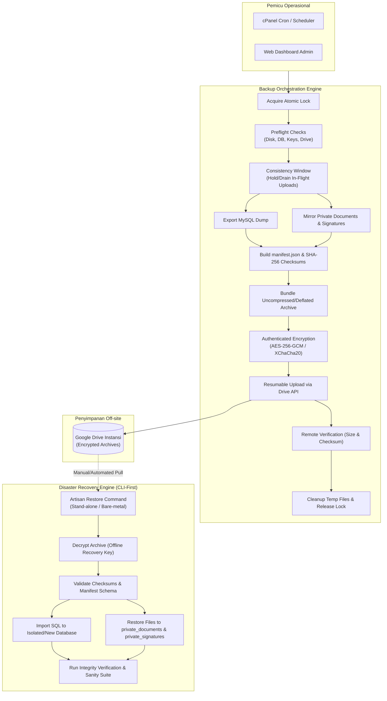
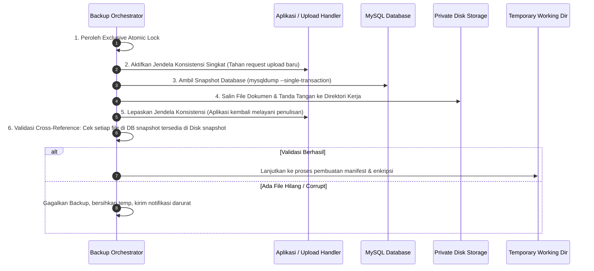
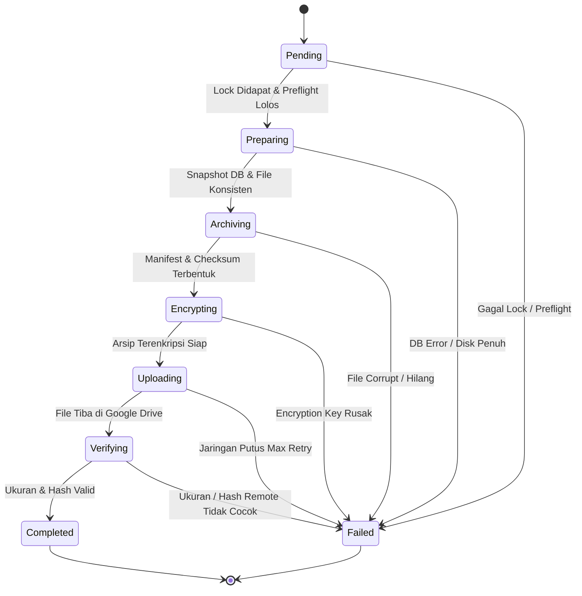
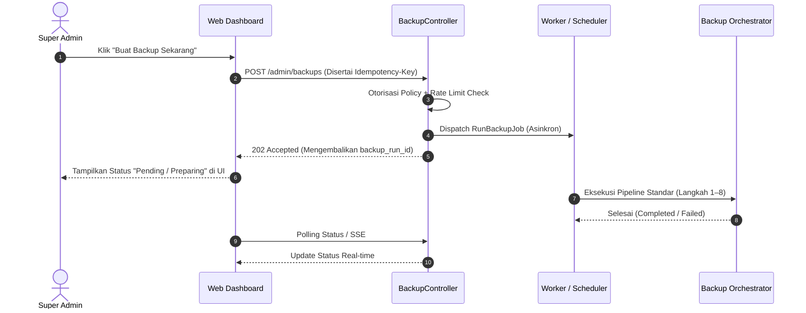
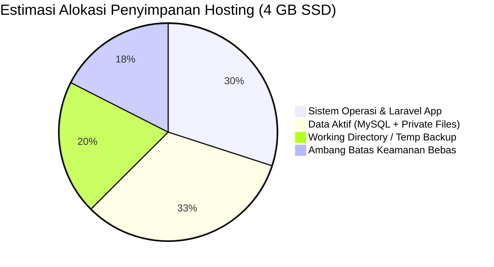
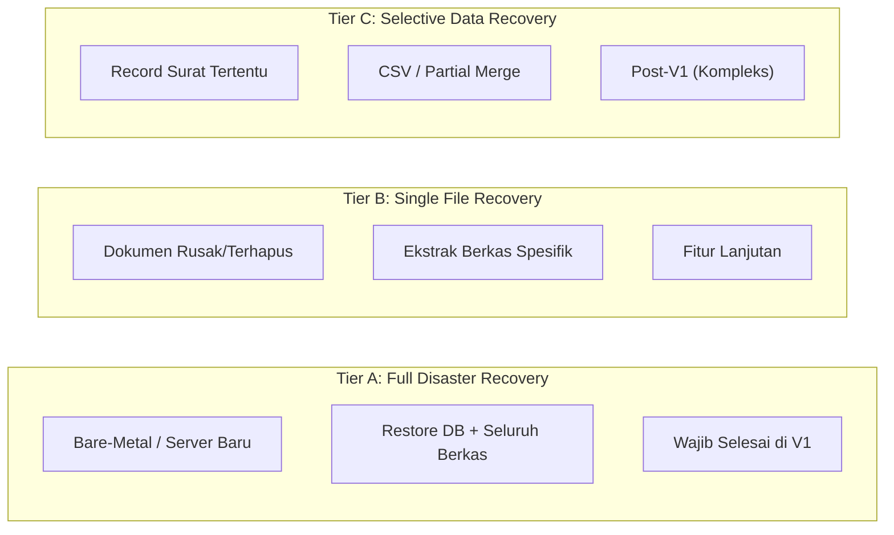
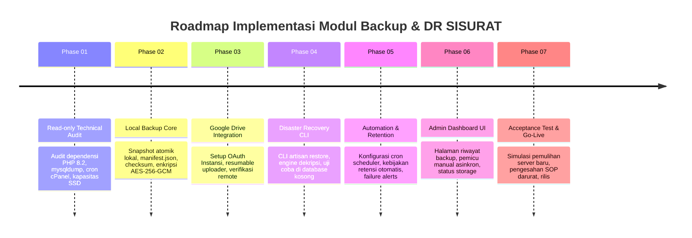
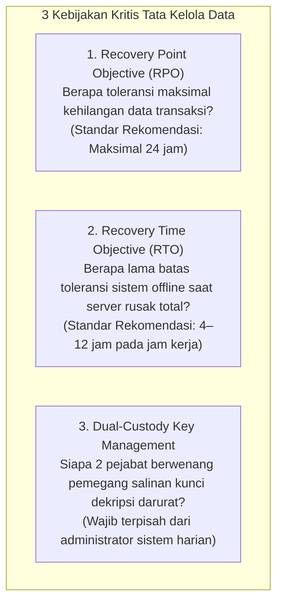

# Blueprint Arsitektur Backup & Disaster Recovery SISURAT

> **Dokumen Spesifikasi Teknis & Desain Sistem (V1.0)**  
> **Target Lingkungan:** Laravel 12 (PHP 8.2) · MySQL 8.0 / MariaDB 10.4 · Private Storage · Google Drive · Shared Hosting (cPanel)

---

## Ringkasan Eksekutif & Filosofi Desain

Sistem backup SISURAT dirancang bukan sekadar sebagai tugas rutin pembuatan file ZIP berkala, melainkan sebagai **sistem ketahanan data (*resilience*) dan pemulihan bencana (*disaster recovery*) end-to-end**. Sistem ini harus mampu memulihkan seluruh operasional persuratan instansi secara utuh, bahkan ketika server shared hosting mengalami kerusakan total (*catastrophic failure*).

Sistem ini berfokus pada keandalan, integritas kriptografis, dan kemudahan pemulihan tanpa merombak mekanisme upload dokumen maupun antarmuka pengguna yang sudah berjalan.

> [!IMPORTANT]
> **Prinsip Fondasi:**  
> *"Backup yang berhasil dibuat belum tentu bisa digunakan. Backup baru benar-benar bernilai ketika datanya terbukti dapat dipulihkan secara utuh, konsisten, dan teruji."*

---

## Daftar Isi

1. [Tujuan Utama Sistem Backup](#1-tujuan-utama-sistem-backup)
2. [Ruang Lingkup: Komponen yang Wajib Dicadangkan](#2-ruang-lingkup-komponen-yang-wajib-dicadangkan)
3. [Arsitektur Utama & Alur Kerja](#3-arsitektur-utama--alur-kerja)
4. [Prinsip Konsistensi Transaksional (Atomic Consistency)](#4-prinsip-konsistensi-transaksional-atomic-consistency)
5. [Workflow Backup Otomatis (Scheduled Pipeline)](#5-workflow-backup-otomatis-scheduled-pipeline)
6. [Workflow Backup Manual (On-Demand Pipeline)](#6-workflow-backup-manual-on-demand-pipeline)
7. [Format Arsip & Kontrak Metadata (Manifest)](#7-format-arsip--kontrak-metadata-manifest)
8. [Integritas Relasional Database & Dokumen Fisik](#8-integritas-relasional-database--dokumen-fisik)
9. [Enkripsi, OAuth, & Keamanan Google Drive](#9-enkripsi-oauth--keamanan-google-drive)
10. [Strategi Frekuensi, Retensi, & Manajemen Kapasitas](#10-strategi-frekuensi-retensi--manajemen-kapasitas)
11. [Recovery Engine: Prosedur Pemulihan Bencana](#11-recovery-engine-prosedur-pemulihan-bencana)
12. [Matriks Penanganan Skenario Kegagalan (Failure Matrix)](#12-matriks-penanganan-skenario-kegagalan-failure-matrix)
13. [Struktur Modul & Arsitektur Kode Laravel](#13-struktur-modul--arsitektur-kode-laravel)
14. [Skema Database Pelacakan Backup](#14-skema-database-pelacakan-backup)
15. [Kriteria Penerimaan & Checklist Pengujian QA](#15-kriteria-penerimaan--checklist-pengujian-qa)
16. [Tahapan Implementasi Bertahap (Roadmap 01–07)](#16-tahapan-implementasi-bertahap-roadmap-0107)
17. [Status Keputusan Arsitektur (Final vs Open Questions)](#17-status-keputusan-arsitektur-final-vs-open-questions)
18. [Rekomendasi Akhir & Kebijakan Stakeholder](#18-rekomendasi-akhir--kebijakan-stakeholder)

---

## 1. Tujuan Utama Sistem Backup

Sistem backup SISURAT wajib menjamin lima kapabilitas pertahanan data:

| Kapabilitas | Deskripsi Operasional |
| :--- | :--- |
| **Data Protection** | Melindungi seluruh data arsip surat masuk/keluar, lampiran berkas, catatan disposisi, riwayat status, data referensi, serta tanda tangan digital dari kehilangan yang tidak disengaja. |
| **Off-site Backup** | Menyimpan salinan arsip di luar lingkungan shared hosting (Google Drive Instansi), mencegah skenario server hosting hangus/tersuspend menghancurkan seluruh data. |
| **Point-in-time Recovery** | Menyediakan kemampuan untuk memulihkan SISURAT ke titik waktu pencadangan spesifik yang valid dan terverifikasi. |
| **Confidentiality & Integrity** | Menjamin seluruh arsip cadangan terenkripsi kuat, tahan terhadap manipulasi/tampering (checksum terverifikasi), dan hanya dapat didekripsi oleh pihak berwenang. |
| **Disaster Recovery** | Memungkinkan rekonstruksi instalasi SISURAT dari nol pada server/penyedia hosting baru tanpa membutuhkan sisa infrastruktur lama. |

### Cakupan Skenario Ancaman

Sistem dipersiapkan untuk memitigasi:
- File dokumen/lampiran surat terhapus secara tidak sengaja oleh pengguna.
- Kerusakan tabel atau korupsi database MySQL/MariaDB.
- Kegagalan proses upload akibat interupsi jaringan atau server crash.
- Kesalahan konfigurasi atau kelalaian administrator (*human error*).
- Akun shared hosting disuspend, terkena malware server, atau penyedia hosting bangkrut/rusak.
- Kebutuhan migrasi sistem ke server atau penyedia hosting baru.

---

## 2. Ruang Lingkup: Komponen yang Wajib Dicadangkan

### 2.1 Matriks Komponen & Strategi Cadangan

| Komponen | Lokasi Sumber | Format / Strategi Cadangan | Keterangan |
| :--- | :--- | :--- | :--- |
| **Database MySQL** | Database Server Hosting | SQL Dump (`mysqldump` / PDO) | Berisi skema, tabel, relasi, view, dan data |
| **Surat Masuk & Keluar** | Tabel `incoming_letters`, `outgoing_letters` | Termasuk dalam SQL Dump | Data transaksional utama |
| **Disposisi & Riwayat** | Tabel relasional terkait | Termasuk dalam SQL Dump | Audit trail dan tracking alur surat |
| **Pengguna & Referensi** | Tabel `users`, `divisions`, dsb. | Termasuk dalam SQL Dump | Akun, hak akses, dan master data |
| **Dokumen & Lampiran** | `storage/app/private/documents/` | Salinan file biner asli | Disimpan pada disk `private_documents` |
| **Tanda Tangan Digital** | `storage/app/private/signatures/` | Salinan file PNG asli | Disimpan pada disk `private_signatures` |
| **Metadata Cadangan** | Manifest otomatis | `manifest.json` | Versi format, hash, daftar file, statistik |
| **Informasi Integritas** | Checksum SHA-256 | `checksums.sha256` | Verifikasi tamper-evident per berkas |
| **Konfigurasi Deployment** | File `.env` & web server config | Prosedur Disaster Recovery terpisah | **Tidak disimpan mentah di arsip publik** |

### 2.2 Struktur Direktori Private Storage

Sesuai aturan keamanan arsitektur, seluruh file dokumen dan tanda tangan tersimpan di dalam direktori privat terlindungi:

```text
storage/app/private/
├── documents/
│   └── [dokumen utama dan lampiran surat]
└── signatures/
    └── [file tanda tangan digital PNG]
```

> [!CAUTION]
> **Larangan Publikasi Storage:**  
> File dokumen dan tanda tangan **TIDAK BOLEH** dipindahkan ke direktori `public/storage` atau diberikan symlink URL publik tanpa autentikasi. Akses file wajib melewati controller streaming resmi yang dilindungi Laravel Policy.

### 2.3 Aturan Audit Inventaris Berkas

Sebelum proses backup dibakukan:
- Jalankan audit terhadap seluruh modul aplikasi untuk mendeteksi file esensial lainnya (misal: template surat dinas, lampiran piagam penghargaan, atau aset modul tambahan).
- Buat inventaris disk resmi agar tidak ada berkas penting yang tertinggal di luar cakupan backup.

---

## 3. Arsitektur Utama & Alur Kerja

Sistem mengadopsi pola **Backup Orchestrator**, yaitu modul sentral yang memvalidasi prasyarat, mengunci proses agar tidak terjadi balapan (*race condition*), membuat snapshot, memvalidasi integritas, mengenkripsi arsip, dan mengirimkannya ke penyimpanan off-site.

### 3.1 Diagram Arsitektur Sistem



### 3.2 Karakteristik Operasional Shared Hosting (CLI-First)

Karena sistem beroperasi di lingkungan shared hosting cPanel:
1. **Artisan-First:** Seluruh operasi backup dan restore harus dapat dieksekusi melalui baris perintah (`php artisan sisurat:backup`, `php artisan sisurat:restore`) tanpa ketergantungan pada browser web.
2. **Resilience to Timeouts:** Menghindari proses HTTP sinkron yang rentan terkena `max_execution_time` (30–60 detik) atau batas memori Apache/LiteSpeed.

---

## 4. Prinsip Konsistensi Transaksional (Atomic Consistency)

### 4.1 Tantangan Concurrency & Race Condition

Jika pengguna mengunggah surat atau lampiran tepat saat proses backup berlangsung, berisiko timbul inkonsistensi:
- **Kasus A:** Database mencatat lampiran baru, namun proses snapshot file telah selesai $\rightarrow$ **Orphan DB Record** (file fisik hilang saat di-restore).
- **Kasus B:** File fisik tersalin ke arsip, tetapi database diekspor sebelum transaksi commit $\rightarrow$ **Ghost File** (file fisik ada di arsip namun tidak terdaftar di database).

### 4.2 Protokol Konsistensi 6 Langkah (V1)

Untuk mencegah data korup, V1 menerapkan protokol konsistensi atomik:



> [!NOTE]
> Karena volume surat SISURAT berada pada skala puluhan surat per minggu, jendela konsistensi berlangsung sangat cepat (umumnya di bawah 3–5 detik), sehingga tidak mengganggu pengalaman pengguna.

---

## 5. Workflow Backup Otomatis (Scheduled Pipeline)

### 5.1 Tahapan Pipeline 8 Langkah

1. **Inisiasi Scheduler:**  
   Cron server cPanel memicu `php artisan schedule:run`. Sistem men-generate `backup_run_id` unik (format: `bkp-YYYYMMDD-HHmmss`) dan mencatat status awal ke database.
2. **Preflight Checks:**  
   Pemeriksaan ketat terhadap koneksi MySQL, akses baca direktori privat, ketersediaan sisa ruang disk sementara (min. $2\times$ estimasi ukuran arsip), status konektivitas Google Drive, dan validitas kunci enkripsi.
3. **Eksekusi Snapshot Konsisten:**  
   Melakukan dump database terisolasi dan menyalin berkas privat secara atomik.
4. **Penyusunan Berkas Arsip:**  
   Mengompilasi SQL dump, file biner, `manifest.json`, dan `checksums.sha256`.  
   *Pengecualian:* `.env`, cache, temporary files, session, dan log aplikasi **wajib diabaikan**.
5. **Enkripsi Terautentikasi (Authenticated Encryption):**  
   Mengenkripsi arsip menggunakan AES-256-GCM atau XChaCha20-Poly1305 sebelum file meninggalkan server.
6. **Resumable Upload ke Google Drive:**  
   Mengunggah arsip terenkripsi menggunakan Google Drive Resumable Upload API agar tahan terhadap putus koneksi jaringan.
7. **Verifikasi Hasil (Remote Verification):**  
   Memeriksa ketersediaan file di Google Drive, memvalidasi ukuran file (*content length*) dan hash remote jika tersedia.
8. **Finalisasi & Pembersihan (Cleanup):**  
   Menandai status `Completed`, mencatat audit log, menghapus seluruh file kerja sementara di server hosting, dan mengevaluasi kebijakan retensi.

### 5.2 Siklus Hidup State Machine

Status backup tidak boleh hanya boolean sederhana. Sistem menggunakan *state machine* eksplisit:



| Status | Makna Operasional |
| :--- | :--- |
| `Pending` | Permintaan backup dicatat, menunggu antrean worker/scheduler. |
| `Preparing` | Preflight checks berjalan, lock aktif, persiapan direktori kerja. |
| `Archiving` | Snapshot database dan file sedang disalin serta dikompilasi. |
| `Encrypting` | Arsip sedang dienkripsi dengan authenticated cipher. |
| `Uploading` | File terenkripsi sedang dikirim ke Google Drive via resumable session. |
| `Verifying` | File di Google Drive diverifikasi keberadaan dan integritas ukurannya. |
| `Completed` | Backup selesai, diverifikasi, dan aman di off-site storage. |
| `Failed` | Terjadi kegagalan pada salah satu tahapan; log error tersimpan aman. |

### 5.3 Strategi Penanganan Kegagalan & Retry

- **Upload Gagal (Network Flap):** Jika pengunggahan ke Google Drive terputus, gunakan *exponential backoff* (retry interval: 30s, 60s, 120s). Jika arsip lokal terenkripsi masih utuh dan valid, **jangan mengulang dump database dari awal**, cukup ulangi sesi upload.
- **Snapshot/Enkripsi Gagal:** Hentikan proses secara fail-fast, bersihkan artefak setengah jadi, dan tandai `Failed`.
- **Deteksi Stale Lock (Shared Hosting Killed Process):** Jika shared hosting mematikan proses PHP secara paksa karena batas sumber daya, scheduler berikutnya akan memeriksa waktu lock. Lock yang berusia lebih dari batas toleransi (misal: > 60 menit) ditandai sebagai `Stale/Failed` dan dibersihkan otomatis.

---

## 6. Workflow Backup Manual (On-Demand Pipeline)

Backup manual diperuntukkan bagi administrator sebelum melakukan tindakan berisiko tinggi (misalnya migrasi schema database, upgrade versi aplikasi, atau pembersihan data massal).

### 6.1 Alur Pemicuan via Dashboard



### 6.2 Aturan Keamanan & Perlindungan Akses

- **Eksekusi Asinkron:** Permintaan HTTP tidak boleh menjalankan backup secara sinkron agar tidak menyebabkan timeout koneksi browser.
- **Proteksi Idempotensi & Rate Limiting:** Mencegah spam klik berulang yang dapat membebani server hosting.
- **Otorisasi Unduh:** Tautan download file backup tidak boleh mengekspos public URL Google Drive. Setiap pengunduhan melalui dashboard wajib melalui streaming controller yang dilindungi middleware otorisasi Super Admin.

---

## 7. Format Arsip & Kontrak Metadata (Manifest)

### 7.1 Struktur Direktori Arsip Backup

Arsip internal (sebelum enkripsi) disusun dengan struktur baku agar mudah dibaca oleh Recovery Engine kapan pun di masa depan:

```text
sisurat-backup-2026-10-16T010000Z/
├── database/
│   └── sisurat.sql
├── storage/
│   └── app/
│       └── private/
│           ├── documents/
│           │   └── [struktur berkas dokumen & lampiran surat]
│           └── signatures/
│               └── [struktur berkas tanda tangan PNG]
├── manifest.json
└── checksums.sha256
```

### 7.2 Spesifikasi Kontrak `manifest.json`

Manifest adalah sumber kebenaran teknis (*source of truth*) saat proses pemulihan berjalan:

```json
{
  "format": "sisurat-backup",
  "format_version": 1,
  "backup_id": "bkp-20261016-010000",
  "type": "full",
  "created_at": "2026-10-16T01:00:00Z",
  "environment": "production",
  "application": {
    "name": "SISURAT",
    "laravel_version": "12.x",
    "php_version": "8.2.x"
  },
  "database": {
    "engine": "mysql",
    "version": "8.0",
    "dump_file": "database/sisurat.sql",
    "dump_size_bytes": 15420120,
    "sha256": "e3b0c44298fc1c149afbf4c8996fb92427ae41e4649b934ca495991b7852b855"
  },
  "storage": {
    "documents": {
      "target_disk": "private_documents",
      "path": "storage/app/private/documents",
      "file_count": 1420,
      "total_size_bytes": 458120400
    },
    "signatures": {
      "target_disk": "private_signatures",
      "path": "storage/app/private/signatures",
      "file_count": 310,
      "total_size_bytes": 12450800
    }
  },
  "encryption": {
    "cipher": "aes-256-gcm",
    "key_id": "sisurat-backup-master-2026",
    "tag_length_bits": 128
  }
}
```

> [!WARNING]
> **Larangan Menyimpan Kunci:**  
> File `manifest.json` **DILARANG KERAS** memuat password, secret key, atau token dekripsi apa pun. Manifest hanya mencatat identitas kunci (`key_id`) untuk pencocokan saat pemulihan.

---

## 8. Integritas Relasional Database & Dokumen Fisik

### 8.1 Pemetaan Relasi Surat ke Path Relatif

SISURAT mengandalkan pemetaan relasional antara tabel database dan berkas fisik pada disk privat:

| Surat ID | Nomor Surat | Disk Terdaftar | Path Relatif Database |
| :---: | :--- | :--- | :--- |
| `101` | `001/SM/X/2026` | `private_documents` | `documents/2026/10/101-surat.pdf` |
| `102` | `002/SK/X/2026` | `private_documents` | `documents/2026/10/102-lampiran.pdf` |
| `101` | *(Tanda Tangan)* | `private_signatures` | `signatures/2026/10/101-sig.png` |

Saat proses pemulihan (*restore*):
1. **Tidak Ada Rekonstruksi Tebak Nama:** Recovery engine tidak perlu menebak nama file, melainkan mengembalikan seluruh struktur direktori relatif sesuai apa adanya.
2. **Path Preservasi:** Relasi foreign key dan path pada field database tetap 100% cocok dengan lokasi berkas di disk penyimpanan privat.

### 8.2 Kebijakan Orphan & Ghost Files

- **Orphan File (File ada di disk, tidak ada di DB):** Backup tetap mencadangkan file ini jika berada di direktori privat, tetapi mencatatnya dalam laporan audit agar dapat diinvestigasi.
- **Missing File (File ada di DB, fisik tidak ada):** Jika saat validasi pra-backup terdeteksi file yang tercatat di database namun fisiknya hilang, sistem mencatat status `is_missing = true` (sesuai aturan `DEC-FILE-003`) dan memberikan flag peringatan pada hasil backup.

---

## 9. Enkripsi, OAuth, & Keamanan Google Drive

### 9.1 Konfigurasi OAuth 2.0 (Least Privilege)

Untuk menghubungkan SISURAT dengan Google Drive Instansi:
- Gunakan **Google Cloud Project** resmi milik instansi terkait.
- Aktifkan **Google Drive API**.
- Terapkan scope izin paling sempit: `https://www.googleapis.com/auth/drive.file`. Scope ini membatasi SISURAT agar hanya dapat membaca, mengubah, dan menghapus file yang dibuat oleh aplikasi ini sendiri, tanpa akses ke file pribadi lain di Google Drive instansi.
- Refresh token disimpan dalam database dalam format terenkripsi (`Crypt::encryptString`).

### 9.2 Peringatan Status OAuth "Testing"

> [!CAUTION]
> **Risiko Token Kedaluwarsa 7 Hari:**  
> Google Cloud Project yang status penerbitan OAuth-nya masih disetel ke **"Testing"** memiliki batas kedaluwarsa refresh token selama **7 hari**.  
> **Tindakan Wajib:** Project OAuth instansi wajib dipublikasikan ke status **"In Production / Internal"** agar refresh token berlaku permanen dan tidak menggagalkan cron backup mingguan.

### 9.3 Standar Enkripsi Berkas Arsip

Semua arsip backup wajib dienkripsi sebelum keluar dari server hosting menggunakan algoritma kriptografi modern terautentikasi (*Authenticated Encryption with Associated Data* - AEAD):
- **Pilihan Utama:** `AES-256-GCM` (didukung native oleh OpenSSL PHP 8.2+).
- **Pilihan Alternatif:** `XChaCha20-Poly1305` (via libsodium).

### 9.4 Tata Kelola Kunci Dekripsi (Disaster Recovery Kit)

1. **Separation of Concerns:** Kunci enkripsi/dekripsi **TIDAK BOLEH** disimpan di Google Drive yang sama dengan arsip backup.
2. **Off-Band Emergency Kit:** Kunci dekripsi dicetak dan disimpan dalam *sealed envelope* fisik atau password vault institusi yang dikelola oleh minimal 2 penanggung jawab berwenang (*dual custody*).
3. **Peringatan Kerusakan Server:** Jika server hosting terbakar bersama satu-satunya kunci dekripsi, seluruh file backup di Google Drive akan menjadi sampah digital yang tidak dapat dipulihkan.

---

## 10. Strategi Frekuensi, Retensi, & Manajemen Kapasitas

### 10.1 Asumsi Pertumbuhan Volume Data

- **Estimasi Transaksi:** ~20 surat masuk/keluar per minggu.
- **Ukuran File Rata-rata:** Dokumen utama $\le 2\text{ MB}$, Lampiran $\le 5\text{ MB}$.
- **Pertumbuhan Storage:** Rata-rata $\approx 50\text{--}140\text{ MB}$ per minggu ($\approx 2.5\text{--}7\text{ GB}$ per tahun).
- **Implikasi:** Full backup setiap hari aman dijalankan pada fase awal V1, namun sistem harus siap bertransisi ke skema diferensial jika kapasitas hosting mulai padat.

### 10.2 Matriks Frekuensi Operasional V1

| Jenis Kegiatan | Frekuensi | Waktu Pelaksanaan | Tujuan |
| :--- | :--- | :--- | :--- |
| **Backup Database SQL** | Harian | 01:00 WIB (Dini hari) | Meminimalkan kehilangan data transaksi (*low RPO*) |
| **Full Backup (DB + Berkas)** | Harian (V1) / Mingguan | 02:00 WIB (Dini hari) | Menyediakan arsip restorasi instan satu paket |
| **Backup Manual** | On-Demand | Sebelum migrasi/rilis | Jaring pengaman sebelum perubahan besar |
| **Verifikasi Integritas** | Setiap Selesai Upload | Pasca-upload | Memvalidasi ukuran dan checksum arsip di cloud |
| **Monitoring Kegagalan** | Harian | Otomatis via Scheduler | Notifikasi instan jika backup gagal berjalan |
| **Simulasi Uji Restore** | Bulanan | Jadwal QA terisolasi | Memastikan arsip benar-benar dapat dibaca & dipulihkan |
| **Audit Kapasitas Hosting** | Bulanan | Akhir bulan | Evaluasi tren pemakaian SSD shared hosting |

### 10.3 Kebijakan Retensi Arsip (Rolling Retention)

Untuk menjaga kuota Google Drive dan ruang server:
- Simpan **7–14 full backup harian** terbaru.
- Simpan **4 backup mingguan** (titik akhir pekan).
- Simpan **12 backup bulanan** (titik akhir bulan) untuk arsip permanen tahunan.
- **Golden Rule:** Dilarang menghapus backup lama sebelum backup baru berhasil dibuat dan lolos verifikasi integritas secara sempurna.

### 10.4 Manajemen Kapasitas Penyimpanan (SSD 4 GB Shared Hosting)

Karena shared hosting memiliki kuota SSD terbatas (misal: 4 GB), sistem menyediakan kalkulasi ruang kerja sementara:



**Ambang Batas Peringatan Ruang Disk:**
- **$\le 70\%$ Kapasitas:** Normal (Hijau).
- **$75\%$ Kapasitas:** Peringatan Dini (Kuning) $\rightarrow$ Kirim alert dashboard, evaluasi retensi file temporary.
- **$\ge 90\%$ Kapasitas:** Kritis (Merah) $\rightarrow$ **Preflight check membatalkan proses backup otomatis** untuk mencegah disk server penuh $100\%$ yang dapat menyebabkan database MySQL crash (*read-only lockup*).

---

## 11. Recovery Engine: Prosedur Pemulihan Bencana

### 11.1 Tiga Tingkat Pemulihan (Recovery Tiers)



### 11.2 Prosedur Standar Full Disaster Recovery (9 Langkah)

Jika server produksi lama mengalami kerusakan total, ikuti protokol pemulihan server baru berikut:

1. **Penyediaan Server Baru:** Siapkan server/shared hosting baru yang memenuhi prasyarat (PHP 8.2+, MySQL 8.0+/MariaDB 10.4+, ekstensi PHP wajib aktif).
2. **Deploy Source Code:** Clone source code SISURAT resmi dari repository git terpercaya atau extract deployment bundle rilis.
3. **Ambil Arsip Backup:** Unduh file arsip terenkripsi dari Google Drive Instansi (baik via CLI atau download manual via browser).
4. **Dekripsi Arsip:** Jalankan dekripsi menggunakan kunci pemulihan (*Emergency Recovery Key*).
5. **Validasi Checksum & Manifest:** Recovery engine memverifikasi `checksums.sha256` dan membaca kompatibilitas versi skema dari `manifest.json`.
6. **Restorasi Database:** Import file `database/sisurat.sql` ke database MySQL yang masih kosong.
7. **Restorasi Berkas Privat:** Ekstrak file dokumen ke `storage/app/private/documents/` dan tanda tangan ke `storage/app/private/signatures/` dengan proteksi pencegahan *path traversal* (`../`) dan *symlink attacks*.
8. **Konfigurasi Environment & Permissions:** Salin file konfigurasi `.env`, jalankan `php artisan key:generate` (jika baru), dan sesuaikan permission direktori storage (`chmod 775`).
9. **Verifikasi Integritas Pasca-Restore:** Jalankan pengujian otomatis untuk memvalidasi jumlah baris database vs ketersediaan fisik berkas, lalu buka akses kembali untuk pengguna.

> [!CAUTION]
> **Larangan Restore Langsung ke Lingkungan Produksi Aktif:**  
> Proses restore bersifat destruktif (*overwrite*). Pemulihan **WAJIB** diuji terlebih dahulu pada database/server terisolasi (staging) untuk menghindari terhapusnya surat-surat baru yang masuk setelah tanggal backup tersebut dibuat.

### 11.3 Pemulihan Mandiri Tanpa Ketergantungan API (Offline Fallback)

Recovery engine harus dapat berjalan secara **100% offline**:
- Jika API Google Drive diblokir, akun tersuspend, atau token kedaluwarsa, administrator cukup mengunduh file backup secara manual dari web browser Google Drive.
- File arsip ditaruh pada folder lokal server, kemudian didekripsi dan dipulihkan sepenuhnya via perintah Artisan:
  ```bash
  php artisan sisurat:restore --archive=/path/to/backup-archive.enc --key="MASTER_KEY"
  ```

---

## 12. Matriks Penanganan Skenario Kegagalan (Failure Matrix)

| Skenario Insiden | Dampak Risiko | Tindakan Mitigasi & Protokol Sistem |
| :--- | :--- | :--- |
| **MySQL Unreachable** | SQL dump gagal di tengah jalan | Batalkan backup secara aman, hapus temp file, catat log audit `DATABASE_OFFLINE`. |
| **File Dokumen Hilang** | DB merujuk file yang fisiknya hilang | Catat warning pada manifest, tandai `is_missing = true`, lanjutkan backup jika memenuhi toleransi. |
| **Ruang SSD Hosting Menipis** | Server crash jika disk 100% penuh | Preflight check membatalkan proses sebelum file sementara dibuat. Beri peringatan darurat ke admin. |
| **Google Drive Penuh** | Upload ditolak (Quota Exceeded) | Simpan arsip lokal jika disk mencukupi, kirim peringatan kapasitas Google Drive ke instansi. |
| **Token OAuth Kedaluwarsa** | Upload gagal autentikasi (401/403) | Kirim peringatan dashboard untuk rekoneksi OAuth instansi. Jangan pernah meminta password Google pengguna. |
| **Koneksi Jaringan Terputus** | Upload terhenti di tengah jalan | Gunakan resumable upload chunking. Lakukan retry hingga 3 kali dengan exponential backoff. |
| **Cron cPanel Tidak Berjalan** | Backup terjadwal tidak tereksekusi | Integrasikan external monitoring (heartbeat/dead man's snitch) untuk mendeteksi ketiadaan proses backup. |
| **Dua Backup Berjalan Bersama** | Beban server dobel & data corrupt | Gunakan atomic lock (`Cache::lock` / lock file). Backup kedua ditolak atau dialihkan ke antrean. |
| **Arsip Backup Dimanipulasi** | Arsip rusak / terkena ransomware | Dekripsi dan verifikasi checksum SHA-256 gagal secara otomatis; tolak proses restorasi. |
| **Kunci Dekripsi Hilang / Salah** | Data tidak dapat dibaca | Tolak proses restorasi dan laporkan kegagalan autentikasi kriptografi secara aman. |

---

## 13. Struktur Modul & Arsitektur Kode Laravel

Untuk menjaga keteraturan kode (*clean architecture*) dan kemudahan pemeliharaan, sistem backup dipisahkan ke dalam service-service spesifik:

```text
app/
├── Console/
│   └── Commands/
│       ├── CreateSisuratBackup.php       # php artisan sisurat:backup
│       ├── VerifySisuratBackup.php       # php artisan sisurat:backup:verify
│       └── RestoreSisuratBackup.php      # php artisan sisurat:restore
│
├── Services/
│   ├── Backup/
│   │   ├── BackupOrchestrator.php        # Koordinator alur utama backup
│   │   ├── BackupPreflightService.php    # Pemeriksaan ruang disk, DB, & dependensi
│   │   ├── BackupConsistencyService.php  # Manajemen lock & hold upload
│   │   ├── BackupManifestService.php     # Penyusunan manifest.json & checksum SHA-256
│   │   ├── BackupEncryptionService.php   # Enkripsi & dekripsi berkas arsip
│   │   ├── BackupRetentionService.php    # Pembersihan arsip lama berbasis kebijakan
│   │   └── GoogleDriveStorageService.php # Resumable upload & interaksi Drive API
│   │
│   └── Recovery/
│       ├── RecoveryOrchestrator.php      # Koordinator proses pemulihan data
│       ├── ArchiveExtractorService.php   # Validasi, dekripsi, & ekstraksi arsip aman
│       ├── DatabaseRecoveryService.php   # Pemulihan data SQL ke database target
│       └── FileRecoveryService.php       # Pemulihan berkas privat & perbaikan izin
│
├── Jobs/
│   └── ProcessBackupJob.php              # Background queue worker untuk backup manual
│
├── Models/
│   ├── BackupRun.php                     # Model log riwayat eksekusi backup
│   └── BackupArtifact.php                # Model data fisik berkas arsip
│
└── Http/Controllers/Admin/
    └── BackupController.php              # Controller web dashboard manajemen backup
```

### 13.2 Analisis Pendekatan Hybrid (Spatie + Custom SISURAT)

Rekomendasi implementasi mengadopsi pola **Hybrid Architecture**:
1. **Pemanfaatan Komponen Spatie:** Memanfaatkan logika mature dari `spatie/laravel-backup` khusus untuk eksekusi dump database MySQL dan kompilasi zip dasar.
2. **Komponen Kustom SISURAT:** Membangun logic sendiri untuk:
   - Koordinasi konsistensi dokumen privat (`private_documents` & `private_signatures`).
   - Penyusunan `manifest.json` berstandar formal SISURAT.
   - Enkripsi client-side sebelum pengunggahan.
   - Resumable upload ke Google Drive Instansi.
   - Disaster Recovery Engine mandiri via CLI.

---

## 14. Skema Database Pelacakan Backup

### 14.1 Tabel `backup_runs`

Mencatat setiap sesi eksekusi backup yang pernah berjalan:

```sql
CREATE TABLE `backup_runs` (
    `id` BIGINT UNSIGNED AUTO_INCREMENT PRIMARY KEY,
    `backup_id` VARCHAR(64) NOT NULL UNIQUE,       -- bkp-20261016-010000
    `type` ENUM('full', 'database', 'files') NOT NULL DEFAULT 'full',
    `trigger` ENUM('scheduled', 'manual') NOT NULL DEFAULT 'scheduled',
    `requested_by` BIGINT UNSIGNED NULL,           -- user_id (NULL jika scheduler)
    `status` ENUM('pending', 'preparing', 'archiving', 'encrypting', 'uploading', 'verifying', 'completed', 'failed') NOT NULL DEFAULT 'pending',
    `started_at` DATETIME NOT NULL,
    `completed_at` DATETIME NULL,
    `archive_size_bytes` BIGINT UNSIGNED NULL,
    `files_count` INT UNSIGNED NULL,
    `sha256_checksum` CHAR(64) NULL,
    `remote_storage_provider` VARCHAR(32) NOT NULL DEFAULT 'google_drive',
    `remote_file_id` VARCHAR(255) NULL,            -- File ID Google Drive
    `error_code` VARCHAR(64) NULL,
    `error_message` TEXT NULL,
    `created_at` TIMESTAMP NULL DEFAULT CURRENT_TIMESTAMP,
    `updated_at` TIMESTAMP NULL DEFAULT CURRENT_TIMESTAMP ON UPDATE CURRENT_TIMESTAMP,
    CONSTRAINT `fk_backup_runs_user` FOREIGN KEY (`requested_by`) REFERENCES `users` (`id`) ON DELETE SET NULL,
    INDEX `idx_backup_runs_status` (`status`),
    INDEX `idx_backup_runs_created` (`created_at`)
) ENGINE=InnoDB DEFAULT CHARSET=utf8mb4 COLLATE=utf8mb4_unicode_ci;
```

### 14.2 Redundansi Metadata Off-Site

Karena tabel `backup_runs` ikut hilang jika database server rusak, file `manifest.json` yang tersimpan di dalam arsip Google Drive berfungsi sebagai **duplikasi metadata independen** untuk proses recovery.

---

## 15. Kriteria Penerimaan & Checklist Pengujian QA

Checklist penerimaan ini wajib dipenuhi dan diuji pada lingkungan staging sebelum modul backup dinyatakan *production-ready*:

- [ ] **1. Full Backup End-to-End Berhasil:** Pipeline sukses mengekspor database, dokumen privat, tanda tangan, dan manifest tanpa error.
- [ ] **2. Integritas Checksum Sempurna:** Nilai SHA-256 setiap berkas hasil ekstraksi cocok 100% dengan catatan di `checksums.sha256`.
- [ ] **3. Konsistensi Database Terjaga:** Seluruh tabel transaksi, referensi foreign key, dan view berhasil dipulihkan tanpa pelanggaran constraint.
- [ ] **4. Pencocokan Relasi Berkas & Database:** Setiap surat yang memiliki lampiran di database terbukti memiliki berkas fisik yang sesuai di folder disk.
- [ ] **5. Toleransi Interupsi Google Drive:** Saat koneksi internet diputus di tengah upload, mekanisme resume/retry bekerja tanpa menimbulkan file corrupt.
- [ ] **6. Preflight Disk Protection:** Ketika simulasi sisa ruang disk hosting disetel di bawah ambang aman ($<10\%$), backup menolak berjalan dan disk server tidak penuh.
- [ ] **7. Pencegahan Eksekusi Konkuren (Locking):** Menjalankan dua perintah backup bersamaan berhasil menggagalkan proses kedua tanpa merusak proses pertama.
- [ ] **8. Penanganan OAuth Revocation:** Saat izin Google Drive dicabut, sistem mendeteksi error 401/403 dengan anggun dan mencatat notifikasi jelas di log.
- [ ] **9. Deteksi Modifikasi Arsip (Tamper-Proofing):** Jika 1 byte pada arsip terenkripsi diubah secara sengaja, proses dekripsi/verifikasi menolak arsip tersebut.
- [ ] **10. Kegagalan Kunci Dekripsi yang Aman:** Memasukkan kunci dekripsi yang salah saat restore membatalkan proses tanpa merusak data yang ada.
- [ ] **11. Uji Bare-Metal Restoration:** Memulihkan sistem pada server baru yang benar-benar kosong membuktikan aplikasi SISURAT dapat langsung beroperasi.
- [ ] **12. Rollback Pemulihan Aman:** Jika proses restore mengalami kegagalan di tengah jalan, database dan direktori yang sedang berjalan tidak menjadi rusak.

---

## 16. Tahapan Implementasi Bertahap (Roadmap 01–07)



### Rincian Tiap Fase

1. **Fase 01 — Read-only Technical Audit:**  
   Pemeriksaan konfigurasi hosting: versi PHP, modul `pdo_mysql`, ketersediaan binary `mysqldump`, hak akses direktori privat, limit memori PHP, batas eksekusi script, dan dukungan cPanel cron.
2. **Fase 02 — Local Backup Core:**  
   Pembangunan service inti di lingkungan lokal: dump SQL, duplikasi file privat, kalkulasi hash SHA-256, pembuatan `manifest.json`, dan enkripsi arsip.
3. **Fase 03 — Google Drive Integration:**  
   Registrasi Google Cloud Console instansi, konfigurasi OAuth 2.0 (scope `drive.file`), pembuatan modul resumable upload, dan verifikasi status remote file.
4. **Fase 04 — Disaster Recovery CLI:**  
   Pembuatan perintah baris perintah `php artisan sisurat:restore` yang mampu mendekripsi, memvalidasi, dan mengimpor data ke server baru tanpa dependensi dashboard web.
5. **Fase 05 — Automation, Retention, & Monitoring:**  
   Pemasangan cron scheduler, pengaktifan *state machine*, implementasi *rolling retention* pembersihan arsip lama, dan pencatatan audit log.
6. **Fase 06 — Admin Dashboard UI:**  
   Penyediaan antarmuka web bagi Super Admin untuk memantau status backup, melihat sisa ruang penyimpanan, dan memicu backup manual dengan proteksi rate limiting.
7. **Fase 07 — Staging Acceptance & Go-Live:**  
   Menjalankan 12 poin checklist QA pada server staging, simulasi pemulihan bencana sesungguhnya, dokumentasi SOP penanganan darurat, dan serah terima ke tim operasional.

---

## 17. Status Keputusan Arsitektur (Final vs Open Questions)

| Topik Arsitektur | Status Saat Ini | Dasar Pertimbangan / Tindak Lanjut |
| :--- | :---: | :--- |
| **Framework & Database** | **FINAL** | Menggunakan Laravel 12 pada PHP 8.2 dan MySQL 8.0/MariaDB 10.4. |
| **Lokasi Penyimpanan File** | **FINAL** | Tetap di private storage (`storage/app/private/documents` & `signatures`). |
| **Ruang Lingkup Arsip** | **FINAL** | Wajib mencakup SQL dump, documents, signatures, manifest, dan checksum. |
| **Kompresi Dokumen** | **FINAL** | Tidak ada kompresi lossy pada berkas dokumen dan lampiran asli. |
| **Pipeline Konsistensi** | **FINAL** | Backup otomatis dan manual berbagi engine orkestrasi yang sama. |
| **Tujuan Off-site Awal** | **FINAL (Bersyarat)** | Google Drive akun instansi menggunakan scope `drive.file`. |
| **Standar Kriptografi** | **FINAL** | Enkripsi simetrik terautentikasi (AES-256-GCM) sebelum pengunggahan. |
| **Disaster Recovery CLI** | **FINAL** | Pemulihan via baris perintah independen wajib tersedia sejak V1. |
| **Ekspor/Impor CSV Parsial** | **DITUNDA** | Ditunda ke rilis berikutnya; fokus V1 pada proteksi bencana penuh. |
| **Spesifikasi Library Zip/Dump** | *Menunggu Audit* | Evaluasi integrasi package `spatie/laravel-backup` terhadap shared hosting. |
| **RPO & RTO Resmi** | *Menunggu Persetujuan* | Perlu disahkan oleh pimpinan instansi (lihat Bagian 18.2). |
| **Penyimpanan Kunci Dekripsi** | *Menunggu Keputusan* | Penunjukan 2 pejabat instansi pemegang kunci fisik cadangan. |
| **Layanan Monitoring Eksternal** | *Menunggu Keputusan* | Pemilihan layanan gratis/berbayar untuk health-check ping (misal: UptimeRobot/Healthchecks.io). |

---

## 18. Rekomendasi Akhir & Kebijakan Stakeholder

Pendekatan yang diadopsi adalah **Secure, Recoverable, and Cost-Aware**:
- **Secure:** Semua arsip terenkripsi sebelum meninggalkan server hosting.
- **Recoverable:** Dapat dipulihkan di server baru secara mandiri tanpa sisa infrastruktur lama.
- **Cost-Aware:** Target biaya tambahan infrastruktur adalah **Rp 0** pada tahap awal, dengan mengoptimalkan kuota Google Drive resmi milik instansi dan shared hosting yang ada.

### Tiga Keputusan Kritis yang Perlu Disahkan Stakeholder

Sebelum implementasi teknis dimulai, diskusikan 3 kebijakan tata kelola berikut dengan pimpinan instansi:



### Kesimpulan & Langkah Segera

Blueprint arsitektur backup dan disaster recovery SISURAT V1 ini telah matang dan komprehensif. Langkah teknis pertama yang direkomendasikan adalah memulai **Fase 01 (Read-only Technical Audit)** pada lingkungan hosting untuk memastikan ketersediaan binary `mysqldump`, ketersediaan memory, dan perilaku cron shared hosting.

---

## 19. Adendum V1.1: Evolusi Format Cadangan Ramah Dinas (Spreadsheet-First & Google Drive Link)

> [!IMPORTANT]
> **Keputusan Stakeholder Operasional:**  
> Berdasarkan evaluasi kebutuhan riil pegawai ASN dan staf dinas non-teknis, sistem cadangan SISURAT diperluas dengan paradigma **Spreadsheet-First & Human-Readable Archive**. Format arsip yang diakses oleh pengguna dinas adalah **berkas Excel / CSV terpadu yang memuat kolom tautan langsung (*hyperlink*) ke berkas PDF surat dan PNG tanda tangan di Google Drive**, melengkapi cadangan database SQL teknis untuk pemulihan bencana.
> 
> Spesifikasi teknis, skema kolom spreadsheet, alur kerja pengunggahan berkas individual, dan antarmuka web ramah dinas didokumentasikan secara lengkap pada:  
> 📄 [`docs/30-SPESIFIKASI-BACKUP-SPREADSHEET-DINAS.md`](30-SPESIFIKASI-BACKUP-SPREADSHEET-DINAS.md).
> 
> *Catatan Arsitektur:* Seluruh mesin inti yang dibangun pada Fase 01–06 (`DatabaseDumperService`, `BackupConsistencyService`, `GoogleDriveStorageService`, cron scheduler, dan tabel `backup_runs`) **tetap dipertahankan 100% sebagai mesin di bawah kap (*engine under the hood*)**. Format Spreadsheet-First ini bertindak sebagai lapisan luaran dan antarmuka ramah pengguna (*presentation layer*) yang ditenagai oleh mesin tersebut.


